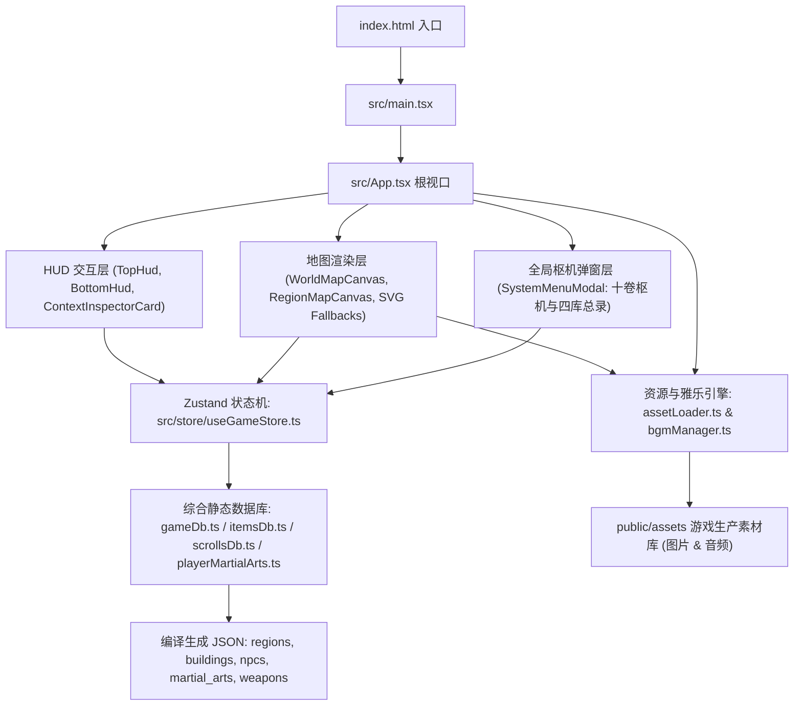

# 《北宋立志传》(Northern Song Chronicles) - 项目完整指南 (PROJECT_GUIDE)

> **版本**：v0.3.0-m1.2-sync  
> **更新时间**：2026-11-13  
> **仓库标识**：`zhby99/northern-song-chronicles`

---

## 目录
1. [项目定位与架构总览](#一项目定位与架构总览)
2. [工程目录与核心代码结构](#二工程目录与核心代码结构)
3. [核心代码模块职责与关键符号](#三核心代码模块职责与关键符号)
4. [全量游戏素材清单与路径索引](#四全量游戏素材清单与路径索引)
5. [工具链、数据编译与构建命令](#五工具链数据编译与构建命令)

---

## 一、项目定位与架构总览

本项目是一款以**公元 1050 年（北宋仁宗皇祐二年 · 《天龙八部》黄金前传时代）**为背景的国风开放世界历史人生模拟武侠 RPG（《北宋立志传》）。
前端技术栈采用 **Vite 8 + React 19 + TypeScript 7 + Tailwind CSS v4 + Zustand 5 + Lucide-React**，所有核心数据采用由七大 Markdown 设定专卷确定性编译而成的静态 JSON 数据库，配合 `public/assets/` 按需懒加载（366 张生产图片 + Web Audio 场景雅乐）与 `IndexedDB + localStorage` 多槽位存档架构（`M1.2.0` Schema）。

### 架构分层


---

## 二、工程目录与核心代码结构

```text
northern-song-chronicles/
├── index.html                           # 网页入口单页
├── package.json                         # 项目依赖与运行脚本
├── tsconfig.json / tsconfig.app.json    # TypeScript 配置
├── vite.config.ts                       # Vite 构建与音频自动扫描插件配置
├── AGENTS.md / .gemini/GEMINI.md        # Agent 全局工程守则与上下文锚点
├── PROJECT_GUIDE.md                     # 本文档 (项目全局导引与资源索引)
├── README.md                            # 项目简介与里程碑概览
│
├── docs/                                # 游戏系统与数值策划单一事实源
│   ├── CHARACTER_COMPENDIUM.md          # 1000 人物图鉴、三维与十艺派系全录
│   ├── EQUIPMENT_COMPENDIUM.md          # 皇祐披挂总纲（第一卷：百兵谱 100 种武器）
│   ├── GAME_MECHANICS.md                # 历法时辰、体能资粮、七槽四库、同步盲选战斗与核心机制总纲
│   ├── MARTIAL_ARTS_SECTS.md            # 30 武林门派（20 一流 + 10 二三流）与 11 庙堂四夷组织专卷
│   ├── MARTIAL_ARTS_COMPENDIUM.md       # 216 门十一大类武学全典与天阶修习条件
│   ├── MARTIAL_ARTS_STATS.md            # 216 门武学 1~10 重数值表与 37 门天阶战斗特效
│   ├── REGIONAL_MAPS_AND_BUILDINGS.md   # 43 州府名山区域与 138 座特殊建筑名录（总计 268 座建筑）
│   ├── HANDOFF_CONTEXT.md               # 跨会话历史演进与工程避坑备忘
│   └── ROADMAP_AND_TODO.md              # 开发里程碑与主线待办看板 (M0 ~ M5)
│
├── src/                                 # 核心业务源码
│   ├── main.tsx                         # 挂载入口
│   ├── App.tsx                          # 主容器组件、三层空间视图分发与行军时钟驱动
│   ├── index.css                        # 全局样式与宋代古籍宣纸设色变量
│   │
│   ├── components/                      # React 视图组件库
│   │   ├── hud/                         # 界面抬头显示与浮动信息
│   │   │   ├── TopHud.tsx               # 常驻顶部状态栏 (年月日十二时辰/气血/体能/资金/粮草) + 二级舆图控制条
│   │   │   ├── BottomHud.tsx            # 底部江湖行记日志、门派威望与当前坐标底栏
│   │   │   ├── ContextInspectorCard.tsx # 选定实体详细检视舱 (城池/建筑/最末层驻留人物互动)
│   │   │   ├── MapTooltip.tsx           # 地图悬浮纯实色笺纸浮窗
│   │   │   └── TravelBanner.tsx         # 大地图逐时辰行军进度与旷野随时扎营条
│   │   ├── map/                         # 地图画布与交互组件
│   │   │   ├── WorldMapCanvas.tsx       # 北宋华夏东亚全景舆图 (SVG 语义缩放沙盘)
│   │   │   ├── RegionMapCanvas.tsx      # 43 处州府名山全景画布与 138 座建筑室内视图
│   │   │   ├── SvgRegionPanoramaFallback.tsx   # 新辟 5 州府宋辽营造青绿等轴城郭矢量渲染器
│   │   │   └── SvgBuildingInteriorFallback.tsx # 宋式《营造法式》室内建筑矢量渲染器
│   │   └── menu/                        # 行囊枢机与皇祐万象图鉴双模态弹窗模块
│   │       ├── SystemMenuModal.tsx      # 1.5× 双模态总控容器 (行囊枢机7卷 + 万象图鉴6卷调度与跨卷深链)
│   │       ├── RegionCompendiumPanel.tsx# 图鉴壹：43 地区山海舆地全鉴
│   │       ├── SectCompendiumPanel.tsx  # 图鉴贰：30 武林门派与 11 庙堂四夷图鉴
│   │       ├── PortraitLightbox.tsx     # 人物全身/头像与全景图高清放大品鉴灯箱
│   │       ├── MenuIcons.tsx            # 七槽披挂、六槽武学与四库分类共享图标组件
│   │       ├── menuShared.ts            # 导航卷目元数据与博物收录统计纯函数
│   │       └── tabs/                    # 独立拆分的业务子面板 (Hero/Loadout/Bag/Portraits/MartialArts/Armory/Treasures/Engineering/SaveLoad/Settings)
│   │
│   ├── data/                            # 游戏全量静态结构化数据库
│   │   ├── gameDb.ts                    # 数据库聚合导出与 O(1) 索引模块
│   │   ├── itemsDb.ts                   # 七槽位披挂定义、30 丹药毒物、50 雅器百工与兵武共鸣计算器
│   │   ├── scrollsDb.ts                 # 皇祐百卷典籍书画库 (10天/20地/30良/40凡 共 100 卷)
│   │   ├── playerMartialArts.ts         # 主角 6 槽武学运使、1~10 重火候演练与属性加成计算器
│   │   ├── regions.json                 # 43 个区域州府与名山信息
│   │   ├── buildings.json               # 138 座特殊地标 (414 子点位) + 130 座基础建筑设定 (共 268 座)
│   │   ├── buildingPanoramas.json       # 建筑室内全景热区与视角绑定
│   │   ├── npcs.json                    # 1000 名历史名仕与武林人物数据库 (100% 最末层挂载)
│   │   ├── martial_arts.json            # 216 门十一大类四阶十二品武学与 1~10 重数值数据库
│   │   ├── weapons.json                 # 100 种四阶十二品百兵谱数据库
│   │   ├── regionalConfigs.json         # 43 处区域坐标与建筑点位配置
│   │   ├── worldGraph.json              # 43 节点 79 边陆路、运河、塞外与蜀道节点连接拓扑
│   │   ├── worldBaseSvg.ts              # 华夏及东亚山海海岸线矢量轮廓
│   │   ├── idRegistry.json              # 全局实体标准 ID 命名空间注册表 (43地/30派+11组织/216功/100兵/1000人)
│   │   ├── assetManifest.json           # 生产资源清单索引
│   │   └── portraitCatalog.json         # 人物立绘与模板映射表 (249 核心角色目录)
│   │
│   ├── store/                           # 全局状态管理
│   │   └── useGameStore.ts              # Zustand 状态机 (历法时辰、气血体能、七槽装备、六槽武学、四库行囊、空间导航)
│   │
│   ├── types/                           # 全局 TypeScript 接口与类型定义
│   │   └── game.ts                      # Region, Building, NPC, MartialArt, Weapon, Inventory, M1.2.0 存档等类型
│   │
│   └── utils/                           # 工具方法库
│       ├── assetLoader.ts               # 图片素材按需懒加载与字节监控工具
│       ├── bgmManager.ts                # Web Audio 无缝循环与四分类场景 BGM 播放列表引擎
│       ├── mapMath.ts                   # 十二时辰历法换算、Dijkstra 最短路径、旷野扎营与坐骑速度公式
│       └── saveManager.ts               # IndexedDB + LocalStorage 多槽位存取档与 JSON 导入导出校验
│
├── public/                              # 生产运行资源静态目录 (被 Vite 直接托管)
│   ├── icons.svg                        # 界面矢量图标集
│   └── assets/                          # 压缩处理后的生产游戏图片与音频
│       ├── buildings/                   # 58 张地标建筑高清半3D内景图 (JPG)
│       ├── regions/                     # 38 张区域州府等轴测全景底图 (JPG)
│       ├── characters/                  # 人物立绘资源 (共 268 张 JPG)
│       │   ├── avatars/                 # 129 张角色 1:1 正方头像 (100 历史名臣全员 + 29 武林宗师)
│       │   ├── fullbody/                # 129 张角色 3:4 全身立绘 (100 历史名臣全员 + 29 武林宗师)
│       │   └── templates/               # 12 张门派/身份通用全身模板立绘
│       └── audio/                       # 四分类自动扫描音频目录 (world / regions[43] / characters / events)
│
├── assets_raw_masters/                  # 原始高精度美术素材存档 (共 364 张，373.9 MB)
│   ├── MANIFEST.json                    # 原始素材 SHA-256 元数据清单
│   ├── buildings/                       # 60 张原始建筑概念设计原图
│   ├── regions/                         # 42 张原始区域全景原图
│   └── characters/                      # 262 张原始角色立绘母版
│
├── scripts/                             # 项目构建、数据编译与资源维护自动化脚本
│   ├── compile_game_db.py               # 七大 Markdown 设定集 -> JSON 零悬空引用编译器
│   ├── run_py.mjs                       # 跨平台 (Linux/macOS/Windows) Python 执行包装器
│   ├── build_preview_artifact.mjs       # 纯 Node.js 离线自包含演示单文件打包器
│   ├── build_preview_artifact.py        # Python 版离线演示打包器备份
│   ├── archive_all_branch_assets.py     # 分支美术资产归档合并工具
│   └── extract_legacy_assets.py         # 原型素材提取工具
│
└── legacy_prototypes_and_tools/         # 早期生成工具、规格文档与原型归档
```

---

## 三、核心代码模块职责与关键符号

### 1. 状态管理 (`src/store/useGameStore.ts`)
- **`useGameStore`**: 全局单一数据源，管理：
  - **历法与时辰**：`dayCount`（自皇祐二年正月初一起算天数）与 `shichenIdx`（`0..11` 对应 `子~亥` 十二时辰）。
  - **主角属性与生存资粮**：实战与上限（`hp/maxHp`, `mp/maxMp`, `stamina/maxStamina`, `agility`, `res`）、资金 `silver`、粮草 `food`、骑术 `ridingSkill` 与其余九艺 `skills`。
  - **七槽披挂、六槽武学与行囊四库**：`equipped`（7 槽披挂，第七槽自动同步 `mountKey`）、`equippedArts`（1 内功 + 1 轻功 + 4 招式）、`learnedArts`（1~10 重火候进度）与 `inventory`（四库物品栈）。
  - **三层空间导航与旷野行军**：`viewMode`（`'world' | 'region' | 'building'`）、`currentNodeId`、`activeRegionId`、`activeBuildingInteriorId`、`traveling` 行军队列与 `campPos` 旷野驻扎点。
  - **核心 Actions**：`equipItemToSlot()`, `unequipSlot()`, `equipArtToSlot()`, `practiceLearnedArt()`, `consumeInventoryItem()`, `restRecoverStamina()`, `startJourney()`, `campStop()`, `enterRegionMap()`, `enterBuildingMap()`, `saveToSlot()`, `loadFromEnvelope()`。

### 2. 静态数据库与器物武学表 (`gameDb.ts` / `itemsDb.ts` / `scrollsDb.ts` / `playerMartialArts.ts`)
- **`gameDb.ts`**：导出 `REGIONS_DB`（43）、`BUILDINGS_DB`（268）、`MARTIAL_ARTS_DB`（216）、`WEAPONS_DB`（100）、`NPCS_DB`（1,000）及 O(1) 哈希索引 Map。
- **`itemsDb.ts` & `scrollsDb.ts`**：定义 7 槽位元数据、4 分类行囊元数据、100 种百兵映射、100 卷典籍书画、30 种丹药毒物、50 件雅器百工，以及 `computeEquipmentTotals()` 与 `computeWeaponArtSynergy()` 兵武共鸣计算器。
- **`playerMartialArts.ts`**：定义 6 个武学运使槽位校验、1~10 重火候升级经验曲线与 `computeEquippedArtsTotals()`。

### 3. 素材懒加载、雅乐与历法数学库 (`assetLoader.ts` / `bgmManager.ts` / `mapMath.ts`)
- **`useLazyImage(src)`**：按需懒加载当前视口原画并统计累计解码体积。
- **`bgmManager.ts`**：基于 Web Audio 无缝循环与 HTMLAudio 播放列表，按 `events > characters > regions > world` 优先级自动切换场景配乐。
- **`findBestRoute()` / `getEffectiveSpeed()`**：基于装备栏第 7 槽【坐骑】与轻功/骑术修正计算真实地理行军速度与支持旷野营地起算的最短官道拓扑。

---

## 四、全量游戏素材清单与路径索引

游戏生产图片素材共 **366 张 JPG**，均存放于 `/home/antigravity/zhby99/northern-song-chronicles/public/assets/`。

### 1. 区域州府全景图 (`public/assets/regions/` - 共 38 张)
绝对路径前缀：`/home/antigravity/zhby99/northern-song-chronicles/public/assets/regions/`

| 序号 | 文件名 | 对应区域 ID / 名称 | 序号 | 文件名 | 对应区域 ID / 名称 |
| :--- | :--- | :--- | :--- | :--- | :--- |
| 1 | `bianliang.jpg` | 汴京 (东京开封府) | 20 | `suzhou.jpg` | 苏州府 (平江府) |
| 2 | `changan.jpg` | 长安 (京兆府) | 21 | `taihang.jpg` | 太行山寨 |
| 3 | `chengdu.jpg` | 成都府 | 22 | `taishan.jpg` | 泰山绝顶 |
| 4 | `dading_liao.jpg` | 大定府 (辽中京) | 23 | `taiyuan.jpg` | 太原府 (河东要冲) |
| 5 | `dali_city.jpg` | 大理城 | 24 | `taohuadao.jpg` | 东海桃花岛 |
| 6 | `daming.jpg` | 大名府 (北京) | 25 | `tiezhangfeng.jpg` | 铁掌峰 |
| 7 | `emeishan.jpg` | 峨眉山 | 26 | `tongguan.jpg` | 潼关要塞 |
| 8 | `hangzhou.jpg` | 杭州府 (临安) | 27 | `wudangshan.jpg` | 武当山 |
| 9 | `jiangning.jpg` | 江宁府 (金陵) | 28 | `wuliangshan.jpg` | 无量山剑湖宫 |
| 10 | `jianmenguan.jpg` | 剑门关 | 29 | `wutaishan.jpg` | 五台山清凉寺 |
| 11 | `jinan.jpg` | 济南府 | 30 | `xiangyang.jpg` | 襄阳府 |
| 12 | `kunlun.jpg` | 昆仑山三圣峰 | 31 | `xijin_liao.jpg` | 析津府 (辽南京/燕京) |
| 13 | `linhuang_liao.jpg` | 临潢府 (辽上京) | 32 | `xingqing_xixia.jpg`| 兴庆府 (西夏国都) |
| 14 | `luoxie_tubo.jpg` | 逻些城 (吐蕃都城) | 33 | `yanan.jpg` | 延安府 (西军前线) |
| 15 | `luoyang.jpg` | 洛阳 (西京河南府) | 34 | `yangzhou.jpg` | 扬州府 |
| 16 | `nanshaolin.jpg` | 南少林 (莆田少林) | 35 | `yanmenguan.jpg` | 雁门关绝塞 |
| 17 | `qingcheng.jpg` | 青城山天师洞 | 36 | `yanziwu.jpg` | 燕子坞参合庄 |
| 18 | `quanzhou.jpg` | 泉州府 (市舶重镇) | 37 | `zhending.jpg` | 真定府 |
| 19 | `shaolin.jpg` | 嵩山少林寺 | 38 | `zhongnanshan.jpg` | 终南山活死人墓/全真 |

---

### 2. 名胜建筑场景图 (`public/assets/buildings/` - 共 58 张)
绝对路径前缀：`/home/antigravity/zhby99/northern-song-chronicles/public/assets/buildings/`

| 序号 | 文件名 | 对应地标建筑 | 序号 | 文件名 | 对应地标建筑 |
| :--- | :--- | :--- | :--- | :--- | :--- |
| 1 | `bl_fanlou.jpg` | 汴京 · 樊楼七十二家名酒楼 | 30 | `qc_poison.jpg` | 青城山 · 百草炼丹房 |
| 2 | `bl_jinjun.jpg` | 汴京 · 八十万禁军大校场 | 31 | `qc_shangqing.jpg` | 青城山 · 上清宫 |
| 3 | `bl_kaifengfu.jpg` | 汴京 · 开封府衙南衙大堂 | 32 | `qc_tang.jpg` | 青城山 · 青城剑阁堂 |
| 4 | `bl_palace.jpg` | 汴京 · 大内皇城宣德门 | 33 | `sl_cangjing.jpg` | 少林寺 · 藏经阁密室 |
| 5 | `bl_xiangguosi.jpg` | 汴京 · 大相国寺三门万姓交易 | 34 | `sz_hanshan.jpg` | 苏州 · 寒山寺夜钟台 |
| 6 | `dd_envoy.jpg` | 辽中京 · 枢密使节院 | 35 | `sz_huqiu.jpg` | 苏州 · 虎丘剑池 |
| 7 | `dd_hunt.jpg` | 辽中京 · 斡鲁朵行猎大帐 | 36 | `sz_taihu.jpg` | 苏州 · 太湖归云水寨 |
| 8 | `dd_pagoda.jpg` | 辽中京 · 大明镇国舍利塔 | 37 | `tg_fort.jpg` | 潼关 · 关楼敌台烽燧 |
| 9 | `dm_drill.jpg` | 大名府 · 控扼太行阅兵台 | 38 | `tg_siguoya.jpg` | 潼关 · 华山思过崖 |
| 10 | `dm_ferry.jpg` | 大名府 · 御河漕运码头仓储 | 39 | `tg_summit.jpg` | 潼关 · 华山落雁南峰顶 |
| 11 | `dm_palace.jpg` | 大名府 · 北京大名府行宫 | 40 | `tg_zixia.jpg` | 潼关 · 华山玉泉紫霞院 |
| 12 | `em_jinding.jpg` | 峨眉山 · 金顶佛光台 | 41 | `ts_yuhuang.jpg` | 泰山 · 玉皇顶封禅台 |
| 13 | `em_pond.jpg` | 峨眉山 · 洗象池清修静室 | 42 | `ty_iron.jpg` | 太原府 · 晋阳铁冶坊 |
| 14 | `em_wannian.jpg` | 峨眉山 · 万年寺普贤殿 | 43 | `ty_jinci.jpg` | 太原府 · 晋祠圣母殿 |
| 15 | `jn2_qinhuai.jpg` | 江宁府 · 秦淮两岸烟雨楼台 | 44 | `wl_langhuan.jpg` | 无量山 · 琅嬛福地玉像窟 |
| 16 | `jn2_qixia.jpg` | 江宁府 · 栖霞寺古石窟 | 45 | `wl_yubi.jpg` | 无量山 · 无量剑湖碧玉壁 |
| 17 | `jn2_shitou.jpg` | 江宁府 · 石头城古要塞军寨 | 46 | `xj_horse.jpg` | 辽燕京 · 幽燕马市交易场 |
| 18 | `kl_poison.jpg` | 昆仑山 · 极寒炼毒玄冰崖 | 47 | `xj_marshal.jpg` | 辽燕京 · 留守元帅大堂 |
| 19 | `kl_summit.jpg` | 昆仑山 · 凌霄峰万年冰川 | 48 | `xj_minzhong.jpg` | 辽燕京 · 悯忠寺古塔法堂 |
| 20 | `kl_swordvalley.jpg` | 昆仑山 · 昆仑惊虹剑谷 | 49 | `xq_yipin.jpg` | 兴庆府 · 西夏一品堂暗殿 |
| 21 | `kl_yaochi.jpg` | 昆仑山 · 瑶池仙境暖玉池 | 50 | `yz_24bridge.jpg` | 扬州 · 二十四桥明月夜 |
| 22 | `lh_altar.jpg` | 辽上京 · 契丹天神祭天坛 | 51 | `yz_chaoguan.jpg` | 扬州 · 运河钞关税关司 |
| 23 | `lh_goldtent.jpg` | 辽上京 · 捺钵大金帐 | 52 | `yz_salt.jpg` | 扬州 · 两淮盐运使衙门 |
| 24 | `lh_ironcav.jpg` | 辽上京 · 铁林铁鹞大校场 | 53 | `zd_longxing.jpg` | 真定府 · 隆兴寺千手千眼阁 |
| 25 | `ly_baimasi.jpg` | 洛阳 · 白马寺齐云塔 | 54 | `zd_market.jpg` | 真定府 · 常山商市马行街 |
| 26 | `ly_gaibang.jpg` | 洛阳 · 丐帮总舵城隍破庙 | 55 | `zd_spear.jpg` | 真定府 · 赵云故里演武堂 |
| 27 | `ly_jindao.jpg` | 洛阳 · 金刀王府正气大厅 | 56 | `zn_stream.jpg` | 终南山 · 水帘深潭静室 |
| 28 | `ly_peony.jpg` | 洛阳 · 牡丹花会万花雅集 | 57 | `zn_tao.jpg` | 终南山 · 全真祖庭重阳宫 |
| 29 | `ly_shuyuan.jpg` | 洛阳 · 伊川书院讲经堂 | 58 | `zn_tomb.jpg` | 终南山 · 古墓石棺寒玉床 |

---

### 3. 角色立绘与头像 (`public/assets/characters/` - 共 270 张)

#### (1) 人物头像库 (`public/assets/characters/avatars/` - 128 张)
- **北宋与四夷历史名臣巨匠全员（100 / 100 张）**：完整覆盖 `NPC-0001` ~ `NPC-0100` 全部公元 1050 年在世帝后、名臣良将、文学大家、科技巨匠与辽夏吐蕃大理女真君臣（宋仁宗、曹皇后、范仲淹、欧阳修、包拯、富弼、韩琦、文彦博、司马光、王安石、苏洵、苏轼、苏辙、周敦颐、邵雍、张载、二程、狄青、杨文广、毕昇、苏颂、沈括、贾宪、辽兴宗、萧挞里、没藏太后、段思廉、完颜乌古乃等）。
- **绝世大宗师与武林名宿（29 张）**：覆盖 `NPC-0101`~`NPC-0107`（扫地僧法空、天山童姥、李秋水、慕容博、萧远山、无崖子、黄裳）、`NPC-0109`~`NPC-0115`（玄澄、乔峰、汪剑通、玄慈、鸠摩智、林朝瑶、冯默岚）、`NPC-0118`、`NPC-0120`~`NPC-0121`、`NPC-0125`、`NPC-0128`、`NPC-0140`~`NPC-0142`、`NPC-0144`、`NPC-0236`（段正淳）等核心武林人物。

#### (2) 人物全身立绘库 (`public/assets/characters/fullbody/` - 128 张)
- 与上述 129 位角色严格一对一配对，全部采用 `3:4`（`768×1024`）标准宋画立轴全身构图（含 `NPC-0001` ~ `NPC-0100` 全员 100 张 + 武林核心名宿 29 张）。

#### (3) 通用门派与职业全身模板 (`public/assets/characters/templates/` - 12 张)
当其余二三流 NPC 尚未绘制唯一专属原画时，系统提供 12 套宋风门派/身份通用模板与古籍水墨名牌兜底：
- `tpl_dali_prince_fb.jpg`: 大理世子 / 滇南贵胄
- `tpl_emei_heroine_fb.jpg`: 峨眉女侠 / 剑派闺秀
- `tpl_greenwood_hero_fb.jpg`: 绿林好汉 / 豪迈草莽
- `tpl_khitan_warrior_fb.jpg`: 契丹勇士 / 北方骑士
- `tpl_shaolin_monk_fb.jpg`: 少林高僧 / 禅武武僧
- `tpl_song_empress_fb.jpg`: 大宋贵妇 / 宫闱后妃
- `tpl_song_physician_fb.jpg`: 儒雅名医 / 悬壶郎中
- `tpl_song_scholar_fb.jpg`: 大宋儒士 / 汴京才子
- `tpl_taohua_master_fb.jpg`: 碧海散人 / 奇门术士
- `tpl_taoist_master_fb.jpg`: 玄门羽士 / 武当真人
- `tpl_unorthodox_master_fb.jpg`: 邪派宗师 / 塞外怪客
- `tpl_woman_general_fb.jpg`: 巾帼名将 / 杨门女将

---

## 五、工具链、数据编译与构建命令

### 1. 开发与构建命令
在项目根目录 `/home/antigravity/zhby99/northern-song-chronicles` 执行：

```bash
# 安装依赖
npm install

# 启动本地开发服务 (支持 HMR 热更新)
npm run dev

# 从 docs/*.md 七大设定集重新编译静态 JSON 数据库
npm run build:db

# 运行 oxlint 静态检查与 TypeScript + Vite 生产构建
npm run lint && npm run build

# 打包单文件离线自包含预览包 (Node.js 零 Python 依赖)
npm run build:artifact
```

### 2. 数据与素材自动化维护脚本 (`scripts/`)
- **`scripts/compile_game_db.py` (`npm run build:db`)**：
  解析七大 Markdown 设定专卷，幂等生成 `src/data/*.json` 并校验 43 地区、30 门派+11 组织、268 建筑、216 武学、100 武器与 1,000 名 NPC 零悬空引用。
- **`scripts/archive_all_branch_assets.py` (`npm run archive:masters`)**：
  维护 `assets_raw_masters/` 与 `public/assets/` 资源对应关系并生成 SHA-256 校验表。
- **`scripts/build_preview_artifact.mjs` (`npm run build:artifact`)**：
  将 Vite 构建产物内联打包为单文件离线 HTML 预览包。

---
*注：本项目所有图片素材与代码版权归《北宋立志传》开发组所有。*
