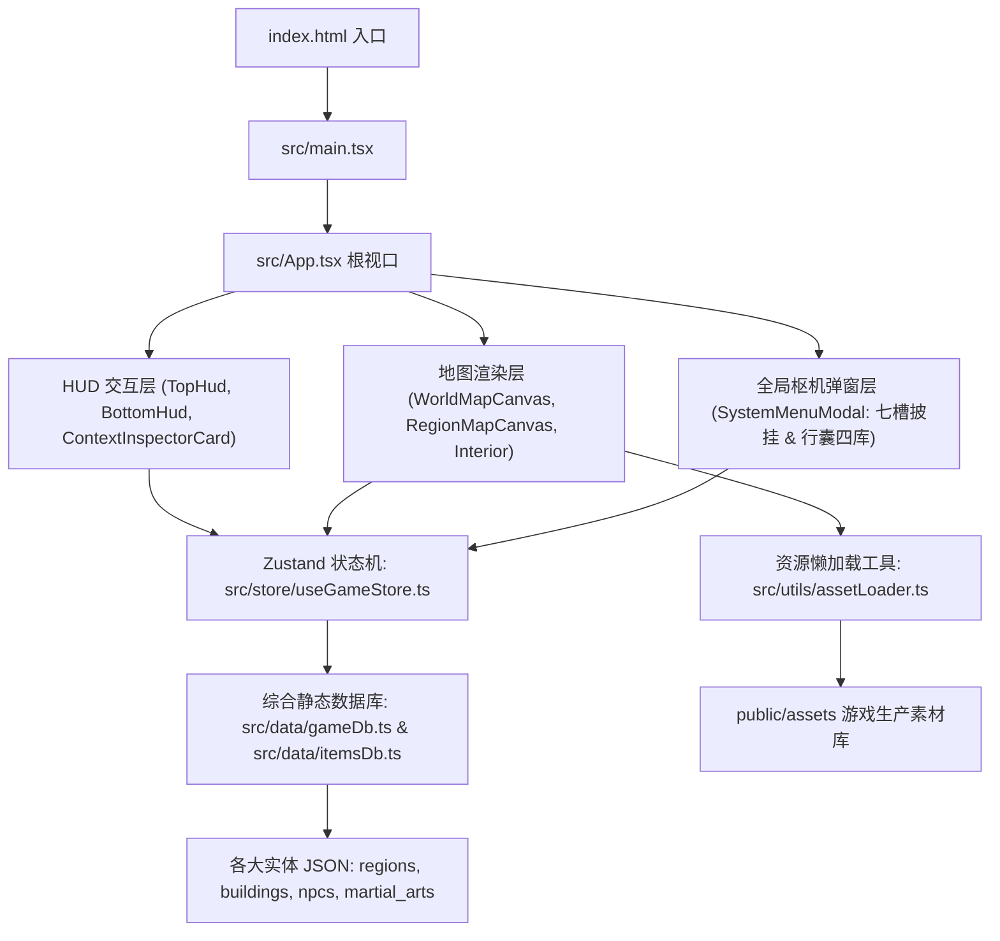

# 《北宋立志传》(Northern Song Chronicles) - 项目完整指南 (PROJECT_GUIDE)

> **版本**：v0.2.0-m1.0-complete  
> **更新时间**：2026-11-12  
> **仓库标识**：`zhby99/northern-song-chronicles`

---

## 目录
1. [项目定位与架构总览](#一项目定位与架构总览)
2. [工程目录与核心代码结构](#二工程目录与核心代码结构)
3. [核心代码模块职责与关键符号](#三核心代码模块职责与关键符号)
4. [全量游戏素材清单与路径索引](#四全量游戏素材清单与路径索引)
5. [工具链、数据编译与构建命令](#五工具链数据编译与构建命令)

---

## 一、项目定位与架构总览

本项目是一款以**公元 1050 年（北宋仁宗皇祐二年 · 《天龙八部》黄金前传时代）**为背景的国风开放世界历史人生模拟武侠 RPG（《北宋立志传》）。
前端技术栈采用 **Vite 8 + React 19 + TypeScript 7 + Tailwind CSS v4 + Zustand 5 + Lucide-React**，所有核心数据采用由四大 Markdown 设定集确定性编译而成的静态 JSON 数据库，配合 `public/assets/` 按需懒加载与 `IndexedDB + localStorage` 双写多槽位存档架构（`M1.0.0` Schema，向后兼容 `M0.4.0`）。

### 架构分层


---

## 二、工程目录与核心代码结构

```text
northern-song-chronicles/
├── index.html                           # 网页入口单页
├── package.json                         # 项目依赖与运行脚本
├── tsconfig.json / tsconfig.app.json    # TypeScript 配置
├── vite.config.ts                       # Vite 构建与服务配置
├── PROJECT_GUIDE.md                     # 本文档 (项目全局导引与资源索引)
├── README.md                            # 项目简介与里程碑概览
│
├── docs/                                # 游戏系统与数值策划设计文案
│   ├── CHARACTER_COMPENDIUM.md          # 1000 人物图鉴与派系
│   ├── EQUIPMENT_COMPENDIUM.md          # 皇祐披挂总纲（第一卷：百兵谱 100 种武器）
│   ├── GAME_MECHANICS.md                # 历法时辰、体能资粮、七槽披挂、四库行囊与核心机制总纲
│   ├── MARTIAL_ARTS_SECTS.md            # 30 武林门派（20 一流 + 10 二三流）与 11 庙堂四夷组织专卷
│   ├── MARTIAL_ARTS_COMPENDIUM.md       # 216 门武学全典与天阶修习条件
│   ├── REGIONAL_MAPS_AND_BUILDINGS.md   # 43 州府名山区域与 138 座特殊建筑名录（总计 268 座建筑）
│   └── ROADMAP_AND_TODO.md              # 开发里程碑与主线待办看板 (M0 ~ M5)
│
├── src/                                 # 核心业务源码
│   ├── main.tsx                         # 挂载入口
│   ├── App.tsx                          # 主容器组件与三层空间视图分发器
│   ├── index.css                        # 全局样式与宋代古籍宣纸设色变量
│   │
│   ├── components/                      # React 视图组件库
│   │   ├── hud/                         # 界面抬头显示与浮动信息
│   │   │   ├── TopHud.tsx               # 常驻顶部状态栏 (年月日十二时辰/气血/体能/资金/粮草) + 二级舆图控制条
│   │   │   ├── BottomHud.tsx            # 底部江湖行记日志、门派威望与当前坐标底栏
│   │   │   ├── ContextInspectorCard.tsx # 选定实体详细检视舱 (城池/建筑/驻留人物互动)
│   │   │   ├── MapTooltip.tsx           # 地图悬浮纯实色笺纸浮窗
│   │   │   └── TravelBanner.tsx         # 大地图逐日行军进度与随时扎营条
│   │   ├── map/                         # 地图画布与交互组件
│   │   │   ├── WorldMapCanvas.tsx       # 北宋华夏东亚全景舆图 (SVG 语义缩放沙盘)
│   │   │   ├── RegionMapCanvas.tsx      # 43 处州府名山全景画布与 138 座建筑室内视图
│   │   │   ├── SvgRegionPanoramaFallback.tsx   # 新辟州府宋辽营造青绿等轴城郭矢量渲染器
│   │   │   └── SvgBuildingInteriorFallback.tsx # 宋式《营造法式》室内建筑矢量渲染器
│   │   └── menu/                        # 系统枢机弹窗
│   │       └── SystemMenuModal.tsx      # 十卷枢机弹窗 (主角/披挂武学/行囊四库/群侠/武学/披挂总纲/工程/存取档/设置)
│   │
│   ├── data/                            # 游戏全量静态结构化数据库
│   │   ├── gameDb.ts                    # 数据库聚合导出与索引模块
│   │   ├── itemsDb.ts                   # 七槽位披挂定义、行囊四库元数据与宋风器物道具表
│   │   ├── regions.json                 # 43 个区域州府与名山信息
│   │   ├── buildings.json               # 138 座特殊地标 + 130 座基础建筑设定 (共 268 座)
│   │   ├── buildingPanoramas.json       # 建筑室内全景热区与视角绑定
│   │   ├── npcs.json                    # 1000 名历史名仕与武林人物数据库
│   │   ├── martial_arts.json            # 216 门四阶十二品武学数据库
│   │   ├── weapons.json                 # 100 种四阶十二品百兵谱数据库
│   │   ├── regionalConfigs.json         # 43 处区域坐标与建筑点位配置
│   │   ├── worldGraph.json              # 43 节点 79 边陆路、运河、塞外与蜀道节点连接拓扑
│   │   ├── worldBaseSvg.ts              # 华夏及东亚山海海岸线矢量轮廓
│   │   ├── idRegistry.json              # 全局实体标准 ID 命名空间注册表 (43地/30派+11组织/216功/100兵/1000人)
│   │   ├── assetManifest.json           # 生产资源清单索引
│   │   └── portraitCatalog.json         # 人物立绘与模板映射表
│   │
│   ├── store/                           # 全局状态管理
│   │   └── useGameStore.ts              # Zustand 状态机 (历法时辰、气血体能、七槽装备、四库行囊、空间导航)
│   │
│   ├── types/                           # 全局 TypeScript 接口与类型定义
│   │   └── game.ts                      # Region, Building, NPC, Equipment, Inventory, M1.0.0 存档等类型
│   │
│   └── utils/                           # 工具方法库
│       ├── assetLoader.ts               # 图片素材按需懒加载与字节监控工具
│       ├── mapMath.ts                   # 十二时辰历法换算、Dijkstra 最短路径与坐骑速度公式
│       └── saveManager.ts               # IndexedDB + LocalStorage 多槽位存取档与 JSON 导入导出校验
│
├── public/                              # 生产运行资源静态目录 (被 Vite 直接托管)
│   ├── icons.svg                        # 界面矢量图标集
│   └── assets/                          # 压缩处理后的生产游戏图片 (共 209 张)
│       ├── buildings/                   # 58 张地标建筑高清插画 (JPG)
│       ├── regions/                     # 38 张区域州府等轴测底图 (JPG)
│       └── characters/                  # 人物立绘资源 (共 113 张)
│           ├── avatars/                 # 51 张角色正方头像 (JPG)
│           ├── fullbody/                # 50 张角色全身立绘 (JPG)
│           └── templates/               # 12 张门派/身份模板全身立绘 (JPG)
│
├── assets_raw_masters/                  # 原始高精度美术素材存档 (未经裁剪/压缩)
│   ├── MANIFEST.json                    # 原始素材元数据清单
│   ├── buildings/                       # 60 张原始建筑概念设计原图
│   ├── regions/                         # 42 张原始区域全景原图 (含未修饰版)
│   └── characters/                      # 102 张原始角色立绘母版
│
├── scripts/                             # 项目构建、数据编译与资源维护自动化脚本
│   ├── compile_game_db.py               # 数据自动聚合编译脚本
│   ├── archive_all_branch_assets.py     # 分支美术资产归档合并工具
│   ├── build_preview_artifact.py        # 离线自包含演示打包脚本
│   └── extract_legacy_assets.py         # 原型素材提取工具
│
└── legacy_prototypes_and_tools/         # 早期生成工具、规格文档与原型
    ├── agent_specs/                     # 美术 Agent 设定与提示词规范
    │   ├── panorama_artist_agent.md     # 全景图生成规范
    │   └── portrait_artist_agent.md     # 角色肖像生成规范
    ├── character_generators/            # 千人批量生成逻辑与测试代码
    ├── map_generators/                  # 地图路径生成、几何运算与修饰工具
    └── early_svg_prototype/             # 第一版 SVG 地图探索原型
```

---

## 三、核心代码模块职责与关键符号

### 1. 状态管理 (`src/store/useGameStore.ts`)
- **`useGameStore`**: 全局单一数据源，管理：
  - **历法与时辰**：`dayTotal`（自皇祐二年正月初一起算天数）与 `shichenIdx`（`0..11` 对应 `子~亥` 十二时辰）。
  - **主角属性与生存资粮**：先天三维（`bone/insight/charm`）、实战与上限（`hp/maxHp`, `mp/maxMp`, `stamina/maxStamina`, `agility`, `res`）、资金 `silver`、粮草 `food` 与通用十艺 `skills`。
  - **七槽位披挂与行囊四库**：`equipped`（`weapon`, `armor`, `shoes`, `bow`, `accessory1`, `accessory2`, `mount` 共 7 槽，第七槽自动同步 `mountKey` 行军速度）与 `inventory`（四库物品栈）。
  - **三层空间导航与行军**：`viewMode`（`'world' | 'region' | 'interior'`）、`currentId`、`activeInteriorBuildingId`、`travel` 行军队列。
  - **核心 Actions**：`equipItemToSlot()`, `unequipSlot()`, `consumeInventoryItem()`, `restRecoverStamina()`, `startTravelTo()`, `enterRegion()`, `enterBuildingInterior()`, `saveToSlot()`, `loadFromSlot()`。

### 2. 静态数据库与器物表 (`src/data/gameDb.ts` & `src/data/itemsDb.ts`)
- **`gameDb.ts`**：导出 `REGIONS_DB`、`BUILDINGS_DB`、`MARTIAL_ARTS_DB`、`NPCS_DB` 及 O(1) 哈希索引 Map（`REGION_MAP`、`BUILDING_DB_MAP`、`NPC_BY_BUILDING_MAP` 等）。
- **`itemsDb.ts`**：定义 7 槽位元数据 `EQUIPMENT_SLOT_METAS`、4 分类行囊元数据 `BAG_CATEGORY_METAS`、宋风器物道具表 `ITEMS_DB` 以及装备总加成计算器 `computeEquipmentTotals()`。

### 3. 素材动态加载与历法数学库 (`src/utils/assetLoader.ts` & `src/utils/mapMath.ts`)
- **`useLazyImage(src)`**：按需懒加载当前视口原画并统计累计解码体积。
- **`SHICHEN_LIST` / `getSongDateParts()` / `formatSongDate()`**：北宋皇祐历法与十二时辰昼夜换算。
- **`findShortestPath()` / `getEffectiveSpeed()`**：基于装备栏第 7 槽【坐骑】与轻功/骑术修正计算真实地理行军速度与最短官道拓扑。

---

## 四、全量游戏素材清单与路径索引

游戏生产素材均存放于 `/home/antigravity/zhby99/northern-song-chronicles/public/assets/`。

### 1. 区域州府全景图 (`public/assets/regions/` - 共 38 张)
绝对路径前缀：`/home/antigravity/zhby99/northern-song-chronicles/public/assets/regions/`

| 序号 | 文件名 | 对应区域 ID / 名称 | 序号 | 文件名 | 对应区域 ID / 名称 |
| :--- | :--- | :--- | :--- | :--- | :--- |
| 1 | `bianliang.jpg` | 汴京 (东京开封府) | 20 | `suzhou.jpg` | 苏州府 (平江府) |
| 2 | `changan.jpg` | 长安 (京兆府) | 21 | `taihang.jpg` | 太行山寨 |
| 3 | `chengdu.jpg` | 成都府 | 22 | `taishan.jpg` | 泰山绝顶 |
| 4 | `dading_liao.jpg` | 大定府 (辽中京) | 23 | `taiyuan.jpg` | 太原府 (河东要冲) |
| 5 | `dali_city.jpg` | 大理城 | 24 | `taohuadao.jpg` | 东海桃花岛 |
| 6 | `daming.jpg` | 大名府 (北京) | 25 | `tiezhangfeng.jpg` | 铁掌峰 |
| 7 | `emeishan.jpg` | 峨眉山 | 26 | `tongguan.jpg` | 潼关要塞 |
| 8 | `hangzhou.jpg` | 杭州府 (临安) | 27 | `wudangshan.jpg` | 武当山 |
| 9 | `jiangning.jpg` | 江宁府 (金陵) | 28 | `wuliangshan.jpg` | 无量山剑湖宫 |
| 10 | `jianmenguan.jpg` | 剑门关 | 29 | `wutaishan.jpg` | 五台山清凉寺 |
| 11 | `jinan.jpg` | 济南府 | 30 | `xiangyang.jpg` | 襄阳府 |
| 12 | `kunlun.jpg` | 昆仑山三圣峰 | 31 | `xijin_liao.jpg` | 析津府 (辽南京/燕京) |
| 13 | `linhuang_liao.jpg` | 临潢府 (辽上京) | 32 | `xingqing_xixia.jpg`| 兴庆府 (西夏国都) |
| 14 | `luoxie_tubo.jpg` | 逻些城 (吐蕃都城) | 33 | `yanan.jpg` | 延安府 (西军前线) |
| 15 | `luoyang.jpg` | 洛阳 (西京河南府) | 34 | `yangzhou.jpg` | 扬州府 |
| 16 | `nanshaolin.jpg` | 南少林 (莆田少林) | 35 | `yanmenguan.jpg` | 雁门关绝塞 |
| 17 | `qingcheng.jpg` | 青城山天师洞 | 36 | `yanziwu.jpg` | 燕子坞参合庄 |
| 18 | `quanzhou.jpg` | 泉州府 (市舶重镇) | 37 | `zhending.jpg` | 真定府 |
| 19 | `shaolin.jpg` | 嵩山少林寺 | 38 | `zhongnanshan.jpg` | 终南山活死人墓/全真 |

---

### 2. 名胜建筑场景图 (`public/assets/buildings/` - 共 58 张)
绝对路径前缀：`/home/antigravity/zhby99/northern-song-chronicles/public/assets/buildings/`

| 序号 | 文件名 | 对应地标建筑 | 序号 | 文件名 | 对应地标建筑 |
| :--- | :--- | :--- | :--- | :--- | :--- |
| 1 | `bl_fanlou.jpg` | 汴京 · 樊楼七十二家名酒楼 | 30 | `qc_poison.jpg` | 青城山 · 百草炼丹房 |
| 2 | `bl_jinjun.jpg` | 汴京 · 八十万禁军大校场 | 31 | `qc_shangqing.jpg` | 青城山 · 上清宫 |
| 3 | `bl_kaifengfu.jpg` | 汴京 · 开封府衙南衙大堂 | 32 | `qc_tang.jpg` | 青城山 · 青城剑阁堂 |
| 4 | `bl_palace.jpg` | 汴京 · 大内皇城宣德门 | 33 | `sl_cangjing.jpg` | 少林寺 · 藏经阁密室 |
| 5 | `bl_xiangguosi.jpg` | 汴京 · 大相国寺三门万姓交易 | 34 | `sz_hanshan.jpg` | 苏州 · 寒山寺夜钟台 |
| 6 | `dd_envoy.jpg` | 辽中京 · 枢密使节院 | 35 | `sz_huqiu.jpg` | 苏州 · 虎丘剑池 |
| 7 | `dd_hunt.jpg` | 辽中京 · 斡鲁朵行猎大帐 | 36 | `sz_taihu.jpg` | 苏州 · 太湖归云水寨 |
| 8 | `dd_pagoda.jpg` | 辽中京 · 大明镇国舍利塔 | 37 | `tg_fort.jpg` | 潼关 · 关楼敌台烽燧 |
| 9 | `dm_drill.jpg` | 大名府 · 控扼太行阅兵台 | 38 | `tg_siguoya.jpg` | 潼关 · 华山思过崖 |
| 10 | `dm_ferry.jpg` | 大名府 · 御河漕运码头仓储 | 39 | `tg_summit.jpg` | 潼关 · 华山落雁南峰顶 |
| 11 | `dm_palace.jpg` | 大名府 · 北京大名府行宫 | 40 | `tg_zixia.jpg` | 潼关 · 华山玉泉紫霞院 |
| 12 | `em_jinding.jpg` | 峨眉山 · 金顶佛光台 | 41 | `ts_yuhuang.jpg` | 泰山 · 玉皇顶封禅台 |
| 13 | `em_pond.jpg` | 峨眉山 · 洗象池清修静室 | 42 | `ty_iron.jpg` | 太原府 · 晋阳铁冶坊 |
| 14 | `em_wannian.jpg` | 峨眉山 · 万年寺普贤殿 | 43 | `ty_jinci.jpg` | 太原府 · 晋祠圣母殿 |
| 15 | `jn2_qinhuai.jpg` | 江宁府 · 秦淮两岸烟雨楼台 | 44 | `wl_langhuan.jpg` | 无量山 · 琅嬛福地玉像窟 |
| 16 | `jn2_qixia.jpg` | 江宁府 · 栖霞寺古石窟 | 45 | `wl_yubi.jpg` | 无量山 · 无量剑湖碧玉壁 |
| 17 | `jn2_shitou.jpg` | 江宁府 · 石头城古要塞军寨 | 46 | `xj_horse.jpg` | 辽燕京 · 幽燕马市交易场 |
| 18 | `kl_poison.jpg` | 昆仑山 · 极寒炼毒玄冰崖 | 47 | `xj_marshal.jpg` | 辽燕京 · 留守元帅大堂 |
| 19 | `kl_summit.jpg` | 昆仑山 · 凌霄峰万年冰川 | 48 | `xj_minzhong.jpg` | 辽燕京 · 悯忠寺古塔法堂 |
| 20 | `kl_swordvalley.jpg` | 昆仑山 · 昆仑惊虹剑谷 | 49 | `xq_yipin.jpg` | 兴庆府 · 西夏一品堂暗殿 |
| 21 | `kl_yaochi.jpg` | 昆仑山 · 瑶池仙境暖玉池 | 50 | `yz_24bridge.jpg` | 扬州 · 二十四桥明月夜 |
| 22 | `lh_altar.jpg` | 辽上京 · 契丹天神祭天坛 | 51 | `yz_chaoguan.jpg` | 扬州 · 运河钞关税关司 |
| 23 | `lh_goldtent.jpg` | 辽上京 · 捺钵大金帐 | 52 | `yz_salt.jpg` | 扬州 · 两淮盐运使衙门 |
| 24 | `lh_ironcav.jpg` | 辽上京 · 铁林铁鹞大校场 | 53 | `zd_longxing.jpg` | 真定府 · 隆兴寺千手千眼阁 |
| 25 | `ly_baimasi.jpg` | 洛阳 · 白马寺齐云塔 | 54 | `zd_market.jpg` | 真定府 · 常山商市马行街 |
| 26 | `ly_gaibang.jpg` | 洛阳 · 丐帮总舵城隍破庙 | 55 | `zd_spear.jpg` | 真定府 · 赵云故里演武堂 |
| 27 | `ly_jindao.jpg` | 洛阳 · 金刀王府正气大厅 | 56 | `zn_stream.jpg` | 终南山 · 水帘深潭静室 |
| 28 | `ly_peony.jpg` | 洛阳 · 牡丹花会万花雅集 | 57 | `zn_tao.jpg` | 终南山 · 全真祖庭重阳宫 |
| 29 | `ly_shuyuan.jpg` | 洛阳 · 伊川书院讲经堂 | 58 | `zn_tomb.jpg` | 终南山 · 古墓石棺寒玉床 |

---

### 3. 角色立绘与头像 (`public/assets/characters/` - 共 113 张)

#### (1) 人物头像库 (`public/assets/characters/avatars/` - 51 张)
- **北宋皇室与朝堂名臣**：
  - `NPC-0001.jpg` (赵祯 / 宋仁宗)、`NPC-0002.jpg` (曹丹姝 / 慈圣皇后)、`NPC-0003.jpg` (赵曙)、`NPC-0004.jpg` (高滔滔)、`NPC-0005.jpg` (张清窈 / 温成贵妃)、`NPC-0006.jpg` (赵允让)、`NPC-0008.jpg` (柴宗庆)
  - `NPC-0009.jpg` (范仲淹)、`NPC-0012.jpg` (欧阳修)、`NPC-0013.jpg` (包拯)、`NPC-0021.jpg` (蔡襄)、`NPC-0022.jpg` (余靖)、`NPC-0023.jpg` (梅尧臣)、`NPC-0024.jpg` (苏舜钦)、`NPC-0025.jpg` (赵抃)、`NPC-0026.jpg` (唐介)、`NPC-0031.jpg` (狄青)
  - `NPC-0041.jpg` (尹源)、`NPC-0042.jpg` (呼延丕显)、`NPC-0043.jpg` (高怀亮)、`NPC-0055.jpg` (苏轼)、`NPC-0061.jpg` (毕昇)、`NPC-0062.jpg` (苏颂)、`NPC-0063.jpg` (沈括)、`NPC-0064.jpg` (贾宪)
- **四夷君臣**：
  - `NPC-0081.jpg` (完颜乌古乃)、`NPC-0082.jpg` (没藏黑云 / 没藏太后)、`NPC-0083.jpg` (李谅祚 / 西夏毅宗)
- **绝世大宗师与武林豪侠**：
  - `NPC-0101.jpg` (法空 / 少林扫地僧)、`NPC-0102.jpg` (巫行云 / 天山童姥)、`NPC-0103.jpg` (李秋水)、`NPC-0104.jpg` (慕容博)、`NPC-0105.jpg` (萧远山)、`NPC-0106.jpg` (无崖子)、`NPC-0107.jpg` (黄裳)
  - `NPC-0109.jpg` (玄澄)、`NPC-0110.jpg` (乔峰)、`NPC-0111.jpg` (汪剑通)、`NPC-0112.jpg` (玄慈)、`NPC-0113.jpg` (鸠摩智)、`NPC-0114.jpg` (林朝瑶)、`NPC-0115.jpg` (冯默岚)、`NPC-0118.jpg` (岳沧溟)、`NPC-0120.jpg` (慕容复)、`NPC-0121.jpg` (耶律惊鸿)、`NPC-0125.jpg` (唐鹤轩)、`NPC-0128.jpg` (云慧师太)
  - `NPC-0140.jpg` (展昭)、`NPC-0141.jpg` (白玉堂)、`NPC-0142.jpg` (王重岳)、`NPC-0144.jpg` (本因 / 天龙方丈)

#### (2) 人物全身立绘库 (`public/assets/characters/fullbody/` - 50 张)
- 覆盖上述绝大多数核心角色全身大图（`NPC-0001`~`NPC-0006`、`NPC-0009`、`NPC-0012`~`NPC-0013`、`NPC-0021`~`NPC-0026`、`NPC-0031`、`NPC-0041`~`NPC-0043`、`NPC-0055`、`NPC-0061`~`NPC-0064`、`NPC-0082`、`NPC-0101`~`NPC-0107`、`NPC-0110`~`NPC-0115`、`NPC-0118`、`NPC-0120`~`NPC-0121`、`NPC-0125`、`NPC-0128`、`NPC-0140`~`NPC-0142`、`NPC-0144`），并额外包含：
  - `NPC-0044.jpg` (石全彬)、`NPC-0065.jpg` (燕度)、`NPC-0236.jpg` (段正淳 / 镇南王)

#### (3) 通用门派与职业全身模板 (`public/assets/characters/templates/` - 12 张)
当 NPC 未分配唯一专属原画时，系统由 `assetLoader.ts` 自动降级映射至对应门派/身份模板：
- `tpl_dali_prince_fb.jpg`: 大理世子 / 滇南贵胄
- `tpl_emei_heroine_fb.jpg`: 峨眉女侠 / 剑派闺秀
- `tpl_greenwood_hero_fb.jpg`: 绿林好汉 / 豪迈草莽
- `tpl_khitan_warrior_fb.jpg`: 契丹勇士 / 北方骑士
- `tpl_shaolin_monk_fb.jpg`: 少林高僧 / 禅武武僧
- `tpl_song_empress_fb.jpg`: 大宋贵妇 / 宫闱后妃
- `tpl_song_physician_fb.jpg`: 儒雅名医 / 悬壶郎中
- `tpl_song_scholar_fb.jpg`: 大宋儒士 / 汴京才子
- `tpl_taohua_master_fb.jpg`: 碧海散人 / 奇门术士
- `tpl_taoist_master_fb.jpg`: 玄门羽士 / 武当真人
- `tpl_unorthodox_master_fb.jpg`: 邪派宗师 / 塞外怪客
- `tpl_woman_general_fb.jpg`: 巾帼名将 / 杨门女将

---

## 五、工具链、数据编译与构建命令

### 1. 开发与构建命令
在项目根目录 `/home/antigravity/zhby99/northern-song-chronicles` 执行：

```bash
# 安装依赖
npm install

# 启动本地开发服务 (支持 HMR 热更新)
npm run dev

# 编译 TypeScript 并打包生产资源至 dist/ 目录
npm run build

# 本地预览构建产物
npm run preview
```

### 2. 数据与素材自动化维护脚本 (`scripts/`)
- **`python3 scripts/compile_game_db.py`**:
  校验 `src/data/` 中的 JSON 数据关联完整性，验证州府、建筑、NPC、武学之间外键 ID 的正确性。
- **`python3 scripts/archive_all_branch_assets.py`**:
  维护 `assets_raw_masters/` 与 `public/assets/` 资源对应关系，自动同步新增素材并生成哈希校验表。
- **`python3 scripts/build_preview_artifact.py`**:
  用于把当前游戏打包为单文件/离线预览沙盒包。

---
*注：本项目所有图片素材与代码版权归《北宋群侠传》开发组所有。*
