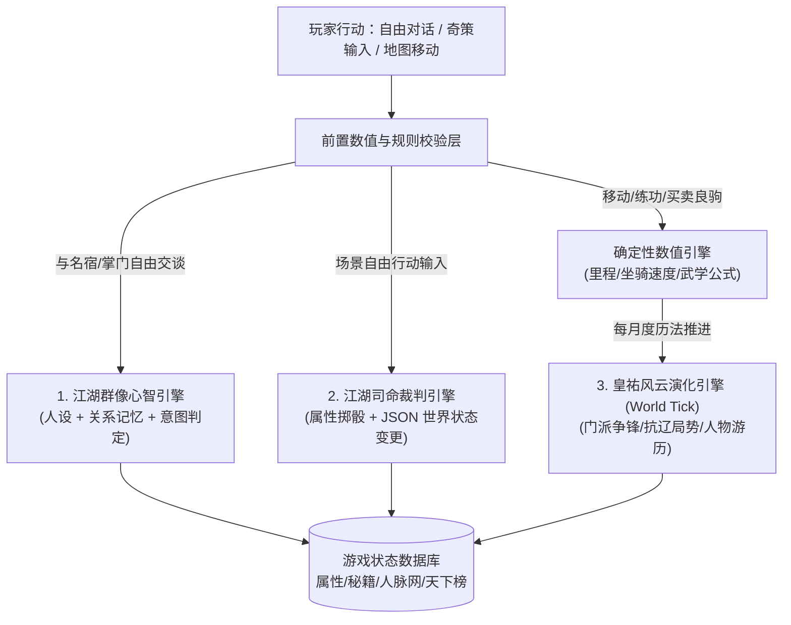

# 《北宋立志传》— 游戏机制与世界观设计文档（一期：武侠篇）

> “举目则青楼画阁，绣户珠帘。雕车竞驻于天街，宝马争驰于御路，金翠耀目，罗绮飘香；新声巧笑于柳陌花衢，按管调弦于茶坊酒肆。八荒争凑，万国咸通。集四海之珍奇，皆归市易；会寰区之异味，悉在庖厨。”
>
> “昔时因，今日意，胡汉恩仇，须倾英雄泪；虽万千人吾往矣，悄立雁门，绝壁无余字。”

---

## 一、 项目定位与时空设定

### 1.1 游戏全貌与当前阶段范围
* **游戏名称**：《北宋立志传》（致敬《太阁立志传》与《金庸群侠传》的开放式历史人生模拟 + LLM 驱动网页游戏）。
* **远期愿景与当前范围**：《北宋立志传》远期支持商贾、科举仕途、武林侠客等多路线人生，**当前阶段（一期核心版本）以【华夏全境及东亚山海全景舆图】为舞台，聚焦【纯武侠路线】**：
  * **地域边界**：采用涵盖华夏九州、辽漠、西域昆仑、雪域吐蕃、西南大理，并完整绘出**台湾岛（流求）、海南岛（琼州）、朝鲜半岛（高丽）、安南（交趾/越南）与日本列岛**的真实地理轮廓全景舆图。共设 **21 座核心城市**（大宋境内 **15 座重镇** + **大辽 3 城、西夏 1 城、吐蕃 1 城、大理 1 城**；其中大宋、大辽与西夏共 19 座城市统一采用三字府名规制）、**20 个主要门派** 及 **昆仑山、雁门关、潼关、剑门关** 等名山秘境与战略雄关。
  * **核心目标**：以武功数值与技能量化为骨、大语言模型（LLM）动态模拟为肉，让玩家在仁宗盛世暗流中快意恩仇，以成为 **“天下第一”**（极致武道）或 **“武林盟主”**（武功 + 江湖人脉声望）为终极目标，并自主选择价值方向（如**助宋抗辽、侠之大者**，或**啸聚山林、快意抗官**，亦或**远游塞外昆仑、隐世逍遥**）。
  * *预留扩展接口*：城市中的“书院”“市易行”“衙门”先作为武侠剧情与基础功能节点存在，底层数值结构为未来科举、行商 DLC 预留字段，本期不做独立玩法展开。

### 1.2 时代背景：宋仁宗皇祐二年（公元 1050 年）
* **庙堂盛景与隐忧**：此时距“庆历新政”落幕未久，范仲淹、欧阳修、包拯、富弼、狄青等名臣良将俱在人世，年轻的王安石、司马光已露头角。表面上商业繁华、文化鼎盛、四海咸通；实则“冗官、冗兵、冗费”积弊渐深，宋辽《澶渊之盟》下暗战不休，宋夏刚刚议和而边衅未绝，河北、贝州（王则起义余波）与岭南（侬智高蠢蠢欲动）民间暗流涌动。
* **江湖大势（《天龙八部》黄金前传时代）**：
  * 这一年，距离“雁门关惨案”发生尚在风云酝酿或初起之际；少林、丐帮同气连枝，在雁门关、河北一线戮力抗辽，威望如日中天。
  * 大辽三府（析津府、大定府、临潢府）密探、西夏兴庆府一品堂高手、吐蕃密宗番僧频频潜入中原刺探军情；西南大理段氏以一阳指、六脉神剑镇守南疆；西域昆仑绝顶奇人隐现；姑苏慕容氏暗蓄燕国复国之志；逍遥派隐于尘世收徒传艺。胡汉恩仇、四国并立、庙堂与江湖的碰撞，构成了公元 1050 年波澜壮阔的华夏武林画卷。

---

## 二、 核心设计哲学：数值量化骨架 + LLM 模拟血肉

为了同时实现《立志传/群侠传》扎实的养成策略感与大语言模型的高自由度互动，采用 **双层混合架构**：

1. **确定性规则与量化层（前端/后端代码控制）**：
   * 各项能力严格通过**数值与技能等级量化**（基本属性、兵刃武学专精、内功境界、轻功骑术、银两物品、地理距离与移动耗时、门派关系度、江湖声望）。
   * 杜绝 LLM“凭空编造神功”或“一句话说死绝世高手”的数值崩坏。
2. **LLM 动态模拟与叙事层（AI 引擎控制）**：
   * 负责全自由度的 NPC 交谈（结交人脉、套取秘闻、拜师请教、挑拨离间）、开放式江湖奇遇裁判（DM 检定）、门派间的离屏恩怨演化（World Tick），让每一个掌门、大侠、酒肆豪客都有鲜活的性格、立场与记忆。

---

## 三、 地图与空间机制设定（华夏全图篇）

### 3.1 全景山海舆图与《三国志》式移动机制
大地图完整呈现公元 1050 年华夏及周边东亚真实陆海轮廓（北起大辽临潢府潢水塞漠、西极万山之祖昆仑与雪域逻些、南括琼州海峡与安南交趾、东纳台湾宝岛、朝鲜半岛高丽及扶桑日本列岛），在此之上构建 **“21 座天下名城 + 17 处名山宗门/战略雄关”拓扑连接图**（交互舆图见 [northern_song_map.html](../index.html)）：

* **地理距离与移动公式**：
  * 地图上任意相邻节点之间标定真实历史折算的 **地理里程 $D$（单位：里）** 与 **地形系数 $T$**（官道 $1.0$、运河水路 $0.8$、塞外草原/戈壁 $1.2$、崇山蜀道/雪域高原 $1.6$）。
  * 玩家队伍的基础移动速度取决于角色披挂栏第七槽 **【坐骑】所佩良驹的基础速度 $V_{\text{mount}}$**（未装备坐骑步行基准为 $60\text{里/日}$，装备普通健马如枣红骢为 $120\text{里/日}$，西夏战马/乌云踏雪可达 $220\text{里/日}$，大宛汗血神驹可达 $300\text{里/日}$）以及角色自身的 **轻功/骑术技能加成**（含装备附加的骑术修正）。
  * **单段行程耗时**：
    $$\text{耗时（天数）} = \frac{D \times T}{V_{\text{mount}} \times (1 + \text{轻功或骑术修正})}$$
* **历法十二时辰与路途演进**：
  * 游戏内采用 **“年 · 月 · 日 · 十二时辰（子、丑、寅、卯、辰、巳、午、未、申、酉、戌、亥）”** 双精度历法，自 `皇祐二年 · 正月初一日 · 辰时` 起算，昼夜晨昏随行动实时流转。
  * 在城池或名山建筑内修习、拜访、饮宴每次推进 $1\sim2$ 个时辰（满十二时辰自动进一日）；点击大地图目标节点行军时，棋子沿道路逐日推进并流转时辰，每日消耗 **粮草（行军干粮）** 与少许盘缠。若粮草告罄仍强行赶路，将额外损耗角色 **体能** 与 **气血**；途中按概率触发胡商偶遇、绿林劫道、名侠同行、辽夏密探截杀或昆仑雪崩奇遇等事件。

### 3.2 天下 21 座核心城市与可互动特殊建筑全录（大宋 15 城 + 辽夏吐蕃大理 6 城）
每座城市除因地制宜配备 **5 座基础互动建筑**（北宋城池标配 **府州衙门、临街酒楼、悦来客栈、演武拳馆、州学书院**；塞外异邦都城对应设有 **番邦官署/王庭牙帐、胡姬酒肆、四方国信馆驿、王庭射猎校场、译经院/国子讲堂**）外，均拥有在地区互动地图上高亮呈现的 **【可互动特殊建筑】**（完整建筑功能与十艺/武学机缘详录见配套专卷 [REGIONAL_MAPS_AND_BUILDINGS.md](./REGIONAL_MAPS_AND_BUILDINGS.md)）：

#### （一）大宋境内 15 座主要城市（统一三字府名，含全部可互动特殊建筑）
| 编号 | 城市名称 | 所属路份 | 地区互动地图背景风貌 | 可互动特殊建筑（除五大基础建筑外，★ 高亮显示） | 邻近重要地点/门派 |
| :--- | :--- | :--- | :--- | :--- | :--- |
| 01 | **开封府** | 京畿路（东京首善） | 三重方城、汴河虹桥巨舟、御街州桥夜市灯火 | **大内皇宫（宣德门秘库）**、**开封府衙（六扇门总捕司）**、**樊楼**、**大相国寺**、**禁军八十万大教场** | 六扇门总捕司、禁军教头场 |
| 02 | **洛阳府** | 京西北路（西京重镇） | 北邙南洛、天津长桥卧波、名园古刹辉映 | **白马寺**、**白马书院**、**洛阳牡丹园**、**丐帮中原总舵（杏子林坛）**、**金刀王家大宅** | **嵩山少林寺**、丐帮总舵 |
| 03 | **大名府** | 河北东路（北京陪都） | 黄河北岸巨防瓮城、铁索浮桥惊涛拍岸 | **北京留守行宫**、**黄河铁索渡口**、**河北枪棒大校场** | 清河武盟、太行山绿林总寨 |
| 04 | **真定府** | 河北西路 | 西屏太行、北望辽境白沟河、榷场胡商驼队 | **隆兴大佛寺（千手观音阁）**、**宋辽边境榷场**、**常山演武堂** | 常山枪派、辽国榷场暗桩 |
| 05 | **太原府** | 河东路 | 汾水晋阳铁城、炉火冲天铁冶坊、苍翠古祠 | **晋祠古柏圣境**、**河东官营铁冶监**、**天波杨家旧祠** | **五台山清凉寺**、**雁门关** |
| 06 | **京兆府** | 永兴军路（关中古都） | 汉唐宏阔坊市、南望终南云海、西市丝路驼铃 | **慈恩寺大雁塔**、**终南草堂**、**西市胡商坊** | **潼关/西岳华山**、**终南山隐宗** |
| 07 | **延安府** | 鄜延路 | 黄土沟壑延水交汇、嘉岭孤塔、边塞连营烽燧 | **嘉岭山宝塔**、**鄜延边军大营**、**塞上番马黑市** | 西夏一品堂潜伏点、星宿派暗点 |
| 08 | **济南府** | 京东东路 | 清泉石上流、四面荷柳映泰岱、东通沧海 | **趵突泉（观澜榭）**、**大明湖画舫水榭**、**泰山岱庙行祠** | **东岳泰山**、京东水陆大寨 |
| 09 | **扬州府** | 淮南东路 | 运河千帆遮天、二十四桥红灯画舫、盐栈林立 | **运河钞关（江淮漕帮码头）**、**二十四桥明月坊**、**淮南盐帮总堂** | 江淮漕帮总舵 |
| 10 | **江宁府** | 江南东路 | 钟山龙蟠石城临江、十里秦淮烟水、栖霞丹枫 | **十里秦淮画舫**、**栖霞山古刹**、**石头城遗址（江南剑庐）** | 江南剑庐、长江水师营 |
| 11 | **苏州府** | 两浙路 | 水陆双棋盘河街、粉墙黛瓦园林、太湖烟波 | **虎丘剑池**、**枫桥寒山寺**、**太湖烟波渡口** | **太湖燕子坞（姑苏慕容氏）** |
| 12 | **杭州府** | 两浙路 | 西子湖三面云山、钱塘怒潮如雪、远洋海舶林立 | **西湖灵隐飞来峰**、**钱塘江观潮台**、**两浙市舶司海港** | **东海桃花岛**、钱塘江潮帮 |
| 13 | **成都府** | 成都府路 | 锦江绕城修竹掩映、交子茶肆繁华、西望雪山 | **大慈寺（唐宋壁画阁）**、**青羊道宫**、**锦江万里桥茶肆** | **峨眉山**、**青城山 / 唐家堡** |
| 14 | **襄阳府** | 京西南路 | 汉水铁打孤城、翠峰隆中竹林、江面楼船竞渡 | **襄阳铁打雄城楼**、**古隆中草庐**、**汉水大码头** | **武当山真武道宗**、**洞庭铁掌峰** |
| 15 | **泉州府** | 福建路 | 闽山榕荫红砖古厝、双石塔镇海、东望台湾流求 | **泉州开元寺东西双塔**、**武夷斗茶雅市**、**刺桐港万国番坊** | **莆田南少林**、闽海镖盟 |

#### （二）四夷列国 6 座雄城（大辽 3 城与西夏 1 城统一三字府名 · 吐蕃 1 城 · 大理 1 城）
| 编号 | 城市名称 | 所属国度/道 | 地区互动地图背景风貌 | 可互动特殊建筑（除番邦五标配外，★ 高亮显示） | 邻近重要地点/关联势力 |
| :--- | :--- | :--- | :--- | :--- | :--- |
| 16 | **析津府** | 大辽·南京道（古幽州） | 燕山古幽州坊市与契丹军帐交错、城外马市蔽日 | **幽州悯忠寺**、**辽南京兵马元帅府**、**燕京榷马大市** | 辽国南院武林暗桩、雁门关北口 |
| 17 | **大定府** | 大辽·中京道 | 老哈河汉城长街、八角巨塔凌云、北郊千里松漠围场 | **大定府大明宝塔**、**宋辽国信大同驿**、**松漠皇家围场** | 大辽护国萨满武士、长白女真猎部 |
| 18 | **临潢府** | 大辽·上京道（契丹龙庭） | 潢水草原皇都、金色斡耳朵捺钵大帐连绵、铁骑森严 | **大辽皇都金帐大内**、**潢水木叶山祭天坛**、**北院铁林军大营** | **辽廷北院护国武尊总坛** |
| 19 | **兴庆府** | 西夏·贺兰王都 | 贺兰山阙映黄河灌渠、党项琉璃白塔、大漠孤烟 | **西夏一品堂总堂**、**西夏皇宫寒玉冰窖**、**贺兰山皇家王陵**、**铁鹞子重骑大营** | **一品堂总坛**、逍遥天山潜脉 |
| 20 | **逻些（拉萨）** | 吐蕃·卫藏 | 雪域冰峰河谷、红山宫堡矗立苍穹、金顶梵宇桑烟 | **红山布达拉古宫**、**大昭圣寺金顶**、**雪域密宗辩经大坛** | 吐蕃密宗大轮明王脉（火焰刀/龙象功） |
| 21 | **阳苴咩城（大理）** | 大理国·苍洱 | 点苍十九峰积雪、洱海万顷明月、三白塔映照花甸 | **点苍崇圣寺三塔（天龙寺）**、**大理国皇宫·镇南王府**、**洱海茶马古道总集** | 大理段氏（一阳指/六脉神剑）、**无量山** |

### 3.3 独立名山秘境与战略雄关（17 处专属互动地图与可互动特殊建筑全录）
地图上除 21 座城池外，全部 **17 处名山宗门与战略雄关** 同样拥有各自独立的地区互动地图与专属可互动特殊建筑：

| 序号 | 地点名称 | 地域属性 | 地区互动地图核心风貌 | 可互动特殊建筑与秘境节点（全录） |
| :--- | :--- | :--- | :--- | :--- |
| 22 | **昆仑山（万山之祖）** | 西域极境 | 万仞雪峰冰川、翡翠瑶池冰湖、西谷紫雾毒泉 | **昆仑瑶池冰窟**、**三圣剑仙幽谷**、**星宿海毒泉外脉**、**万神封禅雪台** |
| 23 | **嵩山少林寺** | 中岳禅宗 | 少室叠翠千峰、红墙古柏禅院、钟鼓梵音 | **少林藏经阁**、**达摩面壁石洞**、**十八铜人罗汉堂**、**大雄宝殿方丈院** |
| 24 | **雁门关** | 宋辽绝险 | 勾注山千仞绝壁夹峙、长城烽燧、关外黄沙朔风 | **雁门关外乱石绝壁**、**镇边李牧武安君祠**、**雁门雄关城楼** |
| 25 | **五台山清凉寺** | 河东佛国 | 五峰高耸残雪清凉、金瓦梵刹护佑边关 | **清凉大雄主殿**、**杨五郎演棍石台**、**边关遗孤慈济院** |
| 26 | **太行山绿林总寨** | 草莽大寨 | 太行峭壁飞瀑断涧、木石山寨高悬替天行道旗 | **聚义忠义大堂**、**飞狐断魂索桥**、**太行藏金义仓** |
| 27 | **潼关 / 西岳华山** | 秦晋奇险 | 黄河东折撞潼关、华山五峰如削苍龙岭悬空 | **华山绝顶论剑台**、**玉女峰紫霞观**、**思过崖古山洞**、**潼关天险瓮城** |
| 28 | **终南山隐宗** | 秦岭幽谷 | 太乙深谷云海清溪、古柏掩映道观与活死人墓门 | **活死人墓幽谷石室**、**重阳古观前脉道院**、**终南后山寒玉涧** |
| 29 | **东岳泰山** | 五岳独尊 | 十八盘天门云梯、东海日出金光万丈 | **玉皇顶古封禅台**、**泰山派东岳道院**、**十八盘云梯石阶**、**五大夫松观云亭** |
| 30 | **太湖燕子坞** | 水泊世家 | 烟波太湖荷叶芦洲、江南画桥水榭相连 | **还施水阁**、**参合庄正厅**、**听香水榭与曼陀花坞** |
| 31 | **东海桃花岛** | 东海仙岛 | 碧海惊涛礁石环岛、漫山绯红八卦桃林 | **奇门八卦桃林大阵**、**弹指试剑海亭**、**听涛碧海琴庐** |
| 32 | **剑门关** | 入蜀锁钥 | 七十二剑峰攒天、绝壁隘口悬空栈道、古柏翠云 | **剑阁鸟道悬空栈**、**剑门雄关箭楼**、**翠云廊古柏驿亭** |
| 33 | **青城山 / 唐家堡** | 川西奇门 | 前山幽林道观、后谷竹海机关碉楼与万毒深涧 | **青城山上清宫松风殿**、**唐家堡天机机关阁**、**唐门万毒试炼涧** |
| 34 | **蜀中峨眉山** | 金顶仙山 | 云海托起万丈金顶佛光、古寺修竹飞瀑清音 | **金顶睹光台**、**万年古寺禅院**、**洗象池灵猴剑坪** |
| 35 | **无量山 / 剑湖秘境** | 大理南疆 | 澜沧大峡谷飞瀑如练、千丈玉壁映剑影、谷底秘洞 | **琅嬛福地神仙玉洞**、**无量玉壁观剑崖**、**无量剑湖宫** |
| 36 | **武当山真武道宗** | 太和道宗 | 七十二峰朝大顶、金殿凌虚松涛云海 | **太和绝顶真武金殿**、**紫霄道宫丹房**、**南岩绝壁试剑崖** |
| 37 | **洞庭铁掌峰** | 两湖霸帮 | 八百里洞庭浩渺、五指奇峰擎空、水寨楼船列阵 | **铁掌帮聚义总堂**、**五指中峰禁地秘冢**、**洞庭水陆连环寨** |
| 38 | **莆田南少林** | 闽海祖庭 | 九莲山苍翠盆地古刹、铁鼎木人演武坪东瞰沧海 | **九莲大雄宝殿**、**千斤铁鼎炼体坪**、**南少林百杰木人巷** |

---

## 四、 江湖格局：20 个主要门派设定

契合公元 1050 年《天龙八部》与北宋中叶风貌，20 个门派按立场与武学特色分为四类。每个门派拥有量化的 **【门派威望】【门规倾向】【镇派绝学】与【价值立场（抗辽/中立/反官/图谋天下）】**。

### 4.1 抗辽中流砥柱·名门正宗（8 派）
1. **嵩山少林寺**（近洛阳府）：天下武学泰山北斗，玄字辈高僧辈出，七十二绝技与《易筋经》冠绝天下，与丐帮共担抗辽重任。
2. **丐帮**（总舵洛阳府，分舵遍布诸城）：中原第一大帮，汪剑通执掌的时代，帮众十万，消息通天，《降龙十八掌》《打狗棒法》威震胡虏。
3. **五台山清凉寺**（近太原府/雁门关）：河东佛门圣地，地处抗辽最前线，寺内武僧精研金刚伏魔杖法与护体神功，常救护边关遗孤。
4. **莆田南少林**（近泉州府）：闽南武学祖庭，拳脚硬功刚猛绝伦，与北少林南北呼应，镇守东南沿海。
5. **华山派**（近京兆府）：西岳剑宗，剑法奇拔险峻，兼修紫霞内功，关中侠士多出于此。
6. **泰山派**（近济南府）：东岳道门，剑法沉稳厚重，讲究泰山压顶之势，在齐鲁绿林中极具公信力。
7. **峨眉派**（近成都府）：蜀中佛道兼修大派，剑掌轻灵飘逸，门风清正，护佑川西百姓。
8. **真武道宗（武当山道脉）**（近襄阳府）：北宋道教昌盛下的内家拳剑宗门，讲求阴阳动静、四两拨千斤。

### 4.2 隐世奇门·绝世传承（4 派）
9. **逍遥派**（驻地隐秘，线索散见开封府、洛阳府、西南无量山）：宋初逍遥子所创，门人极少却个个惊才绝艳，武学融入琴棋书画医卜星相（《北冥神功》《小无相功》《凌波微步》）。
10. **姑苏慕容氏**（近苏州府·太湖燕子坞）：大燕皇室后裔，“南慕容”名动江湖，坐拥还施水阁天下武学典籍，以“以彼之道，还施彼身”掩盖兴复大燕的野心。
11. **终南隐宗（活死人墓/全真前脉）**（近京兆府·终南山）：隐于终南深谷的道家与奇女传承，轻功捕雀、剑法冷冽，不问庙堂纷争。
12. **东海桃花岛一脉**（近杭州府外海）：精研奇门遁甲、五行八卦阵图与音律弹指神通，行事全凭本心，蔑视世俗礼法。

### 4.3 地域世家·霸道强宗（4 派）
13. **蜀中唐门**（近成都府·唐家堡）：巴蜀暗器与毒药第一世家，机关算尽，拿钱办事，正邪两道皆忌惮三分。
14. **青城派**（近成都府·青城山）：巴蜀道家大派，剑走偏锋，迅疾狠辣，常与峨眉、唐门争夺川中话语权。
15. **铁掌帮**（近襄阳府·荆楚水陆）：帮风彪悍霸道，凭一手刚猛无俦的《铁掌功》与“水上漂”轻功称雄两湖。
16. **江淮漕帮**（总舵扬州府，贯通开封府汴河水路）：执掌南北运河生杀大权，帮众悍勇，精擅水战、分水刺与长枪排阵，与官府及盐商关系盘根错节。

### 4.4 朝廷鹰犬·草莽与外邦渗透势力（4 派）
17. **开封府 / 六扇门（含大内禁军武学）**（开封府）：朝廷体制内武林力量，包拯麾下展昭等江湖义士与六扇门名捕并存，擅长缉凶追捕、军阵刀枪与官面威慑。
18. **太行/京东绿林盟（反官义军潜流）**（近大名府/济南府）：庆历年间王则起义余脉与河北山东绿林豪强结成的同盟，劫富济贫、对抗贪官酷吏，为选择“反对朝廷”路线的玩家提供核心阵营。
19. **星宿派（西域毒宗中原潜伏点）**（活动于延安府、京兆府外围）：丁春秋一脉或西域邪派先遣，门内弱肉强食、阿谀成风，专擅化功大法与奇毒蛊术。
20. **一品堂 / 辽国武林暗桩（外邦敌对势力，不可常规拜入或仅限特殊卧底/投敌线）**（总坛兴庆府与析津府、临潢府，潜伏于太原府、真定府、延安府）：西夏与大辽网罗的恶人、番僧与异族高手，专门刺杀抗辽名宿、挑动中原门派内讧，是“助宋抗辽”路线的核心宿敌。

---

## 五、 角色数值与武学量化体系（立志传 × 群侠传融合）

遵循设定要求：**“各项能力通过数值和技能量化，以成为武林盟主（人脉+武功）或天下第一（武功）为目的。”**

### 5.1 角色基础属性（天赋三维，满分均为 $100$，不直接参与战斗结算）
基础属性代表角色的先天禀赋与气度，主要影响**武学修炼效率、突破瓶颈概率、奇遇检定及人际交往**，**不直接代入战斗伤害或攻防公式**：
* **根骨（$1\sim100$）**：决定内功、硬功、炼体武学的修炼速度与周天搬运效率，影响每次闭关/吐纳获得的气血与内力成长倍率，同时也是诸多刚猛或炼体天阶绝学的修行硬门槛。
* **悟性（$1\sim100$）**：决定秘籍研读速度、招式拆解与领悟效率、自创或融会武学的成功率，以及在书院读书、与高人论道时的属性/技能收益。
* **颜值（$1\sim100$）**：决定行走江湖的第一印象与风采气度，影响结交豪杰名姝的初始好感度、市井奇遇触发倾向，以及特殊门派（如逍遥派、终南隐宗等看重姿容风仪之门）的择徒标准。

### 5.2 战斗核心属性与日常生存状态（实战四维 + 体能/资粮）
角色在战棋交锋中的所有攻防、先后手、移动与状态豁免，由以下四项实战属性与所施展的武学招式共同决定；同时辅以日常历练与远行所需的生存资源：
* **气血（`当前 / 上限`）**：即角色生命值（血条），在战斗中承受外伤与内伤冲击；气血归零则重伤落败（切磋点到为止，死斗则有性命之忧）。可通过修炼内外功、穿戴护身披挂、服食灵丹妙药或根骨成长提升上限。
* **身法**：直接决定战斗中的**出手先后顺序（集气速率）**、**战棋移动格数加成**、**闪避率/命中修正**以及危急时刻的脱离战场成功率；主要由轻功修为、鞋履弓马披挂与日常身法锤炼提升。
* **内力（`当前 / 上限`）**：攻防一体的核心战斗资源与强度指标——**进攻端**直接增幅招式威力、催动剑气掌风与内劲外放；**防御端**形成护体真气抵消敌方招式杀伤与震伤，并用于施放高阶绝学时的真气消耗。内力兼具**刚、柔、调和**等劲力特质。
* **抗性**：角色对各类**特殊属性伤害与异常状态**（包括：**奇毒、寒冰、烈火/灼阳、蛊蚀、内息紊乱/封穴**等）的综合防御与豁免能力；通过研习特定护体神功、佩挂避毒奇珍、毒经医理或历经特殊淬炼提升。
* **体能（`当前 / 上限`）**：角色日常习武演练、书院治学、名宿切磋与长途跋涉的精力刻度。在建筑内修习或断粮强行军时会消耗体能，体能过低无法继续高强度苦修；可通过客栈投宿歇息、酒楼饮宴或服食药膳茶饼（如茯苓行军散、北苑龙团胜雪）迅速恢复。
* **资金（纹银两数）与粮草（行军干粮日份）**：行走江湖的盘缠与口粮，常驻显示于全局顶部状态栏；天下舆图行军每日消耗干粮，城市采买、投宿、购置兵甲良驹与通融打点皆需纹银。

### 5.3 通用技能体系（十艺百工，每项满分均为 $100$）
取消灰置阉割，完整确立北宋士农工商与风雅江湖并重的**十项通用技能（范围 $0\sim100$）**。它们既是逍遥派、桃花岛等奇门高人择徒授艺的前置条件，也是酒楼雅集、说服掌门、未来扩展科举仕途与行商系统的核心量化标尺：
1. **骑术（$0\sim100$）**：决定良驹驾驭上限与人马合一程度，直接加快大地图移动速度 $V_{\text{mount}}$ 及马战冲锋表现。
2. **算术（$0\sim100$）**：精研筹算、账目与五行推演，影响钱粮盘算、机关阵法破解（如桃花岛奇门八卦）及未来商贾经营收益。
3. **经义（$0\sim100$）**：儒释道经典义理修养，影响书院讲学、与高僧大儒（如少林玄字辈、洛阳府名士）论道契合度，以及佛道高深内功的心法参悟。
4. **策论（$0\sim100$）**：纵论天下兵事、边防漕运与治国方略，与范仲淹、包拯、狄青等庙堂名臣或抗辽义军首领交谈时至关重要。
5. **诗词（$0\sim100$）**：北宋词风鼎盛，诗词造诣直接影响开封府樊楼、江宁府秦淮画舫等风雅场所的声名传播、名士唱和及特定意境剑法的领悟。
6. **琴（$0\sim100$）**：丝竹音律之技，可融入音波功法（如七弦无形剑、碧海潮生曲意），亦是结交知音高士的雅道。
7. **棋（$0\sim100$）**：纹枰对弈、大局推演之术，用于破解珍珑棋局类奇遇，并提升战棋局势洞察。
8. **书（$0\sim100$）**：笔法骨力与碑帖临摹，北宋尚意书风与剑指笔意相通（如自书帖悟判官笔、书法入剑），亦可鉴定前人绝壁刻字。
9. **画（$0\sim100$）**：丹青妙笔与观物入微，影响舆图测绘、人物易容摹写及从古画图谱中参悟神功步法。
10. **辩才（$0\sim100$）**：舌灿莲花、纵横捭阖之能，用于说服各派掌门、化解死斗、煽动群雄情绪，直接决定 LLM 交涉检定与战中“英雄喝问”的成功率。

### 5.4 武功分级体系：四阶十二品与 200+ 武学总纲
* **四阶十二品评级**：天下武学（涵盖**内功心法、拳掌指爪、剑法、刀法、枪棍长兵、奇门暗器毒术、轻功身法**七大类）严格划分为 **【天阶】、【地阶】、【良品】、【凡品】** 四个大等级，每个大等级内再细分 **上、中、下** 三品（合计 **四阶十二品**）：
  * **天阶（上 / 中 / 下）**：震古烁今的旷世神功与开宗立派绝学。**凡欲修习天阶武学，皆有严苛的前置修行条件**（对根骨/悟性/颜值基础属性、内力/抗性门槛、前置地阶武学造诣、或是十项通用技能中的琴棋书画经义等有明确要求）。
  * **地阶（上 / 中 / 下）**：二十大门派镇派上乘武学、名宿成名绝技与一流轻功秘法，乃江湖一流高手安身立命之本。
  * **良品（上 / 中 / 下）**：各大门派中坚弟子传习的进阶武学、名家镖局与军阵精锐战技，招式严整、威力不俗。
  * **凡品（上 / 中 / 下）**：市井武馆把式、绿林粗浅功夫、门派入门筑基招式与基础步法，易于上手、门槛极低。
* **武学图鉴分册索引**：完整的 **216 门武学分级名录、招式文字介绍及天阶武学前置修行条件** 详见配套专卷文档 —— [MARTIAL_ARTS_COMPENDIUM.md](./MARTIAL_ARTS_COMPENDIUM.md)。

### 5.5 独立主角总览、披挂与武学配招、行囊四库三卷体系
* **壹·主角面板（独立人物总览卷）**：
  * 单独展示少侠全身绘像（支持点击放大品鉴）、骨龄境界、**生存三维双精度进度条**（气血、真气内息、体能及客舍调息入口）、**实战交锋四维合计**（综合披挂与所运武学实时折算的外功杀伤、护体防御、实战身法、周身抗性）、**先天三维禀赋**（根骨 / 悟性 / 颜值）、官道千里脚力以及 **北宋十艺百工修为**。
* **贰·披挂与武学面板（七槽随身披挂 + 六槽武学修为双卷合一）**：
  * **上卷 · 随身七槽可视化披挂（四阶十二品规制，详见专卷 [EQUIPMENT_COMPENDIUM.md](./EQUIPMENT_COMPENDIUM.md)）**：
    * **四阶十二品分级**：天下披挂统一划分为 **【天阶】、【地阶】、【良阶】、【凡阶】** 四大阶（每阶细分上、中、下三品）；天阶神兵须满足先天禀赋、实战修为或十艺百工门槛方能认主佩备。
    1. **【武器】（第一卷《百兵谱》100 种已定稿 · `WPN-001 ~ WPN-100`）**：严格按 **10 天阶 / 20 地阶 / 30 良阶 / 40 凡阶** 覆盖 **剑、刀、枪、棍棒、拳掌护手、暗器、奇门音兵** 七大兵种；具备战棋攻击格数、刚柔劲力词条与 **【兵武共鸣】** 机制（佩备契合兵种或本命绝配武学招式可额外增幅外功杀伤）；
    2. **【服饰】（第二卷待定稿 · 旧占位已清空）**：劲装、澜衫、宝衣、软甲等护体衣甲；
    3. **【鞋履】（第三卷待定稿 · 旧占位已清空）**：草鞋、快靴、云履等轻身足具；
    4. **【弓箭】（第四卷待定稿 · 旧占位已清空）**：猎弓、角弓、神臂弓等远射军械；
    5. **【配饰壹】** & 6. **【配饰贰】（第五卷待定稿 · 旧占位已清空）**：双槽位自由搭配玉佩、香囊、护心镜、信物等奇珍；
    7. **【坐骑】（第六卷待定稿 · 旧占位已清空）**：未佩坐骑时大地图默认按徒步行走（$60\text{里/日}$）结算，后续专卷录入良驹鞍辔。
  * **下卷 · 主角六槽武学运使与所习武学演练**：
    * 常设 **6 个专属武学运使槽位**：**【主运内功】**（1 槽，决定内力上限、护体真气与抗性）+ **【轻功身法】**（1 槽，决定战中集气闪避与大地图行军提速百分比）+ **【出战招式壹~肆】**（4 槽，自由搭配已习得的拳掌、剑法、刀法、长兵或奇门招式）。
    * 完整列出少侠已习得的全部武学、当前火候重数（`1~10 重`）与熟练度进度条，支持消耗体能与时辰直接 **【演武精修】** 突破重数，穿卸装备或切换运使武学瞬间动态重算实战四维与大地图日速。
* **叁·随身行囊四库分类**：
  * 行囊作为第三独立面板，按北宋器物门类严格划分为四大分栏页签，支持一键检视详情、展卷研读领悟新武学、服食丹膳或直接披挂上身：
    1. **【典籍书画】**：武学秘籍（研读可直接习得新武学或精进已习武学重数）、古谱残卷、儒释道经史典籍、前代名家字画真迹；
    2. **【丹药毒物】**：金创疗伤药、回气灵丹、恢复体能的药膳茶饼、奇毒暗器涂剂与解药；
    3. **【雅器百工】**：全库 **50 件**四阶器物（**天阶 5 件 / 地阶 10 件 / 良品 15 件 / 凡品 20 件**），涵盖九霄环佩古琴、逍遥珍珑玉枰、澄心堂端溪宝匣、苏颂水运星晷、毕昇胶泥活字印匣、汝窑建盏茶香重器、沈括水浮司南、太医局针灸铜人及民间文房筹算渔樵百工器具，支持随身佩挂增幅十艺与把玩修习；
    4. **【行囊杂物】**：替换下来的备用兵甲衣履、马匹契券、通关路引文书、信物令牌与四海奇珍杂物。

### 5.6 胜负目标双轨制与价值方向抉择
* **双核心通关目标量化**：
  1. **【天下第一】路线（纯武道巅峰）**：无需迎合世俗好感，挑战二十门派掌门与隐世绝顶高手，修成天阶绝学，淬炼极致气血、身法、内力与抗性，在 **“嵩山/华山绝顶论剑”** 中单挑连胜群雄，武道战力登顶天下榜首。
  2. **【武林盟主】路线（人脉 + 武功 + 大义）**：不仅实战战力需达一流之境（前十水准），还需善用【辩才】【策论】【诗词】等通用技能折服群豪，拥有极高的 **江湖声望**、至少 **8 个主流门派的崇敬关系** 以及数十位结义/生死之交的知名豪侠。最终在雁门关抗辽大战或洛阳府英雄大会上振臂一呼，获群雄推举执掌武林盟主令。
* **价值方向抉择轴**：
  * **护国侠义轴（助宋抗辽/抗夏）**：追查辽国密探与一品堂阴谋、保卫边关名将（如狄青、杨家后人）、死守雁门关。
  * **反叛草莽轴（替天行道/反对朝廷）**：痛击贪官污吏、劫夺不义官银、救援受迫害义士、与六扇门及禁军高手周旋抗衡。

---

## 六、 可交互地图与地区独特内景舆图 UI 设计（Web 端）

### 6.0 全局顶部常驻状态栏（Top Status HUD）与 1.5× 宽幅行囊枢机菜单
* **全场景常驻顶部状态栏**：无论处于天下舆图、州府全景还是特殊建筑室内，画面最上方始终常驻宋式乌木鎏金状态横栏，实时展示：
  * **历法时辰**：当前年号、月日与十二时辰徽章（如 `皇祐二年 · 正月初一日 · 辰时`，随昼夜切换日月星象图标）；
  * **主角生存双条**：直观进度条实时显示 **【气血（当前/上限）】** 与 **【体能（当前/上限）】**（点击直达【壹·主角面板】）；
  * **资粮盘缠**：实时显示当前 **【资金（纹银两数）】** 与 **【粮草（行军干粮份数）】**（点击直达【叁·行囊四库】），以及一键呼出 `行囊枢机（ESC）`。
* **1.5× 宽幅行囊枢机总览窗与人物绘像灯箱**：
  * 枢机菜单采用 **1.5 倍宽幅高挑展卷规制（`1536px × 975px`，随屏幕视口自适应）**，依序排布 **【壹·主角面板】【贰·披挂与武学】【叁·行囊四库】【肆·群侠图鉴】【伍·武学总纲】【陆·工程与字典】【柒/捌·存取档】【玖·设置】** 九大卷册。
  * **群侠图鉴等比画框与点击放大品鉴**：所有人物全身绘像统一锁定 `3:4` 标准立轴画幅（防长文本挤压变形），并支持点击任意人物全身像或半身头像弹出全屏高清灯箱（支持在【全身绘卷】与【半身头像】间一键切换品鉴）。

### 6.1 宏观大地图（华夏及东亚山海全景舆图）
* **视觉风格与未开放绝域雕版纹饰**：北宋古舆图（仿《禹迹图》《华夷图》真实山海疆界与宋代青绿水墨设色结合），完整绘出华夏大陆海岸线、辽东与山东半岛、雷州半岛、**台湾岛（流求）**、**海南岛（琼州）**、**朝鲜半岛（高丽）**、**安南（交趾/越南）** 与 **日本列岛（九州、四国、本州、虾夷）**，基于 SVG 可平滑缩放拖拽。对于游戏核心版图以外的边荒绝域（漠北瀚海、西域三十六国、白山黑水、天竺、南诏外徼），覆盖**宋代雕版茶褐宣纸排线 + 祥云如意回纹装饰暗影**，彻底消除空白黄地感。
* **语义缩放（Semantic Zoom LOD）与双层朱砂疆界线**：
  * 列国分界采用**温润米白玉带衬底 + 古雅朱砂点划线**双层设色，清晰醒目而不突兀刺眼。
  * 当滚轮缩小至 `< 0.85×` 时，自动隐藏城池、名山与关隘细碎地名，醒目浮现 **“宋”、“辽”、“西夏”、“吐蕃”、“大理”** 宏观国号与疆界总览。
* **【地名文字】四分类下拉栏目与战略谍报开关**：
  * 左上角【地名文字】下拉菜单收纳 **【城市】**、**【独立名山秘境与战略雄关】**、**【名侠踪迹】**、**【道路里程】** 四项独立开关（支持一键全显 / 全隐仅保留各地区图标），并配合【门派与四国势力圈】、【边关渗透警报】自由组合视图。
* **节点交互**：
  * 悬停任一城市/名山节点，立刻弹出**完全不透明实色古籍笺纸浮窗**（杜绝与底层地图山川文字透叠干扰），清晰显示：**【所属国度/路份】【距离当前位置里程 $D$】【按当前坐骑预计抵达天数】【城内驻留知名人物数量】【近期江湖传闻标签】**。
  * 点击【策马出发】，角色骑马图标沿道路逐日移动，顶部日历与时辰实时跳动（如 `皇祐二年 · 三月十二日 · 申时`），支持随时驻扎露营。

### 6.2 地区独特互动地图（38 处可进入地点主视图无缝切换）
当主角进入任一可进入地点（21 座城市或 17 处名山秘境/雄关）后，**主画面直接从《天下山海舆图》切换为该地区独一无二的手绘互动内景地图**（取代传统小弹窗，支持一键点击城门/山门出口返回天下舆图）：
* **因地制宜的特色场景背景**：38 处地点各具专属地貌与城郭结构——如 **开封府** 的三重城垣、汴河虹桥与御街灯火；**苏州府** 的水网画桥与粉墙黛瓦；**临潢府** 的潢水草原与斡耳朵金帐；**逻些** 的雪峰冰河与红山古宫；**东海桃花岛** 的碧海礁岸与九宫桃林；**昆仑山** 的万仞冰川、瑶池玉湖与星宿毒泉。
* **醒目高亮的可互动建筑节点**：
  * **特殊建筑（★ 地标）**：采用**朱红鎏金立体飞檐古建图标 + 金色呼吸边框 + 100% 纯实色高对比铭牌**突出绘制（如开封府的 `大内皇宫`、`樊楼`、`大相国寺`、`开封府衙`、`禁军大教场`；大理的 `崇圣寺三塔`；兴庆府的 `一品堂总堂`；昆仑的 `瑶池冰窟` 等）。
  * **基础功能建筑**：采用青砖檀木立体图标清晰排布于坊市干道两侧（`衙门/王庭`、`酒馆`、`客栈`、`演武拳馆`、`书院/译经院`）。
* **最末层建筑人物实景寻访与全维度属性呈现**：
  * **严禁刚进城即列出全城 NPC**：千名历史与江湖人物（`NPC-0001..1000`）全部精确驻留至**最末层建筑**——若为内设子建筑的 123 座特殊地标建筑（`地区 > 特殊建筑 > 子建筑`，共 369 处子建筑），玩家须步入建筑内院并点击具体子建筑（如 `开封府 > 大内皇宫 > 垂拱殿` 方见宋仁宗、`嵩山少林 > 藏经阁 > 顶层密卷室` 方见扫地僧法空）；若为无内部子院的 105 座城市基础建筑（`地区 > 基础建筑`），点击该基础建筑即达最末层。
  * **全人物全量量化属性**：每位 NPC 均完整具备 **实战四维（气血 / 内力 / 身法 / 抗性）**、**先天三维禀赋（根骨 / 悟性 / 颜值，满分 $100$，不入战中伤害公式）** 与 **十艺百工（骑术 / 算术 / 经义 / 策论 / 诗词 / 琴 / 棋 / 书 / 画 / 辩才，范围 $0\sim100$）**，在最末层建筑交互卡与【肆·群侠图鉴】中实时可查，并可执行 **【交谈】【唱和（随名宿十艺专精进益对应雅艺）】【讨教】**。

### 6.3 战斗系统：快节奏网格战棋
* 触发切磋或死斗时，展开 **8×8 轻量化武侠战棋盘**（街道、山门、雁门关绝壁、昆仑冰川等地形障碍）。
* **实战四维结算**：角色凭 **【身法】** 决定行动次序、走位距离与闪避，凭 **【内力】** 催动招式杀伤并撑开护体气墙减伤，以 **【气血】** 承受最终伤害，并由 **【抗性】** 判定是否豁免奇毒、寒冰、烈火等特殊侵袭（根骨、悟性、颜值不介入战中数值计算）。
* **战中“英雄喝问”（LLM 特色介入）**：每场关键战斗限用 1 次，玩家可输入一句符合当时情境的台词（如晓以胡汉大义、点破对方武功破绽、虚张声势），结合玩家 **【辩才】** 等通用技能检定后转化为士气震慑、停战罢斗或内息破防效果。

---

## 七、 LLM 底层模拟核心机制

为确保大语言模型真正服务于“立志传”式的涌现体验，而非变成纯文字聊天室，设计三大底层引擎：

1. **江湖群像心智引擎（人脉系统核心）**
   * 游戏内置约 **80~120 位核心武林人物与时代名流**（二十派掌门长老、独行大侠、抗辽名将、辽夏吐蕃大理高手）。
   * 每位 NPC 拥有动态 **【坐标位置】**（他们也会按骑马速度在天下 21 城与昆仑名山间游历访友或办案！）、**【好感度（-100 至 +100）】**、**【义气/野心值】** 与 **【长期记忆条目】**。
   * 当玩家想走“武林盟主”路线时，不能只靠机械送礼刷数值，而要在酒馆对饮或并肩作战后，通过 LLM 对话投其所好——对少林高僧谈经义佛法，对河北豪杰谈抗辽策论，对名士才女赋诗词抚琴，对慕容氏虚与委蛇谈天下大势。系统根据对话契合度与【颜值 / 辩才 / 经义 / 诗词】等数值结算好感突破（点头之交 $\rightarrow$ 莫逆之交 $\rightarrow$ 八拜结交）。

2. **江湖司命裁判引擎（DM 自由互动）**
   * 在任何建筑或特殊地点（如雁门关绝壁、昆仑瑶池冰窟、皇宫外墙、燕子坞水阁），玩家除点击常规按钮外，均可输入自由行动指令。
   * 引擎结合玩家当前的量化属性（如 `身法`、所修轻功品阶、`书/画/算术` 造诣、`悟性`）执行暗骰检定，裁定玩家是否识破了绝壁上的前人剑意刻字、是否破开奇门机关潜入王府盗得辽国密信，并输出严格的 JSON 指令发放奖励或触发围捕。

3. **皇祐风云演化引擎（World Tick 动态江湖）**
   * 游戏时间每过 **一个月**，后台自动结算一次天下动态：
     * 各门派高手跨城移动、比武夺帅；
     * 大辽三府（析津府、大定府、临潢府）与西夏兴庆府一品堂密探在河北、河东制造事端，少林丐帮发布英雄帖召集义士；
     * 各地酒馆更新当月《大宋江湖风闻录》，让玩家每次踏入酒馆都能听到最新鲜、且可亲自顺藤摸瓜参与进去的动态大事件。

---

## 八、 技术架构与分阶段开发路线（MVP）

### 8.1 推荐 Web 技术栈
* **前端**：React + TypeScript + Vite + Tailwind CSS（宋代古籍宣纸与水墨设色 UI）+ SVG/Canvas 交互地图引擎 + Zustand 状态管理（支持本地存档导入导出）。
* **后端与 LLM 接入**：Node.js / TypeScript 服务端（或纯前端本地规则引擎 + 轻量 API 代理层），采用 **JSON Schema 结构化输出** 约束大模型返回格式；日常酒馆对话用轻量高速模型（Flash 级），月度天下演化与关键剧情裁决用高推理模型（Pro 级）。

### 8.2 武侠篇迭代路线图
* **M1：华夏山海全景舆图与《三国志》式移动底座**
  * 完成公元 1050 年天下 21 城（大宋 15 府 + 大辽 3 府 + 西夏兴庆府 + 吐蕃/大理各 1 城）+ 昆仑山等 17 处名山雄关的数据配置与真实海岸线可交互古风地图（含台湾岛、朝鲜半岛、越南、日本列岛）。
  * 实装地理里程计算、马匹购买装备、骑术与轻功移动耗时推进及城市基础建筑界面。
* **M2：人物量化养成与四阶十二品武学战斗系统**
  * 实装基础三维（根骨/悟性/颜值）、战斗四维（气血/身法/内力/抗性）、十项通用技能（骑术/算术/经义/策论/诗词/琴/棋/书/画/辩才）、200+ 四阶十二品武学修炼系统与 8×8 轻战棋面板。
  * 生成首批 20 门派代表人物与天下武功排行榜。
* **M3：LLM 群侠人脉与自由奇遇系统**
  * 接入酒馆/山门 NPC 自由对话、结交拜师检定、DM 自由行动裁判。
* **M4：胡汉恩仇大事件与双路线终局**
  * 实装月度 World Tick 动态传闻、雁门关抗辽/反官绿林主线抉择，以及【天下第一（绝顶论剑）】与【武林盟主（英雄大会）】两大通关结算系统。
  * *（架构验收：确保城市、银两、书院、时间系统接口清晰解耦，未来可平滑挂载“商贸篇”与“科举变法篇”DLC。）*
