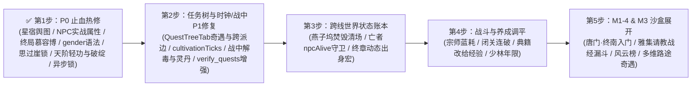

# 《北宋立志传》全项目深度审查报告 v2（基于 `ea3ad45`）

> **审查基线**：`HEAD: ea3ad45`（较上一轮 `8486e9e` 前进 40+ 提交）
> **体量与健康度**：`src/` 共 `114,937` 行 TS/TSX（其中 `src/data/quests/` 含 `121` 个文件 / `52,586` 行，注册 `63` 条任务链、累计 `1,532` 幕剧情与 `183` 场剧情战）；`npm run lint`（`oxlint` + 单文件护栏 + `verify_quests.mjs`）`0` 警告 `0` 错误；Vitest `18` 个测试文件 / `124` 条用例全绿；生产构建通过（`boot-core` 压缩后 `12.1 kB`）。
> **修复进度**：速查表全部 **7 项 P0 + 3 项 P1 真 Bug（共 10 项）** 及 **第一节代码重构与性能优化核心项** 已完成 ✅（Vitest `18` 个测试文件 / `125` 条用例全绿，含回归测试 [p0AuditFixes.test.ts](../src/engine/__tests__/p0AuditFixes.test.ts)），其余数值平衡与剧情跨线账本项待推进。

> [!IMPORTANT]
> 上一轮指出的 `engine/` 分层、Vitest 测试框架、`.scenes.ts` 拆分、跨版本存档迁移链、银钱物价锚与 `{reignYear}` 动态纪年均已高质量落地。本报告聚焦于**本轮大规模扩充（华山 22 卷、禁军 Lv.1→Lv.5 全线、8 派白纸入门重制）后新暴露的真实 Bug、新架构瓶颈、宗师局数值失衡及跨任务世界状态撕裂**。

---

## 〇、 已核实的高优真 Bug 速查表（建议优先热修）

| 状态 | 级别 | 领域 | 问题摘要与复现机制 | 代码定位 |
| :---: | :---: | :---: | :--- | :--- |
| ✅ **已修复** | **P0** | 任务/地图 | **星宿派入门后永久无法前往本门总舵昆仑山**：重制后的《星宿紫烟 · 投名血契》完结拜师时漏发 `ITM-MSC-022`《万山之祖昆仑雪域舆图》，全库无任何获取途径，导致星宿弟子在延安府结案后被大地图锁死在昆仑山外，无法回总舵闭关或挑战师兄晋升。*（修复：`491da1c`，星宿入门结案由门人赠予 `ITM-MSC-022` 并同步更新提示文案与校验）* | [itemsDb.ts](../src/data/itemsDb.ts#L771-L779)、[xingxiuEntryQuest.scenes.ts](../src/data/quests/sects/xingxiuEntryQuest.scenes.ts#L638-L649) |
| ✅ **已修复** | **P0** | 战斗数值 | **全库 1,052 名编目 NPC 实战属性与图鉴面板割裂**：图鉴面板展示 `deriveNpcEffectiveStats(dbRecord)`（武学+披挂派生值，如乔峰气血内力 ~10,000、身法 ~160），但进入战斗时 `npcNode.stats?.hp ?? dbEff.maxHp` 因 `npcs.json` 恒带裸 `stats` 而使 `?? dbEff` 成为死代码（乔峰实战仅 `HP 6080 / 身法 86`，被毕业玩家全程先手 + 满额 35% 闪避碾压）。*（修复：仅在剧情显式覆写 `npcNode.stats` 时沿用覆写值，常规编目 NPC 统一走 `deriveNpcEffectiveStats`）* | [combatants.ts](../src/engine/combat/combatants.ts#L169-L180)、[NpcStatsSheetPanel.tsx](../src/components/hud/npc/NpcStatsSheetPanel.tsx#L106-L120) |
| ✅ **已修复** | **P0** | 终局 Boss | **禁军大结局慕容博配装错乱**：`buildMurongBoFinalNpc` 将剑法 `MA-029`（玄铁重剑法）错填进 `qinggong` 轻功槽，内功填了 `MA-013`（先天功）而非文案宣称的 `MA-008`（斗转星移），且硬编码内力 `5800` 甚至低于普通版 `NPC-0104`（`7050`）。*（修复：改为 `MA-008` + `MA-097` 八步赶蝉，巅峰四维提升至 `hp 7800 / mp 7600 / agi 96 / res 88`）* | [jinjunFinal3Quest.ts](../src/data/quests/sects/jinjunFinal3Quest.ts#L33-L50) |
| ✅ **已修复** | **P0** | 异步竞态 | **`.scenes.ts` 懒加载窗口期四重竞态**：首次触发未缓存剧本走异步 `Promise` 时，`activeStoryScene` 在同步返回瞬间仍为 `null`，导致：① 行军途经（`isPassThrough`）不停车继续跨城狂奔；② 入城展昭缉拿 `activeCombat` 与随后落地的 `activeStoryScene` 叠窗；③ 连点按钮重复结算前置效果；④ 缺少 `.catch()` 断网静默失败。*（修复：引入瞬态 `pendingSceneLoad` 令牌锁、即时停行旅/关对话、`.then()` 令牌与战斗/结局门禁及 `.catch()` 错误恢复）* | [effectHandlers.ts](../src/engine/quest/effectHandlers.ts)、[navigationTravelSlice.ts](../src/store/slices/navigationTravelSlice.ts)、[questSlice.ts](../src/store/slices/questSlice.ts) |
| ✅ **已修复** | **P0** | 地点锁 | **思过崖秘洞锁 `getSpotLockMeta` 在三处入口被绕过**：驻留于 `tg_sg_cave` 的华山弟子（梁离/岳烟芷）可通过群侠图鉴「前往所在地点」直接瞬移进未解锁的思过崖秘洞，且该寻址入口落地后漏调 `fireLocationTriggersForCurrentSpot()`；任务寻路与读档净化亦漏检子点位锁。*（修复：三处入口全部强制校验 `getSpotLockMeta`，补齐 NPC 寻址落地触发器调用并修复大厅纯 toast 触发器短路问题）* | [navigationTravelSlice.ts](../src/store/slices/navigationTravelSlice.ts)、[saveManager.ts](../src/utils/saveManager.ts) |
| ✅ **已修复** | **P0** | 战斗公式 | **天阶轻功常态闪避在后期恒为 `+0%`**：`computeDodgeChancePreview` 对《凌波微步》（20%）/《神行百变》（12%）采用 `Math.max(dodge, override)` 取大值而非叠加，后期主角基础身法闪避已达 22%~35%，使天阶轻功常态闪避词条完全失效；且守御方**闪避未受击**时仍会反挂攻方【破绽】。*（修复：改为基础 35% 上限之上叠加并封顶 55%/65%；移除完全闪避分支的反挂破绽逻辑）* | [formulas.ts](../src/engine/combat/formulas.ts)、[resolveStep.ts](../src/engine/combat/round/resolveStep.ts) |
| ✅ **已修复** | **P0** | 文本插值 | **4 处 `{gender:...,...}` 逗号语法错误原样吐出花括号源码**：引擎正则仅识别竖线 `|`，华山入门 1 处与星宿入门 3 处误写为中文逗号；另有华山 Q18 串戏出现「五岳剑派遗骨 / 魔教十长老」。*（修复：修正全部逗号占位符与华山 Q18 时代错置文案，并在 `verify_quests.mjs` 增设静态正则护栏）* | [huashanEntryQuest.scenes.ts](../src/data/quests/sects/huashanEntryQuest.scenes.ts#L323)、[xingxiuEntryQuest.scenes.ts](../src/data/quests/sects/xingxiuEntryQuest.scenes.ts#L158)、[huashanJianDuguNineQuest.scenes.ts](../src/data/quests/sects/huashanJianDuguNineQuest.scenes.ts#L194-L208)、[verify_quests.mjs](../scripts/verify_quests.mjs) |
| ✅ **已修复** | **P1** | 任务树 UI | **生涯任务树过滤逻辑屏蔽了全部奇遇与跨派连线**：`selectSectQuests` 在无门派时仅取 `sect_entry`、入派后仅取 `factionId === sectId`，导致顶栏「江湖奇遇」「皇祐风云」Tab 点开为空白画布；且 `questGraphBuilder` 将水图/海图误写为不存在的 `'ITM-MAP-001/002'`（实为 `'ITM-MSC-020/021'`）。*（修复：`selectSectQuests` 收归 `questGraphBuilder.ts` 并始终并入全服 `adventure`/`main_story`/`city_story`，修正舆图 ID 为 `ITM-MSC-020/021`）* | [QuestTreeTab.tsx](../src/components/menu/tabs/QuestTreeTab.tsx)、[questGraphBuilder.ts](../src/engine/quest/questGraphBuilder.ts) |
| ✅ **已修复** | **P1** | 时钟/门派 | **闭关/抄经/打工跨月漏算【策论】俸禄加成 + 转派残留常山军令**：90% 跨月路径漏传 `celunSkill` 与秘境解锁守卫 `canMasterEnterNode`；常山弟子持举荐信转投五台山时 `activeLiaoSpy` 未清零，到期倒扣五台山贡献。*（修复：`cultivationTicks.ts` 全 6 条推进通道与 `clock.ts` 补齐 `celunSkill`/`deadNpcIds`/`canMasterEnterNode`；`joinSect.ts` 转派一律清零 `activeLiaoSpy`）* | [cultivationTicks.ts](../src/engine/time/cultivationTicks.ts)、[clock.ts](../src/engine/time/clock.ts)、[joinSect.ts](../src/engine/sect/joinSect.ts#L157) |
| ✅ **已修复** | **P1** | 战中状态 | **战中解毒未清零 `slowPct/weakPct` 幅度 + 战中服食永久灵丹结算残缺**：解毒只清回合数不清幅度，同回合再中低阶毒会复活旧高额减速/虚弱；战中服永久灵丹与行囊服药代码分叉，漏算多项十艺与上限钳制。*（修复：`resolveStep.ts` 解毒同步归零 `slowPct/weakPct`，`registry.ts` 的 `huagong_weak`/`dagou_slow` 改 `Math.max` 防降级；抽离共享纯函数 `elixirEffects.ts` 统一行囊与战中灵丹/十艺结算）* | [resolveStep.ts](../src/engine/combat/round/resolveStep.ts#L331-L340)、[registry.ts](../src/engine/combat/effects/registry.ts)、[elixirEffects.ts](../src/engine/stats/elixirEffects.ts)、[combatSocialSlice.ts](../src/store/slices/combatSocialSlice.ts) |

---

## 一、 代码重构与性能优化建议

### 1. P0：收口异步剧本状态机与统一空间准入守卫
1. ✅ **已完成｜原子化 `.scenes.ts` 异步打开流程**：
   - 已在 Store 增加瞬态锁 `pendingSceneLoad: { questId?: string; sceneId: string; token: number } | null`。
   - [`executeQuestEffectsBatch`](../src/engine/quest/effectHandlers.ts#L106) 遇到未缓存的 `openScene` 时，先设置 `pendingSceneLoad`、立即暂停 `traveling`、关闭 `activeNpcInteraction`，阻断窗口期重复点击；待动态 `import()` 解析且校验 `!gameOver && !activeCombat && token 匹配` 后再提交 `activeStoryScene`，并在 `.catch()` 中解锁且弹出错误提示。
   - 已修复 [`navigationTravelSlice.ts`](../src/store/slices/navigationTravelSlice.ts) 中大厅纯 `toast` 触发器短路跳过子点位正式剧情触发器的问题。
2. ✅ **已完成｜统一空间锁守卫**：
   - 已在 `navigateToNpcLeafInCurrentRegion`、`locateQuestTargetOnMap` 与 [`validateSaveEnvelope`](../src/utils/saveManager.ts) 接入 `getSpotLockMeta` 校验，并在图鉴寻址落地后统一调用 `fireLocationTriggersForCurrentSpot()`。
3. 🟡 **部分完成｜补强 `verify_quests.mjs` 静态护栏**：
   - ✅ 已新增 `{gender:...}` 逗号语法错误静态扫描；
   - ✅ 已新增 `REGION_UNLOCK_MAP_REQUIREMENTS`（`ITM-MSC-020/021/022`）全库 `giveItem` 可达产出校验；
   - ⬜ 待补：`markNpcsDead` × `npcAlive` 交叉守卫校验（结合第三节跨线亡者修复一并落地）。

### 2. P1：消除四大新膨胀模块的重复与耦合
1. ✅ **已完成｜剥离静态校验器，瘦身 `questEngine.ts`（1,855 行 → 1,054 行）**：
   - 已将 [`validateAllRegisteredQuests`](../src/engine/quest/questValidator.ts) 与 [`computeQuestMaxTenArtsGain`](../src/engine/quest/questValidator.ts) 共 ~810 行静态校验代码剥离至独立模块 [`questValidator.ts`](../src/engine/quest/questValidator.ts)，测试与 `verify_quests.mjs` 改为直接引用新模块，生产包 `useGameStore` 直接减重。
2. ✅ **已完成｜收敛六条时钟推进通道（[`cultivationTicks.ts`](../src/engine/time/cultivationTicks.ts)）**：
   - 已抽离统一纯函数 `stepSessionShichen(snapshot, opts)` 收拢十艺 / 藏经阁抄经 / 市井做工 / 百业当差 / 少林杂役 / 武学闭关全部 6 条推进通道，消除 `tickTenArtSession` 双次 `computeTimeAdvanceState` 调用，确保 `celunSkill`、`deadNpcIds` 与 `canMasterEnterNode` 永不漏传。
3. ✅ **已完成｜统一战斗 Debuff 幅度保护与灵丹结算纯函数**：
   - 已修复 `huagong_weak` / `dagou_slow` 的 `Math.max` 防弱覆盖强与 `curePoison` 同步归零 `slowPct` / `weakPct`；
   - 已将永久灵丹与十艺消耗品结算抽为共享纯函数 [`elixirEffects.ts`](../src/engine/stats/elixirEffects.ts)，统一 [`loadoutInventorySlice.ts`](../src/store/slices/loadoutInventorySlice.ts) 与 [`combatSocialSlice.ts`](../src/store/slices/combatSocialSlice.ts)。
4. ✅ **已完成｜修复两处 UI 与资源管理细节不一致**：
   - [`RegionCompendiumPanel.tsx`](../src/components/menu/RegionCompendiumPanel.tsx#L476) 左侧列表人数已改用 `filterLivingNpcs` 过滤 `deadNpcIds` 后的计数，对齐右侧面板；
   - [`LoadoutTab.tsx`](../src/components/menu/tabs/LoadoutTab.tsx#L246-L250) 槽位小图标已统一改用 `<ManagedAssetImg>`，复用 Blob 引用计数池。

### 3. P2：分包重平衡、DSL 降噪与数据管线归位
- ✅ **已完成｜重平衡 Vite 任务分包（[`vite.config.ts`](../vite.config.ts)）**：已拆分独立 chunk `data-quests-huashan`（`171.29 kB` / gzip `39.07 kB`），`data-quests-sects-1` 由 `223.3 kB` 降至 `52.45 kB`（gzip `15.88 kB`）。
- ✅ **已完成｜任务触发器 DSL 宏降重**：已在 [`dsl.ts`](../src/engine/quest/dsl.ts) 新增 `bindSceneTrigger` 统一绑定进场触发器/据点按钮/NPC 动作，并在 [`questEngine.ts`](../src/engine/questEngine.ts) 的 `interpolateStoryText` 新增 `{ifFlagEq:key=val|A|B}` 条件插值宏。
- 🟡 **部分完成｜反转 `engine -> data/itemsDb` 依赖与商铺入管线**：
  - ✅ 已将 `computeEquipmentTotals`、`getEffectiveTalents`、`computeWeaponArtSynergy` 迁至 [`src/engine/equipment/equipmentStats.ts`](../src/engine/equipment/equipmentStats.ts) 并更新引擎层引用（`itemsDb.ts` 保留兼容重导出）；
  - ⬜ 待做：`spotShops.ts`（858 行）纳入 Markdown→Python 编译管线与 `RARITY_STYLE_MAP` 样式拆分。
- 🟡 **部分完成｜状态隔离与深拷贝**：
  - ✅ 已在 [`uiSaveSlice.ts`](../src/store/slices/uiSaveSlice.ts) `loadFromEnvelope` 中对 `equipped`/`equippedArts`/`learnedArts`/`inventory` 执行 `structuredClone`（`sectState`/`questState` 走专用深拷贝）；
  - ✅ 已在 [`bgmManagerCore.ts`](../src/utils/bgmManagerCore.ts) 空闲驱逐回调中复位 `battlePreloadScheduled = false`；
  - ⬜ 待做：`SystemMenuModal.tsx` 顶层筛选状态 `useReducer` 重构。

---

## 二、 游戏玩法机制与数值系统设计建议

### 1. 战斗系统重构后复盘：从 Lv.1-3 好玩走向 Lv.4-5 宗师局同样紧凑
上一轮守御重构与大类本能已让前中期战斗明显更有章法，但经数学验算，当前版本在**对称盲选期望**与**绝顶局（Lv.4-5）缩放**上存在四个新失衡点：

1. 🟡 **部分修复｜守御两回合净收益仍亏 `-0.25D` + 闪避空手套【破绽】**：
   - 同伤 $D$ 对局中，R1 乙守御受 $0.5D$、R2 乙反击打 $1.25D$ 同时受 $1.0D$，两回合乙失 $1.50D$、甲失 $1.25D$，主动守御仍净亏 $-0.25D$（遇刀/棍亏 $-0.40D$）。
   - **调整公式**：① ✅ **已修复** 仅当守御方实际受击（未闪避）时才令攻方陷入【破绽】；② ⬜ 待调：将【破绽】易伤从 `+25%` 提升至 **`+35%`**，且守御成功格挡受击时返还攻方招式内力消耗的 `20%` 为自身内力，使预判守御真正正收益。
2. ⬜ **修复宗师局「蓝条无限溢出」与「吸内二次方统治」**：
   - 当前 `mpCost = moveDamage * 0.35`（天阶 10 重仅耗 `475~732 MP`），而绝顶主角 `maxMp` 达 `9,500~11,500`，30 回合根本打不空内力；同时当前 `mp` 既决定攻方真气催动 $1 + \sqrt{\text{mp}}/50$（`2.90×`），又按 `mp * 0.16` 提供高达 `+1,440` 点护体防御，导致《北冥神功》/《化功大法》百分比抽内在绝顶局兼具削攻与破甲双重雪崩收益。
   - **调整公式**：
     $$\text{mpCost} = \operatorname{round}\!\left(\text{moveDamage} \times 0.32 + \text{maxMp} \times k_{\text{tier}}\right), \quad k_{\text{tier}} \in \{0.01, 0.02, 0.03, 0.045\}$$
     使天阶大招每合消耗约 `9%~11%` 内力上限，逼迫宗师战在 8~10 回合内必须调息守御或轮换低耗招式；并将守方内力护体改为封顶软饱和 `min(900, sqrt(mp) * 8.5)`。
3. 🟡 **部分修复｜天阶轻功闪避叠加化 + 弱势大类本能重做**：
   - ✅ **已修复**：《凌波微步》《神行百变》已改为在基础身法 35% 上限之上叠加（总上限常态 55% / 守御 65%）。
   - ⬜ 待调：**枪法本能**由「后手增伤 +20%」（与提速鞋/轻功负协同）改为 **「长兵寸强：对拳/指/暗器/短兵类招式或刚换招目标增伤 +15%」**；**刀/棍本能**改为「常驻无视 10% 护体，对守御架势增伤 +35%」；**毒功持续伤**去掉二次 `resFactor` 折算；**《弹指神通》震腕**扩展为封锁目标「上一回合刚施展的外功槽位」1 回合。
4. ⬜ **堵住 AI 探囊重置诱导与永久灵丹战中误吃**：
   - [`initiative.ts`](../src/engine/combat/round/initiative.ts#L69-L70) 中使用丹毒（`item`）不再归零 `consecutiveMoveRounds`（防止「二招一药」骗 AI 32% 空守），并允许宗师级 NPC 每战至多使用 `1~2` 次门派特色丹药/奇毒；
   - 战斗探囊面板过滤掉永久加属性上限的天地灵丹（仅限战外服食）；
   - 给 **28 把弓箭（`BOW-*`）** 增加实质机制：首回合开场自动触发一次不占行动的「弯弓先射」远程追击（按 `bow.attack * (1 + riding/100)` 结算），不再把弓箭攻击力白加给空手拳掌。

### 2. 养成节奏、战经断层与「囤书陷阱」调优
1. ⬜ **弥合「有剧本门派 vs 其余 31 派」的战经（`combatExp`）鸿沟**：
   - 练满 6 门地/天阶功法约需 `9,000 ~ 13,500` 战经。禁军全线共发 `29,275` 战经（溢出 2 倍），华山 22 卷发 `9,160` 战经（刚好够用），而**其余 31 门派与散人剧本战经近乎为 0**，靠单场切磋（15~50）或甲等缉凶（95）需机械重复 **220~350 场**！
   - **建议**：① 宗门二月大比夺魁/入围奖励补发 `250 ~ 600` 战经；② 每位宗师/长老首次切磋十合不败设有「首胜印证奖」（一次性 `+120 ~ +350` 战经，记录于存档集合），鼓励周游天下访友问剑而非原地刷同一人；③ 禁军线单篇战经奖励适度下调 35%。
2. ⬜ **闭关交互减负（108 次点击 → 6 次点击）+ 少林年限回调**：
   - 在演武场/客栈闭关新增 **「连修带破（战经充足时自动破境续修至十重或盘缠耗尽）」** 开关；
   - [`promotion.ts`](../src/engine/sect/promotion.ts#L215) 中少林寺晋升 Lv.4 禅武尊宿要求在寺 **`7,200` 天（整整 20 年！）**，远超 8~12 年正常通关周期，建议下调为 Lv.3 `365` 天、Lv.4 `1,080` 天（3 年），并允许佛学经义或伏魔功绩抵扣年限。
3. ⬜ **根治十艺「囤书陷阱」与雅器秒换宏**：
   - 当前百卷典籍直接 `+等级`（如字画直加 `+50` 级），而书院经验曲线为 $18 \cdot L^{1.8}$，`70→90` 级所需经验是 `0→20` 级的 **5.4 倍**，导致早读书血亏、玩家被迫囤书不读。**建议将典籍改为授予固定十艺经验值（并附首次品鉴感悟文案）**，无论何时展卷总收益完全等价。
   - 为雅器槽（`curio1/2`）增加「佩满 3 日气机相合方激活十艺/禀赋加成」规则（或限定仅在客栈/本门整备时更换），消除买药换算盘、题壁换诗卷的繁琐换装套利。

### 3. 中后期银钱沉淀池与 M3（社交 / 风云榜 / 秘境）系统咬合方案
开局半年经济紧凑感很好，但 Lv.3 后玩家普遍沉淀 `8,000 ~ 25,000` 两纹银，而开封六月大集 5 件地阶孤品全包仅需 ~1,900 两且买完绝版。建议用即将推进的 **M3 三大模块**直接承接银两消耗与 31 派沙盒可玩度，无需为每派写 22 个线性剧本：

- **门派非对称破局（「1+3 门派轻脊梁 + 四大生态母版」）**：
  - 剩余一流门派每派仅写 **1 篇入门 + 3 篇关键晋升拐点**；日常 Lv.2→4 晋升体验由四大系统化母版驱动：**佛道清修系**（开坛讲经/护寺伏魔）、**侠义江湖系**（抗辽截粮/联防义举）、**世家官府系**（门客派遣/卷宗断案）、**邪魔奇门系**（神鼎炼毒/暗杀悬红/夜劫大集孤品）。
- **M3-2 确定性人脉社交（核心银两与战经转化器）**：
  - **曲水流觞雅集**（每季耗银 `300 ~ 1,200` 两）：邀同城 3~5 位名宿比拼指定十艺，胜出获全员好感 `+15` 与秘藏线索；
  - **备礼请教 / 拆招授艺**：好感 `≥ 80`（义结金兰 `≥ 90`）且契合对方十艺偏好，奉上束脩名礼并切磋十合不败，可请教其**非镇派独门良/地阶武学**或获赠 **`+300` 战经心得**；
  - **死仇寻仇链**：决斗击杀 NPC 写入 `deadNpcIds` 后，其同门师长与至交好感立降 `-80` 转入死敌池，按月触发官道寻仇截杀与反向衙门通缉。
- **M3-3 天下风云榜与实体化游历**：
  - 以派生有效面板计算动态战力分（自动过滤 `deadNpcIds`），每月放榜 **《皇祐天骄榜》（≤25 岁）、《九州宗师榜》、《朝廷海捕恶人榜》**；
  - 将大地图 `roamingMasters` 真正注入目标州府酒楼/名胜的子点位名册供当面交互；《恶人榜》前十联动州府衙门刷新高难「紫金海捕榜」。
- **M3-4 秘境连战与多维行路奇遇**：
  - 将目前仅 3 条固定文本的 `ROAD_EVENTS` 扩充为按 **七大地域风貌 × 节气 × 十艺/禀赋暗骰** 的 30+ 轻抉择卡；
  - 将燕子坞、桃花岛、昆仑雪域等解锁区域升级为需筹措向导费与破阵器具的**多层探索秘境**；并在开封六月大集增加每年常驻刷新的高价消耗拍品（名师讲武帖、传功残页、绝品丹材匣）。

### 4. 文档与代码口径漂移清单（已全部对齐 ✅）
- ✅ **已修复**｜[ROADMAP_AND_TODO.md](./ROADMAP_AND_TODO.md#L10)：已将顶部快照与 M1 进度对齐为 `246 武学 / 33 门派 / 1,052 NPC / 64 条任务链`、三次方闭关公式 `0.35 + 3.65*(T/100)^3`，并保留最新重制后的峨眉/青城/唐门任务卷名。
- ✅ **已修复**｜[GAME_MECHANICS.md](./GAME_MECHANICS.md#L47)：已将行军耗时公式改为与 `mapMath.ts` 一致的同括号加算与骑术地形减速抵消公式，并将查拳馆/怒潮帮入门束脩统一对齐为 `20 两`。
- ✅ **已修复**｜[MARTIAL_ARTS_STATS.md](./MARTIAL_ARTS_STATS.md#L3)：已在战斗结算模式锚定句补齐「探囊取物［每场限用 3 次丹药毒物］」。

---

## 三、 游戏剧情发展与叙事连续性建议

### 1. P0：修复六大跨任务世界状态撕裂（「活尸登场」与「平行宇宙失忆」）
当前全库共有 9 处 `markNpcsDead`（累计处决 54 名具名 NPC），随着长篇支线交织，出现了六处必须止血的连续性穿帮：

1. ⬜ **燕子坞焚毁后的「活尸包不同」与「21 名慕容门人照常营业」**：
   - 在禁军 `MURONG-ARC-3` 处斩四大家将并焚毁燕子坞后：① 若玩家此前已接取《燕子坞水图》停在半途，回太湖渡口合成水图时**已被枭首的包不同（`NPC-0213`）会摇舟复活迎客**；② [`npcDeath.ts`](../src/engine/social/npcDeath.ts#L31-L42) 的 `isNpcAbsentFromWorld` 仅屏蔽了慕容博父子，`SECT-10` 其余 **21 名门人（含燕子坞内 12 人）仍完好站在“已烧成白地”的水榭内**。
   - **修复**：`jj_mr3_yanziwu_razed` 置位后将燕子坞驻地 `SECT-10` 门人全部纳入缺席过滤（并自动完结/旁白改写半途的《燕子坞水图》）。
2. ⬜ **跨线亡者复活（摘星子 / 史万山 / 樊威渊）与沙盒决斗软死锁**：
   - 禁军《邕州道》阵斩摘星子（`NPC-0181`）后若辞官赴延安触发《星宿紫烟》，摘星子原地复活训话；禁军《太行剿匪·叁》处决史万山（`NPC-0229`）、樊威渊（`NPC-0681`）后若赴大名府做《铁锁镇河朔》，二人死而复生。此外，全库有 **21 条任务**的关键接引人未加 `npcAlive` 守卫，沙盒 `duel` 击杀后会导致任务悬空卡死。
   - **修复**：补齐 `npcAlive` 守卫（或为未完结主线关键接引人设沙盒决斗「重伤惜败不死」保护）。
3. ⬜ **禁军终章硬编码「常山枪派」出身篡改玩家履历**：
   - [`jinjunFinal3Quest.scenes.ts`](../src/data/quests/sects/jinjunFinal3Quest.scenes.ts#L70) 第 70、168、386、485、576 行未加条件判断，直接让慕容博怒斥「常山小儿」、主角自述「自白沟河畔起步，历常山、六扇门、禁军」，导致白身或八极门出身玩家直接穿帮。应改为 `{ifQuestDone:QST-SECT-22-LONGLING|...|...}` 动态履历插值。
4. ⬜ **六扇门→禁军破燕失忆 & 雁门关后萧峰分身**：
   - 在 `jinjunMurongArc1` 补入 `{ifQuestDone:QST-SECT-17-MURONG-2|...}` 承接六扇门旧案，避免王德用与主角初见苏绣丝帕时假装初闻慕容氏；
   - 补写 `FINAL-1`（杏子林未揭身世）到 `FINAL-3`（突然旁白带过“已复姓为萧”）之间的军情通报过渡，并在 `FINAL-3` 萧峰远走塞外后于 `isNpcAbsentFromWorld` 屏蔽洛阳杏子林的 `NPC-0110`；
   - 统一华山 Q18 与禁军 `FINAL-1` 中两套数值/立绘打架的临时 NPC `段延庆`。

### 2. P1：1050 皇祐正典校准与北宋细节打磨
- ⬜ **统一天龙人物年龄口径**：[`AGENTS.md`](../AGENTS.md#L12) 仍写「少年乔峰」，而图鉴为 30 岁帮主、丐帮入门写「二十出头」、华山论剑写「三十来岁」。建议正式确立 **「天龙正篇整体前移约 40 年至仁宗皇祐—嘉祐朝」** 的校准基准（如此原著耶律洪基 1055 即位、1063 平重元之乱均与史实严丝合缝），统一乔峰开局为 26~30 岁壮年帮主，并修正 `AGENTS.md`。
- **微调五处宋制与原著穿越词句**：
  1. ✅ **已修复｜华山 Q18 思过崖**：已将 [`huashanJianDuguNineQuest.scenes.ts`](../src/data/quests/sects/huashanJianDuguNineQuest.scenes.ts#L194-L208) 残留的「昔日五岳剑派遗骨 / 魔教十长老」统一改回 Q13 已确立的「天圣年间华山气剑两脉前辈遗骸」；
  2. ⬜ **「苏州平江府」**（`jinjunMurongArc1/3`）：政和三年（1113）方升平江府，皇祐年间应统称 **「苏州 / 苏州府（平江军）」**；
  3. ⬜ **「军器监督造神臂弓」**（`jinjunMurongArc1`）：军器监复置（1073）与神臂弓献图的熙宁年代晚于皇祐约 20 年，建议统一按 `FINAL-2` 口径表述为 **「三司胄案 / 弓弩院秘研踏张神臂弩试作图」**；
  4. ⬜ **汴京行贿塞「交子」**（`jinjunMurongArc1:82`）：皇祐官交子仅限川峡铁钱区，汴京宜改为 **「榷货务便钱交引 / 金叶子」**；
  5. ⬜ **终章官阶撞车**（`jinjunFinal3:439`）：皇祐五年狄青平岭南正拜枢密使，主角宜受封 **「检校太尉 · 同知枢密院事（或殿前都指挥使领节度使）」**，或交代与狄青文武并相，更添史实厚重感。

### 3. P1：扭转「单按钮翻页器」与终章过场膨胀，重塑有效抉择
- ⬜ **提升交互密度（当前 1,532 幕中仅 99 幕含 ≥2 选项，占比 6.5%）**：华山中后期（Q03~Q22）与禁军破燕/终章大量沦为单按钮连续翻页；`FINAL-3` 在雁门关斩慕容博后更是连播 **26 幕零抉择过场**。建议：① 将单次非交互连播压缩在 4~5 幕以内；② 在断案、交涉、破阵幕补入 **十艺百工多路分支**（如樊楼查账检定 `算术`、同文馆舌战检定 `辩才/经义`、秦州验马检定 `骑术`，可智取免战或解锁隐藏线索）。
- ⬜ **用「代价与因果」替代「答错一题永久封死山门」**：目前多派入门终考采用零提示四选一，选错即置 `*_entry_failed` 永久拒之门外。建议改为「答偏者罚挑水/抄经/受杖三日后重考，或带着『桀骜/迂阔』师门印记入门」，保留戏剧张力而不粗暴剥夺玩家内容。

### 4. P1-P2：后续门派叙事体裁差异化与 M5「四道合流」架构
避免再写 20+ 卷同质化门派长篇，后续优先补齐尚缺入门或正传的核心门派时，每派锁定**独占叙事体裁**：
- **`SECT-13` 蜀中唐门（缺入门，P0）**：**家族宗房夺权 × 机关毒谱工坊 × 刺杀契约伦理剧**（调动 `算术/抗性` 拆解连环机括，区别于星宿的无底线嗜杀）。
- **`SECT-11` 终南隐宗（缺入门，P0）**：**盛唐古墓秘仪解谜 ×「终南捷径（入仕）」与「守静出世」道统分裂剧**。
- **`SECT-01` 少林寺 & `SECT-02` 丐帮（补 3 篇晋升脊梁，P1）**：少林走 **「七十二绝技盗经罗生门 + 戒律公案推理 + 扫地僧化戾气」**（高 `经义/悟性` 可佛法渡化免战，正面联动藏经阁慕容博/萧远山）；丐帮完整收回 **「马大元命案追凶 + 净污二派路线之争 + 民间抗辽谍网」** 主视角。
- **M5 四道跨阵营共享大事件合流**：以 **正统江湖道**（共享《少室山英雄大会》《绝顶论剑》）、**朝堂王师道**（禁军武线 + 待拓士林幕僚十艺文线）、**草莽逆命道**（绿林/铁掌/漕帮/星宿：抗官聚义 vs 招安抗辽）、**四夷潜龙道**（解锁慕容/一品堂/辽暗桩/大理，以对手戏暗战视角切入同文馆、杏子林与雁门关）四条轨道，复用同一批历史与江湖大事件节点导向双终局与《宋史列传》式结局卷轴。

---

## 四、 推荐落地顺序

