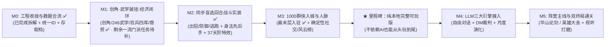

# 《北宋立志传》— 全局研发路线图与 Todo 进度总表

> **定位**：本文档汇总了跨会话分支的所有已完成工作，诊断当前距离“真正可玩（Playable）”的核心缺口，并作为后续唯一的主任务追踪看板（Single Source of Truth）。

---

## 一、 现状盘点与核心诊断：为什么感觉“东一榔头西一棒子”？

> [!NOTE]
> **本节为 M0 立项时（早期原型阶段）的历史诊断快照**，其中“216 武学 / 30 门派 / 1,000 人 / 8×8 战棋”等表述反映当时状态，现已由 **246 门武学、33 大门派、1,052 名 NPC 与同步盲选回合制战斗**取代；最新进度以下方【八大核心模块】表格与各阶段勾选为准。

通过盘点现有分支（地图与空间主线 [分支 165aeb2d](conversation://v1/default/jetski_remote_agents_3p/165aeb2d-47c6-4ae8-9373-51acdcc9d87b) 与人物群像主线 [分支 222a70e6](conversation://v1/default/jetski_remote_agents_3p/222a70e6-fab2-424a-aeea-38a28a2e1fd7)），目前项目的真实画像非常清晰：

> [!IMPORTANT]
> **一句话诊断**：**世界观设定与视觉资产已完成约 75%，但驱动游戏的“可玩规则闭环”仅完成了约 12%（目前仍停留在地图漫游 + 点击加减几点数防的静态演示壳子）。**

### 当前暴露出的三大痛点
1. **横向铺量远超纵向闭环**：已经铺开了 **1,000 名独立人物**、**216 门武学名录**、**38 张地区手绘全景图**、**58 张特殊建筑半 3D 内景图** 和 **100+ 张人物画作**，但玩家还无法“创建角色 → 习得并装备一门武功 → 打一场真正的 8×8 战棋 → 获得战利品存盘”。
2. **多分支数据开始分叉**（注：已在 M0-2 完成合并）：
   * 地图分支的 [GAME_MECHANICS.md](./GAME_MECHANICS.md) 已将宋辽夏 19 城统一为三字府名（如 `开封府`、`洛阳府`、`泉州府`）；
   * 人物分支的 [CHARACTER_COMPENDIUM.md](./CHARACTER_COMPENDIUM.md) 中，1,000 名 NPC 的常驻地已完成归一并接入主地图。
3. **单文件 HTML + Base64 架构触顶**（注：已在 M0-1 拆解为模块化工程）：早期单文件原型体积曾膨胀至 **19.7 MB** + **4.1 MB**，现已拆分为 `Vite 8 + React 19 + TypeScript 7` 模块化架构与 `public/assets/` 静态懒加载。

### 八大核心模块当前进度总览

| 模块领域 | 当前进度 | 已完成资产 | 距离“能玩”的核心缺口 |
| :--- | :---: | :--- | :--- |
| **1. 世界观与规则总纲** | `100%` | 时空背景、十二时辰历法、33 门派（21 一流［含独立分立的 `SECT-33` 大宋禁军］+ 12 二三流）、三维/四维/战斗经验资粮、按日闭关与破境公式、九槽披挂与四库行囊、双终局设定齐全 | **规则总纲已全面定稿** |
| **2. 宏观舆图与移动系统** | `95%` | 华夏东亚全景 SVG、语义缩放、寻路、按日/时辰骑马行军（与坐骑槽及粮草/宿费联动，骑术抵消塞外蜀道减速）、旷野安营闭关、43 地区全景（43 手绘全齐）全齐 | 路途奇遇事件池待扩充 |
| **3. 地区建筑与室内交互** | `88%` | 43 地共 147 座特殊建筑（含全部 33 大门派驻地）+ 121 座基础建筑全量入库；268/268 实景内景 100% 覆盖，已实装商铺分类买卖与二次确认弹窗、客栈休整闭关、衙门缉凶 | 剩余一流门派专属入门任务链持续扩充中 |
| **4. 工程架构与存取档** | `100%` | 已完成 M0 全阶段并升级至 `M1.5.5` 存档结构：完整序列化时辰、战斗经验、9 槽披挂、6 槽运使武学、所习武学重数、任务状态与四库行囊 | **Phase M0 已圆满收官** |
| **5. 角色养成与武学系统** | `95%` | 已实装开局创角（`CharacterCreationModal`）、1.5× 宽幅菜单、【壹·主角面板】、【贰·披挂与武学（闭关结束自动回返本页）】、【叁·行囊四库】、246 武学数值化与全套商贸经济 | 待补充更多一流门派天阶传承任务 |
| **6. 同步盲选回合战斗** | `100%` | 已实装 `CombatOverlay` 六择一同步盲选、`combatEngine.ts` 双轨护体与 37 门天阶特效、AI 心理博弈、切磋/生死决斗与 `GameOverModal` | **Phase M2 已圆满收官** |
| **7. 1052 群侠生态与社交** | `65%` | 1,052 人全量入库并精确挂载至 43 地区最末层建筑；7 大图鉴均支持跨栏保留筛选状态；已实装 9 类性格对白、好感度、赠礼筛选与切磋/决战 | 待补充义结金兰、雅集论道与《天下风云榜》 |
| **8. LLM 引擎与主线终局** | `15%` | 已实装多段任务引擎（`questEngine.ts`）及 64 条门派/城池/奇遇剧情线 | LLM 三大引擎与双终局主线待接入 |

---

## 二、 破局研发策略与两条铁律

> [!TIP]
> **防跑偏铁律 1（主支线彻底解耦）**：从现在起，**暂停一切散装生图任务**。5 座新辟州府全景（已实装青绿营造 SVG 矢量全景兜底）、剩余 89 座建筑内景图（已实装宋式营造 SVG 矢量室内图兜底）和剩余核心人物立绘（已实装门派母版与古籍名牌兜底）统一放入文末 **【异步美术积压池】**，绝不阻塞代码可玩闭环。
>
> **防跑偏铁律 2（先骨骼跑通，后上 LLM）**：在 M0~M3 阶段先把确定性数值玩法彻底做扎实——确保即便断网、不调大模型，这也是一款能创角、跑图、拜师、打回合心理博弈战、刷秘籍、冲排行榜的好玩《立志传》；M4 再接入 LLM 让对话和奇遇产生化学反应。

---

## 三、 分阶段研发 Todo List（主线进度追踪）

### 阶段 M0：工程底座收拢与跨分支数据合流（✅ 已全部完成）
> **阶段目标**：终结多分支各自为战与 20MB 单文件膨胀问题，在工作区建立标准模块化 Web 工程，跑通现有地图浏览并支持真实存取档。

- [x] 完成《北宋立志传》核心机制总纲、30 门派专卷、216 武学名录、43 地区建筑名录、1000 人物全录与百兵谱六大设定文档
- [x] 完成宏观《华夏山海全景舆图》与全部 43 处地区等轴全景（38 手绘 JPG + 5 青绿营造 SVG）
- [x] **[M0-1] 初始化标准前端工程**：已在 `/home/antigravity/northern-song-chronicles` 搭建 `Vite 8 + React 19 + TypeScript 7 + Tailwind CSS v4 + Zustand 5` 模块化工程；完整抽离独立 JPG 静态原画至 `public/assets/{regions,buildings,characters}/`，代码包内嵌 Base64 降至 `0 B`，实装 `useLazyImage` 按需懒加载与实时资源监控面板
- [x] **[M0-2] 统一跨分支标准 ID 字典**：已建立 `src/data/idRegistry.json`（43 地区 `REG-01..43`、30 武林门派 `SECT-01..30`［20 一流大派 + 10 二三流门派］ + 11 朝堂四夷组织 `ORG-01..11`、216 武学 `MA-001..216`、`WPN-001..100`），1,000 名 NPC 零悬空引用
- [x] **[M0-3] 编译结构化游戏数据库**：已编写可复现构建脚本 `scripts/compile_game_db.py`（`npm run build:db`），将六大 Markdown 文档编译为严格 TypeScript 类型的静态数据包（`regions.json`、`buildings.json`、`martial_arts.json`、`weapons.json`、`npcs.json`）及索引层 `src/data/gameDb.ts`
- [x] **[M0-4] 移植三层空间视图与真实存取档**：已打通 `天下舆图 → 43 地区全景 → 全部 147 座特殊建筑内景（58 手绘 JPG + 89 宋式营造 SVG 矢量内院）` 无缝切换，挂载千人名录与 216 武学总纲检视，并基于 `IndexedDB + localStorage` 实装 1 自动槽 + 6 手动槽存档、读档、抹除及 `.json` 存档文件导出/导入校验

---

### 阶段 M1：三大角色核心卷宗 UI、创角出身、246 武学数值化与养成经济闭环
> **阶段目标**：先把全局顶部状态 HUD、1.5× 宽幅行囊枢机菜单（【壹·主角面板】【贰·披挂与武学】【叁·行囊四库】独立三卷）与图鉴品鉴体验打磨到位，再推进创角、246 武学 1~10 重数值表与城市门派养成闭环。

- [x] **[M1-0] 全局顶部状态栏（HUD）、1.5× 宽幅枢机菜单与三大核心面板拆分重构**：
  - **顶部常驻状态栏（Top Status HUD）**：常驻显示【年月日 + 十二时辰】、主角【气血】【内力】进度条与【战斗经验】【资金（纹银）】【粮草（干粮）】
  - **枢机菜单长宽 1.5 倍扩容（`1536px × 975px` 响应式宽幅展卷）**，并将前三大核心功能重构为清晰独立的三卷：
    1. **【壹·主角面板】**：独立呈现少侠全身绘像（支持点击放大）、气血/真气进度条与【战斗经验】印证栏、实战交锋四维合计（装备+武学实时叠加）、先天三维禀赋、官道行军脚力与北宋十艺百工修为
    2. **【贰·披挂与武学】**：上半卷为 **9 槽位可视化纸娃娃装备栏**（武器、服饰、鞋履、弓箭、双配饰、双雅器、坐骑）；下半卷为 **6 槽位主角武学运使台**（1 主运内功 + 1 轻功身法 + 4 出战招式）及 **少侠所习武学全表**（支持 1~10 重火候进度检视、仅限【本门演武场 / 客栈 / 野外扎营】三类场所按日闭关精修、消耗【战斗经验】破境升重、切换运使实时重算实战属性与轻功行军提速）
    3. **【叁·行囊四库】**：【典籍书画】（已扩充实装皇祐百卷典录：10 天阶 + 20 地阶 + 30 良阶 + 40 凡阶共 100 卷；武学秘籍仅限初次展卷领悟第 1 重入门，熟练度与重数统一由按日闭关与战斗经验破境提升；经史字画与雅器修习提升十艺根基）、【丹药毒物】、【雅器百工】、【行囊杂物】四大分栏，同步实装裸身根基 `baseStats` 纯函数派生与最新 `M1.5.0` 存档结构
  - **【肆·群侠图鉴】立绘尺寸统一与高清放大灯箱修复**：修复不同人物全身像因下方长文本挤压导致大小不一的 Bug（锁定 `3:4` 标准立轴画框 `shrink-0`），并为全部人物立绘与头像实装**点击全屏高清放大灯箱**（支持全身绘卷/半身头像一键切换品鉴）
- [x] **[M1-1] 开局创角与出身系统 ✅**：已实装标题页 `StartScreen.tsx` 与创角弹窗 `CharacterCreationModal.tsx`（姓名/随机取名、10 套主角男女立绘挑选、240 点三维禀赋 `根骨/悟性/颜值` 分配（单项 70~90）、100 点骑术与九艺分配（单项至多 40）、初始 150 两纹银与开封府启程）
- [x] **[M1-2] 246 门武学十一大类重构、12 档按日闭关总经验曲线与战斗经验破境表定稿 ✅**：统一收拢为 **内功、轻功、拳掌、指法、剑法、刀法、枪法、棍棒、毒功、暗器、音功** 十一大类，定稿强天赋三次方公式 `0.35 + 3.65*(T/100)^3`（内功额外享经义修为加成）、四阶十二品内功 `30万~150万` / 外功轻功 `1/3`（`10万~50万`）总经验、前五重 `35%` 阶梯曲线与良/地/天阶【战斗经验】破境门槛（详见 [MARTIAL_ARTS_STATS.md](./MARTIAL_ARTS_STATS.md)），并同步接入前端面板（闭关结束/提前收功均直接返回【披挂与武学】）
- [x] **[M1-3] 披挂与四库总纲分卷定稿及城市商贸经济闭环 ✅**：
  - [x] **[M1-3a] 清空旧版占位披挂并定稿《皇祐披挂总纲 · 第一卷：百兵谱》100 种武器**：已彻底移除早期 14 件 `ITM-EQP-*` 占位装备，建立 [EQUIPMENT_COMPENDIUM.md](./EQUIPMENT_COMPENDIUM.md) 单一事实源并接入 `scripts/compile_game_db.py` 生成 `src/data/weapons.json`（`WPN-001 ~ WPN-100`：严格 **10 天阶 / 20 地阶 / 30 良阶 / 40 凡阶**，涵盖剑/刀/枪/棍棒/拳掌护手/暗器/奇门音兵七类，实装【兵武共鸣】、天阶佩戴门槛校验与【陆·披挂总纲】百兵图鉴面板）
  - [x] **[M1-3b] 清空旧版占位书卷并定稿《皇祐四库 · 典籍书画百卷录》100 种典籍书画**：已移除旧版 6 件示例典籍，于 `src/data/scrollsDb.ts` 完整设计 **100 卷典籍书画（严格 10 天阶 / 20 地阶 / 30 良阶 / 40 凡阶）**，并在行囊面板实装【随身藏卷 / 皇祐百卷总录】双视图检索
  - [x] **[M1-3c] 后续五卷披挂（服饰/鞋履/弓箭/双配饰/坐骑）及丹药雅器定稿与城市商贸交易 ✅**：已完成全套披挂与四库入库，并实装 `spotShops.ts` 各地马市、铁匠铺、药铺、书肆、市集与门派军械库分类买卖及「商贸采办确认」批量选购弹窗
- [ ] **[M1-4] 建筑功能实装与 33 门派三级拜师出师体系**（三流、二流门派与部分一流/奇遇任务链已完成 ✅，其余一流门派独立入门任务链待做）：
  - 基础五建筑闭环（已完成 ✅）：衙门（州府【悬赏缉凶榜】：散人每月可揭丙/乙/甲三等榜文，赚取银两、战斗经验与侠义 ✅）、客栈（投宿恢复气血/内力、异乡每日宿费 1~2 两纹银［本门驻地城市免宿费］、发起闭关修炼与存档）、拳馆/武堂（演武磨砺与传授凡品把式）、书院（修习十艺）、酒楼（打听情报与饮酒结交）；已移除白嫖式「门派当差」按钮
  - **门派五级职阶与 246 门武学门槛（已完成 ✅）**：全势力统一 5 阶职阶（外门 / 内门 / 真传 / 长老 / 掌门，真传与长老习武同权；良阶上品起需内门、地阶上品起需真传/长老、天阶上品唯掌门可学；南少林共享少林外门与内门武学；逍遥/慕容/桃花岛/大理皇室不收外门直入内门并备齐内功，其余各派皆保底外门内外功）；**2026-11 起除开封府/六扇门（`SECT-17`）外，一流大派武学不再按职阶从门派名录自取，一律由本门剧情任务亲授（`isSectArtCatalogQuestOnly`），二三流门派仍按职阶领取**
  - **少林 / 华山 / 终南新手期减负（2026-11 ✅）**：少林按职阶月发常住单银（Lv.1~4：1 / 3 / 5 / 10 两）且门人寺内修习十艺免束脩；三派剧情围攻护栏——同时围攻的敌人须比任务推荐修为下限低两档以上，否则改为 `format: 'gauntlet'` 车轮连战（逐阵单挑、阵间回复三成），由 `sectQuestDifficulty.test.ts` 校验；图鉴境界高于剧情设定的对手以 `realmCap` 压低；少林/华山开蒙首章即传良品轻功《穿云纵》，少林另配一套良阶披挂配饰（旧档可向师兄补领）；江湖任务追踪面板显示「门派主线 · 下一步」，条件未满时舆图指引置灰并列出缺口。
  - **三流小派、6 大二流门派及首批一流名门/长篇任务链（持续推进 ✅）**：三流 6 派统一 20 两束脩入门；二流 6 派实装【江淮漕帮 / 沧州八极门 / 闽海镇远镖局】【太行/京东绿林盟】【洛阳金刀门】【常山枪派】；一流名门已实装 **【嵩山少林寺（`SECT-01`）·《嵩门问心 · 佛缘有价》入门与僧俗剃度体系 + 完整六十卷超大型网状史诗（主线四十二卷 `QST-SECT-01-01..42`，977 幕，127 CG + 下院/嵩山十八支线 `QST-SECT-01-SIDE-01..18`，234 幕，36 CG；总计 60 任务 / 120 懒加载文件 / 1,211 幕 / 163 CG `CG-QST-287..449`，严格对齐 `evalShaolinZen` 1/5/20/22/23 年工龄与经义/书法/辩才门禁，涵盖外门共干→罗汉/达摩/戒律/俗家四脉分流与莆田南少林联动→藏经阁慈悲/铁血分叉→少室山丑闻大劫与洗髓经/金刚不坏觉醒→慈悲方丈/铁腕法王/白衣大居士三大 Lv.5 终局→千僧列阵血护少室→扫地僧法空古杏传《易筋经》绝顶封神）】**、**【丐帮（`SECT-02`）·《青囊乞骨 · 杏林受袋》八幕侠义入门卷】**、**【五台山清凉寺（`SECT-03`）·《清凉残雪 · 雁门梵钟》二十幕剃度入门长卷】**（零内功白身开局友好、善松/小石锁/明安三段因果闭环、多维资质分支与零门槛赤诚兜底、驰援雁门关破辽国密探、方丈道清剃度授明字辈法号并传授《五郎八卦棍》与《清凉禅定吐纳法》，并登记 `CG-QST-036/037`）、**【莆田南少林（`SECT-04`）·《刺桐风起 · 铁桥问禅》二十幕港式南拳入门长卷】**、**【华山派（`SECT-05`）·《西岳问道 · 剑气淬锋》十五幕白纸入门长卷 + 气剑双脉 Lv.1→Lv.5 全本二十二卷史诗主线（`QST-SECT-05-01..22`，548 幕，88 CG `CG-QST-174..261`）+ 十卷 Lv.1~Lv.4 关中专项支线（`QST-SECT-05-SIDE-01..10`，122 幕，22 CG `CG-QST-265..286`，严守凡/良阶奖励）】**（Lv.1 严守凡品筑基经博台大比分流气宗/剑宗；Lv.2~3 按气剑次第亲授《养吾剑法》《华山混元掌》/《落雁剑法》《希夷剑法》《混元功》/《夺命连环三仙剑》与《太岳三青峰》；思过崖后洞择定「石室止戈」或「魔刻噬心」跨脉汇流并经雁塔除魔晋升 Lv.4；Lv.4 分悟天阶《紫霞神功》获《太岳紫霞长剑》或绝壁《独孤九剑》，迈向紫霞正主/剑压逆夺/两仪共主三大 Lv.5 掌门终局，终章《西岳绝顶 · 华山论剑》会战慕容复、鸠摩智、慕容博、乔峰）、**【泰山派（`SECT-06`）·《东岳砺剑 · 封禅问心》十五幕白纸入门长卷】**（仅收白纸弟子、趵突泉托牌、十八盘挑水作弊永拒、道院授剑试锋与玉皇顶褚玄机零提示问剑）、**【峨眉派（`SECT-07`）·《锦水清音 · 金顶问心》二十幕白纸入门长卷】**（仅收从未入派且未学良品及以上武学之白纸弟子、男女皆宜，历万里桥茶肆、百草堂、大慈寺、万年寺修习《峨眉吐纳术》与洗象池《分水峨眉刺》后登金顶入派）、**【武当山真武道宗（`SECT-08`）·《汉水止戈 · 龟蛇问剑》十四幕白纸入门长卷】**（仅收白纸弟子，历汉水止戈、古隆中取信、紫霄受传《武当长剑》与南岩化解旧怨后登太和紫金殿拜入真武）、**【终南隐宗（`SECT-11`）· 完整五十卷观墓双脉网状史诗（入门长卷 `QST-SECT-11-ENTRY` + 主线四十一卷 `QST-SECT-11-01..41` + 关中风物日常八支线 `QST-SECT-11-SIDE-01..08`；总计 50 任务 / 100 懒加载文件 / 192 CG `CG-QST-450..641`，全面接入 `evalZhongnanQuest` 全任务晋升制）】**（白纸双门槛入门习《全真入门剑法》→外门共干习《全真大道筑基歌》经寒涧试剑晋升 Lv.2 分流「重阳古观脉（王重楼 & 古观七子）」与「活死人墓脉（林朝瑶 & 冷清秋）」→Lv.2~3 双脉各八卷遍历关学、秦州、华山、武当、蜀道唐门、姑苏虎丘、洛阳聪辩雅集→寒涧残碑汇流揭三十载赌约→万里远征（延安狄青、泉州黄裳《万寿道藏》、青城、江宁剑庐、昆仑采玉获《昆仑雪域舆图》）晋升 Lv.4 长老/护法→一品叩关择定「寒涧同心」跨脉互通或「孤峰执念」观墓决裂→天阶觉醒《先天功》《玉女素心剑法》及四件地阶镇派孤品 `WPN-102/103`、`ARM-057`、`ACC-057`→紫阳掌教/双剑共主/黯然孤鸿（悟《黯然销魂掌》）/道藏真君四大 Lv.5 终局→奇袭兴庆府寒玉冰窖撼大宗师李秋水→重阳太乙论道连战冯默岚、鸠摩智、慕容博封神）、**【蜀中唐门（`SECT-13`）·《川药血引 · 万毒试药》十二幕白纸世家入门长卷】**（仅收白纸外姓以防细作，历成都百草堂诱擒掉包毒贩、万毒试炼涧五彩瘴潭修习《唐门闭毒养气功》并截杀盗药蛊师、天机阁梅花桩随唐千机习《甩手袖箭》试镖及铜案守密考校［私拓草图即永绝唐门］，终登千簧总阁在唐无影与唐鹤轩座前择【天机机括房 / 万毒百草房】立契入籍外宅门客并受传《毒蒺藜散手》，登记 `CG-QST-262..264`）、**【青城派（`SECT-14`）·《蜀道暗棋 · 松风试锋》十二幕白纸入门长卷】**、**【铁掌帮（`SECT-15`）·《铁砂立威 · 五指拜山》十六幕荆湘水陆入门长卷】**（无须内功、支持水陆三派同脉转投，聚义正堂答上官天鹏零提示问心并拍青石试掌碑入帮）、**【星宿派（`SECT-19`）·《星宿紫烟 · 投名血契》十六幕邪宗恶人长卷】**及开封府六扇门，并实装 **【大宋禁军（`SECT-33`）独立建制（42 名三衙宿卫与边军名帅，零专属功法）、开封府 Lv.4 晋阶转职护驾长卷《微服汴梁 · 血护龙颜》】**（38 幕分岐长篇、1.25 万余字对白、三轮西夏一品堂 1v2 连战、双路线赏赐四厢都指挥＋御赐龙骧骢 / 葵花残卷，预埋 5 幅剧情插画台账）、**【护驾后续河北反谍史诗长卷《御前泄密 · 河北暗桩》（`QST-SECT-33-HEBEI-SPY`）】**（四卷共 48 幕［单周目完整 44 幕］）、**【大宋禁军 Lv.3~4 独立十幕支线四部曲】**：《樊楼夜 · 禁军巡夜录》（`QST-SECT-33-FANLOU-NIGHT`，Lv.3 一流上品难度，夜间时辰+辩才算术侠义门槛，限良/凡阶与合规赏银）、《玉津园 · 春日校马记》（`QST-SECT-33-YUJINYUAN-HORSE`，Lv.3 一流上品难度，白昼+入职60日+骑术诗策颜值门槛，赠《大宋边军克敌弓》）、《铁冶监 · 玄铁失耗案》（`QST-SECT-33-TAIYUAN-IRON`，Lv.4 宗师下品难度，算术经义策论声望门槛+太原双结局，赠良/良品装备丹药）、《秦州道 · 茶马失纲录》（`QST-SECT-33-QINZHOU-HORSE`，Lv.4 宗师下品难度，骑术辩才算术侠义盘缠门槛+赠良阶【秦州茶马上等河曲驹】），配 8 幅剧情插画台账 `CG-QST-103..110`，**【大宋禁军《破燕三部曲》（`QST-SECT-33-MURONG-ARC-1..3`）】**：第一部《汴梁暗影》（15 幕，军器监神臂弓失窃案、战风波恶，2 CG `CG-QST-111..112`）、第二部《少室惊变》（30 幕，千军围少林败慕容复、硬接宗师慕容博三轮参合指，玄慈施药护脉并赠《嵩山少林小还丹》、仁宗探望御赐宫中《太玄经》，5 CG `CG-QST-113..117`）、第三部《血染太湖》（40 幕，三千铁甲南征苏州擒公冶乾、五湖水鬼血战擒包风、听香水榭擒邓百川、参合堂五合撼慕容博、焚毁燕子坞建筑并起获《姑苏慕容家传玉玺印》与《参合指》，回开封府市曹处斩四大家将并触发 `markNpcsDead`，8 CG `CG-QST-118..125`）于 [MISSING_QUEST_ILLUSTRATIONS.md](./MISSING_QUEST_ILLUSTRATIONS.md)，以及《龙吟北望》（常山）、《八极镇朔》（大名）、《杨家霸王枪》（天波）、开封慕容线、桃花岛/燕子坞/八步赶蝉奇遇等任务链；并续写 **【大宋禁军 Lv.4→Lv.5 终局五部曲】**：《同文馆 · 四夷宾服录》（`QST-SECT-33-TONGWENGUAN`，Lv.4 专项，25 幕，5 CG `CG-QST-126..130`，雪夜同文馆太玄枪意退鸠摩智、段正淳赠《点苍蹑云雪山骢》与《段氏纯阳吐纳诀》）、《邕州道 · 蛮烟瘴雨平》（`QST-SECT-33-YONGZHOU-NANMAN`，Lv.4 晋升 Lv.5 主线，35 幕，8 CG `CG-QST-131..138`，随狄青杨文广夜焚星宿蛊坛、奇袭昆仑关斩摘星子破侬智高，杨文广赠《天波透甲金枪》，宣德门册封 Lv.5 殿前都指挥使）、《裂夏 · 壹 · 杏林悲风》（`QST-SECT-33-FINAL-1`，Lv.5 主线，35 幕，8 CG `CG-QST-139..146`，玄甲缇骑破杏子林与乔峰联手击退段延庆、废慕容复右肩经脉，松鹤楼结为生死知己）、《裂夏 · 贰 · 横山铁鹞》（`QST-SECT-33-FINAL-2`，Lv.5 主线，45 幕，12 CG `CG-QST-147..158`，统两万禁军会师种世衡、偏厢车城与神臂弓破铁鹞子、五合击伤李秋水，种世衡殉国遗赠《皇祐神臂御赐弩》）、《定鼎 · 叁 · 血月雁门》（`QST-SECT-33-FINAL-3`，Lv.5 终局大结局，50 幕，15 CG `CG-QST-159..173`，千里驰援雁门关斩萧远风、绝壁天波金枪钉杀绝顶慕容博、萧峰迫辽立誓三十年不犯宋境，凯旋大庆殿册封检校太尉枢密使，赐丹书铁券绘像景灵宫）；其余一流名门独立入门任务链持续设计中

---

### 阶段 M2：同步盲选指令 + 身法先后手回合制战斗系统（核心玩法验证器）
> **阶段目标**：把“切磋 / 缉凶 / 闯关”真正变成好玩、快节奏、心理博弈感拉满的三择一武侠回合对决。

- [x] **[M2-1] 回合对决舞台与同步指令面板**：根据当前交战所在地点保留半透场景背景，实装每轮双方同时盲选 **【四式外功 / 守御架势 / 抽身脱战】** 六择一亮牌博弈 UI（`CombatOverlay.tsx`）、禁连续两回合施展同一武学锁、快捷键操控与武侠战斗播报卷轴
- [x] **[M2-2] 实战四维与 37 门天阶特效结算引擎**（`src/engine/combat/`）：
  - **先后手与闪避脱身**：严格按双方实时 `身法`（±3 微扰）决定先后手结算次序（兼容《独孤九剑》料敌机先抢先手）、闪避率 `(守身法−攻身法)×0.35% + 守身法×0.15%` 与逃跑检定
  - **四系伤害与护体抗性**：实装物理伤害（拳指剑刀枪棍）与奇门伤害（毒/音/暗器）双轨护体减伤、`[0.50, 1.50]` 截断正态分布五档交锋浮动、兵武共鸣与 37 门天阶神功专属机制（已通过千场模拟调平，且 `根骨/悟性/颜值` 严格不介入战中公式）
- [x] **[M2-3] AI 对手心理博弈策略**：为 NPC 实装回合制盲选决策 AI（遵守禁连发同招铁律，根据双方气血内力差、受控状态、护体反震/凌波闪避特性智能权衡【四式轮换出招 / 守御】）
- [x] **[M2-5] NPC 生死状态**：主角发起的生死决斗获胜即判对手身故（`deadNpcIds` 持久化，剧情可用 `markNpcsDead`），身故者从世界各处移除，掌门身故由在世最高阶门人代掌门派事务
- [x] **[M2-4] 战斗模式与生死胜负结算**：已实装【点到为止（切磋/论剑：战败保底 15% 气血不死，按禀赋加权结算参战武学熟练度突破与名宿好感）】与【生死相搏死亡终局机制（非切磋类决斗、劫官纳投名状、燕云诛杀辽谍、开封展昭缉拿战败即刻身死或处斩，弹出 `GameOverModal` 支持读档回溯或重开新局）】

---

### 阶段 M3：1,052 群侠生态入驻、社交人脉与江湖奇遇（本地完整可玩版）
> **阶段目标**：把 1,052 位鲜活人物放进 43 个地区里自由流动与交互，达成**第一个从开局到中后期的完整可玩里程碑**。

- [x] **[M3-1] 1000 人物入城与最末层建筑分流挂载**（现已扩充至 1,052 人）：已将 100 位历史名臣大儒与 900 位武林人士按常驻地及身份精确挂载至 43 地区最末层建筑与子建筑（如包拯展昭在开封府衙、乔峰汪剑通在洛阳杏子林、王元霸在洛阳金刀王家大宅、余靖在广州药洲幕府）；对暂无专属立绘的 NPC 提供精致宋式门派/官阶水墨名牌兜底
- [ ] **[M3-2] 确定性人脉社交系统**：实装 NPC 关系度（`-100 死仇` ~ `+100 生死之交`），支持【交谈】【雅集论道（按 NPC 偏好检定诗词/琴棋书画/经义/策论加好感）】【赠礼】【切磋讨教】【义结金兰】【请教独门武学】
- [ ] **[M3-3] 动态游历与《天下风云榜》面板**：升级月度结算逻辑，让名侠在相邻城池游历访友/办案；实装随时可查的【天下武道榜（前百强）】【三十三门派威望榜】【个人人脉结交录】
- [ ] **[M3-4] 秘境机缘与行军路途事件池**：
  - 实装 30+ 个标志性特殊建筑机缘检定（如少林十八铜人阵闯关、华山思过崖悟剑、无量玉洞参悟北冥凌波、大内秘库夜探拓印《葵花残卷》、太原铁冶监铸神兵）
  - 实装大地图赶路随机事件（绿林剪径、胡商奇货、名侠同行指点、辽夏死士截杀、风雪受阻）

---

### 阶段 M4：LLM 三大动态模拟引擎接入（AI 灵魂注入）
> **阶段目标**：在 M3 稳固的数值地基上接入大模型，杜绝数值崩坏的同时实现高自由度涌现叙事。

- [ ] **[M4-1] LLM API 代理层与 JSON Schema 护栏**：搭建后端/代理接口，封装严格的结构化输出校验器（限制单次对话好感变动上下限、严禁凭空发放未定义武学或越阶秒杀宗师，API 异常时自动平滑降级回 M3 确定性模板）
- [ ] **[M4-2] 江湖群像心智引擎（自由交谈）**：接入酒楼/府邸 NPC 自由输入对话，自动组装人物小传、年龄、立场、与主角过往记忆 Prompt，结合主角【辩才/颜值/十艺】判定说服、套话、拜师或挑拨效果
- [ ] **[M4-3] 江湖司命裁判引擎（DM 自由行动）**：在任意建筑/秘境开放自由行动输入框，由 DM 模型结合主角轻功、身法、算术等属性暗骰裁定潜行、破阵、偷听、盗书结果并输出合法状态变更
- [ ] **[M4-4] 战中“英雄喝问”与动态《江湖风闻录》**：在关键武侠回合对决中开放每战 1 次的台词喝问（结合【辩才】触发震慑减防或化敌为友）；每月由模型汇总天下势力变动生成各地酒楼说书人播报的《皇祐江湖风闻录》

---

### 阶段 M5：胡汉恩仇主线抉择、双终局通关与视听打磨（正式发布版）
> **阶段目标**：收束宏大叙事与终极目标，让每一局都有荡气回肠的高潮与结局评价。

- [ ] **[M5-1] 双价值方向主线事件链**：
  - **护国侠义线（助宋抗辽/抗夏）**：识破真定榷场辽谍 → 驰援延安狄青/太原杨家将 → 揭开雁门关带头大哥旧案 → 雁门关绝壁阻击辽军南院高手
  - **反叛草莽线（替天行道/抗官）**：黄河渡口智劫生辰纲 → 太行山总寨聚义 → 救援受迫害义士并抗衡六扇门与大内禁军围剿
- [ ] **[M5-2] 双核心通关终局仪式**：
  - **【天下第一】终局（华山/嵩山绝顶论剑）**：战力达标后开启巅峰擂台，连续单挑战胜各派宗师与隐世大宗师，登顶天下榜首
  - **【武林盟主】终局（洛阳/雁门英雄大会）**：校验战力（前十）+ 江湖声望 + 至少 8 大门派崇敬关系 + 结义豪侠助阵，舌战并武服群雄执掌盟主令
  - **通关史册结算**：根据本局历法年限、武道境界、结交红颜知己/生死弟兄、护国或草莽事迹，生成宋代卷轴风格的《个人江湖列传》与多周目继承奖励
- [ ] **[M5-3] 视听氛围与新手引导打磨**：补充更多州府/战斗 BGM 与环境刀剑马蹄音效开关、首局 3 分钟轻量新手指引、全境界战斗数值平衡调优

---

## 四、 异步美术与内容补全池（非阻塞 Backlog · 有空再补）

> [!NOTE]
> 以下任务已有完善的程序化兜底方案（SVG 城郭/室内矢量图 / 宋风人物名牌），**切勿在 M0~M3 核心玩法跑通前投入主精力**，可利用空闲配额分批自动跑批补齐：

- [x] **[ART-0] 新辟 5 座州府半 3D 等轴全景图补齐**：`广州府`、`潭州府`、`洪州府`、`秦州府`、`辽阳府` 已全部补齐（全游戏 `43 / 43` 州府名山半 3D 全景 100% 齐全）
- [x] **[ART-1] 特殊建筑半 3D 内景图与六域基础建筑模板补齐**：已完成全 6 大风貌区（大宋北方/南方、西夏、吐蕃、大辽、大理）`30` 套通用基础建筑（酒肆/客栈/衙门/武馆/书院）实景内景模板，以及全部 **`147 / 147` 座特殊建筑独立半 3D 内景图**，实现全游戏 `268 / 268` 座建筑 **100% 实景内景全覆盖**
- [x] **[ART-2] 核心 249 人物独立头像与全身立绘补齐**：已 100% 完成全部 `249 / 249` 人共 `498` 张独立原画（SHA-256 100% 唯一）
- [x] **[ART-3] 中低阶人物通用模板立绘映射**：已完成原 `12` 套身份母版 + 全 30 大门派 + 新增 5 大边疆势力（辽国暗桩、吐蕃密宗、大辽朝廷、西夏朝廷、吐蕃诸部）+ 大宋朝廷女官分性别专属双图母版共 `140` 张模板原画（含 `10` 套主角创建立绘/头像已定稿），实现 **1,047 / 1,047 名全人物 100% 立绘与头像全覆盖**
