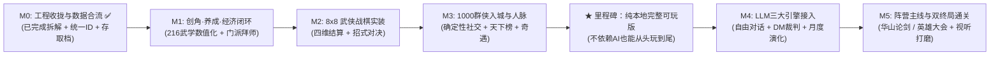

# 《北宋立志传》— 全局研发路线图与 Todo 进度总表

> **定位**：本文档汇总了跨会话分支的所有已完成工作，诊断当前距离“真正可玩（Playable）”的核心缺口，并作为后续唯一的主任务追踪看板（Single Source of Truth）。

---

## 一、 现状盘点与核心诊断：为什么感觉“东一榔头西一棒子”？

通过盘点现有分支（地图与空间主线 [分支 165aeb2d](conversation://v1/default/jetski_remote_agents_3p/165aeb2d-47c6-4ae8-9373-51acdcc9d87b) 与人物群像主线 [分支 222a70e6](conversation://v1/default/jetski_remote_agents_3p/222a70e6-fab2-424a-aeea-38a28a2e1fd7)），目前项目的真实画像非常清晰：

> [!IMPORTANT]
> **一句话诊断**：**世界观设定与视觉资产已完成约 75%，但驱动游戏的“可玩规则闭环”仅完成了约 12%（目前仍停留在地图漫游 + 点击加减几点数防的静态演示壳子）。**

### 当前暴露出的三大痛点
1. **横向铺量远超纵向闭环**：已经铺开了 **1,000 名独立人物**、**216 门武学名录**、**38 张地区手绘全景图**、**58 张特殊建筑半 3D 内景图** 和 **100+ 张人物画作**，但玩家还无法“创建角色 → 习得并装备一门武功 → 打一场真正的 8×8 战棋 → 获得战利品存盘”。
2. **多分支数据开始分叉**（注：已在 M0-2 完成合并）：
   * 地图分支的 [GAME_MECHANICS.md](./GAME_MECHANICS.md) 已将宋辽夏 19 城统一为三字府名（如 `开封府`、`洛阳府`、`泉州府`）；
   * 人物分支的 [CHARACTER_COMPENDIUM.md](./CHARACTER_COMPENDIUM.md) 中，1,000 名 NPC 的常驻地已完成归一并接入主地图。
3. **单文件 HTML + Base64 架构触顶**（注：已在 M0-1 拆解为模块化工程）：早期单文件原型体积曾膨胀至 **19.7 MB** + **4.1 MB**，现已拆分为 `Vite 8 + React 19 + TypeScript 7` 模块化架构与 `public/assets/` 静态懒加载。

### 八大核心模块当前进度总览

| 模块领域 | 当前进度 | 已完成资产 | 距离“能玩”的核心缺口 |
| :--- | :---: | :--- | :--- |
| **1. 世界观与规则总纲** | `97%` | 时空背景、十二时辰历法、20 门派、三维/四维/体能资粮、七槽披挂与四库行囊、双终局设定齐全 | 仅差战斗具体伤害/命中/护体公式定稿 |
| **2. 宏观舆图与移动系统** | `88%` | 华夏东亚全景 SVG、语义缩放、寻路、按日/时辰骑马行军（与第七槽坐骑及粮草体能联动）、38 地区全景图全齐 | 路途奇遇事件池待扩充 |
| **3. 地区建筑与室内交互** | `65%` | 38 地共 123 座特殊建筑 + 105 座基础建筑全量入库；58 座手绘内景 + 65 座宋式营造 SVG 矢量内景 100% 可步入 | 建筑功能仍是固定加点桩，缺商店/悬赏/拜师/奇遇实装 |
| **4. 工程架构与存取档** | `100%` | 已完成 M0 全阶段并升级至 `M1.0.0` 存档结构（向后兼容 `M0.4.0`）：支持时辰、体能、7 槽披挂与 4 类行囊完整序列化 | **Phase M0 已圆满收官** |
| **5. 角色养成与武学系统** | `40%` | 已实装全局顶部状态 HUD、7 槽位可视化纸娃娃披挂面板（含坐骑槽）与四分类行囊系统；216 门武学已编译结构化数据表 | 缺开局创角流程、216 武学战斗数值表与武学配招 |
| **6. 8×8 武侠战棋系统** | `0%` | 仅有设计概念，`切磋` 按钮目前只弹一行字 `内力+18` | 战棋网格、身法行动条、招式范围、内力减伤、胜负结算全缺 |
| **7. 1000 群侠生态与社交** | `35%` | 1000 人全量编译至 `npcs.json`，100% 对齐 38 标准地区并挂载至城池/建筑检视卡与千人图鉴 | 无好感度/送礼/结义/请教与排行榜动态演化逻辑 |
| **8. LLM 引擎与主线终局** | `5%` | 仅有随机游历滚动日志桩 | NPC 对话、DM 自由行动裁判、抗辽/反官事件链、论剑/盟主终局未做 |

---

## 二、 破局研发策略与两条铁律

> [!TIP]
> **防跑偏铁律 1（主支线彻底解耦）**：从现在起，**暂停一切散装生图任务**。剩余 65 座建筑内景图（已实装宋式营造 SVG 矢量室内图兜底）和剩余约 190 位核心人物立绘（已实装门派母版与古籍名牌兜底）统一放入文末 **【异步美术积压池】**，绝不阻塞代码可玩闭环。
>
> **防跑偏铁律 2（先骨骼跑通，后上 LLM）**：在 M0~M3 阶段先把确定性数值玩法彻底做扎实——确保即便断网、不调大模型，这也是一款能创角、跑图、拜师、打战棋、刷秘籍、冲排行榜的好玩《立志传》；M4 再接入 LLM 让对话和奇遇产生化学反应。

---

## 三、 分阶段研发 Todo List（主线进度追踪）

### 阶段 M0：工程底座收拢与跨分支数据合流（✅ 已全部完成）
> **阶段目标**：终结多分支各自为战与 20MB 单文件膨胀问题，在工作区建立标准模块化 Web 工程，跑通现有地图浏览并支持真实存取档。

- [x] 完成《北宋立志传》核心机制总纲、216 武学名录、38 地区建筑名录、1000 人物全录四大设定文档
- [x] 完成宏观《华夏山海全景舆图》与全部 38 处地区手绘等轴全景图
- [x] **[M0-1] 初始化标准前端工程**：已在 `/home/antigravity/northern-song-chronicles` 搭建 `Vite 8 + React 19 + TypeScript 7 + Tailwind CSS v4 + Zustand 5` 模块化工程；完整抽离 **209 张独立 JPG 静态原画（30.64 MB）** 至 `public/assets/{regions,buildings,characters}/`，代码包内嵌 Base64 降至 `0 B`，实装 `useLazyImage` 按需懒加载与实时资源监控面板
- [x] **[M0-2] 统一跨分支标准 ID 字典**：已建立 `src/data/idRegistry.json`（38 地区 `REG-01..38`、20 大门派 `SECT-01..20` + 11 朝堂四夷组织 `ORG-01..11`、216 武学 `MA-001..216`），并批量归一 `docs/CHARACTER_COMPENDIUM.md` 中 658 处旧地名写法，1,000 名 NPC 零悬空引用
- [x] **[M0-3] 编译结构化游戏数据库**：已编写可复现构建脚本 `scripts/compile_game_db.py`（`npm run build:db`），将四大 Markdown 文档编译为严格 TypeScript 类型的静态数据包（`regions.json`、`buildings.json`、`martial_arts.json`、`npcs.json`）及索引层 `src/data/gameDb.ts`
- [x] **[M0-4] 移植三层空间视图与真实存取档**：已打通 `天下舆图 → 38 地区全景 → 全部 123 座特殊建筑内景（58 手绘 JPG + 65 宋式营造 SVG 矢量内院）` 无缝切换，挂载千人名录与 216 武学总纲检视，并基于 `IndexedDB + localStorage` 实装 1 自动槽 + 6 手动槽存档、读档、抹除及 `.json` 存档文件导出/导入校验

---

### 阶段 M1：主角界面与行囊装备底座、216 武学数值化与养成经济闭环
> **阶段目标**：先把全局顶部状态 HUD、可视化七槽位装备栏（含坐骑）与四分类行囊菜单做扎实，再推进创角、武学数值化与城市门派养成闭环。

- [x] **[M1-0] 全局顶部状态栏（HUD）与主角七槽位装备/四分类背包 UI 重构**：
  - **顶部常驻状态栏（Top Status HUD）**：已在界面最上方醒目常驻显示【年月日 + 十二时辰】（如 `皇祐二年 · 正月初一日 · 辰时`，含昼夜日月徽标）、主角基础生存状态【气血（当前/上限）】【体能（当前/上限，建筑历练与赶路消耗）】、以及当前【资金（纹银两数）】【粮草（行军干粮日份）】
  - **主角面板可视化装备区（7 槽位纸娃娃布局）**：已在【壹·主角与披挂】下方新增可视化披挂面板，支持 **武器、服饰、鞋履、弓箭、配饰壹、配饰贰、坐骑** 共 7 个专属可视化槽位（带宋风图标/品质框、选中槽位属性检视、一键卸下与行囊备品快捷披挂，其中【坐骑】槽直接联动大地图行军速度 $V_{\text{mount}}$）
  - **背包四分类栏目重构**：已将【贰·行囊四库】升级为四大分类页签与网格检视容器，并同步升级 `M1.0.0` 存档结构：
    1. **【典籍书画】**：武学秘籍、残卷、经史典籍、名家字画等（支持研读增长武学领悟与十艺）
    2. **【丹药毒物】**：金创丹药、增功灵药、药膳茶饼（恢复气血/内力/体能）、奇毒涂剂等
    3. **【雅器百工】**：古琴、围棋盘、紫毫画笔、算筹等十艺与奇门工具（支持佩入配饰槽）
    4. **【行囊杂物】**：替换下的装备备品、马匹契券、路引文书、信物令牌、各地奇珍杂货等
- [ ] **[M1-1] 开局创角与出身系统**：制作新游戏创角流程（姓名、立绘选择、初始出身预设如【寒门游侠 / 将门遗孤 / 书院学子 / 塞外孤儿】、天赋三维 `根骨/悟性/颜值` 随机或分配、初始落脚城池选择）
- [ ] **[M1-2] 216 门武学数值表定稿**：在保留 [MARTIAL_ARTS_COMPENDIUM.md](./MARTIAL_ARTS_COMPENDIUM.md) 设定基础上，批量补全每门武学的战斗与养成字段（基础威力、内力消耗、冷却回合、攻击距离与范围形状、刚柔阴阳劲力属性、异常状态附带、1~10 重成长收益、前置条件代码校验器）
- [ ] **[M1-3] 武学装配与属性联动系统**：在【壹·主角与披挂】接入 **1 门主运内功 + 1 门轻功身法 + 最多 4 门出战外功/奇门招式**，与下方 7 槽装备加成共同实时重算实战四维（`气血/内力/身法/抗性`）、体能消耗与大地图移动速度
- [ ] **[M1-4] 物品数据库与商贸经济闭环**：在 `src/data/itemsDb.ts` 首批 27 件宋风器物基础上扩充全量道具表（对应四分类背包与七大装备槽位），实装马市、铁匠铺、药铺、书肆与市集/番坊买卖
- [ ] **[M1-5] 建筑功能实装与门派拜师体系**：
  - 基础五建筑闭环：衙门（随机生成缉凶/护镖悬赏任务赚银两）、客栈（投宿恢复气血/内力/体能、推进时辰与存档）、拳馆（消耗体能银两锤炼四维与凡品把式）、书院（修习十艺）、酒楼（打听情报与饮酒结交）
  - 20 大门派入门与晋升：校验门规倾向与属性门槛（如少林不收女弟子/重经义、逍遥派看颜值悟性），实装门派贡献度与从凡品 → 良品 → 地阶 → 镇派天阶的逐级传功机制

---

### 阶段 M2：8×8 轻量化武侠战棋系统（核心玩法验证器）
> **阶段目标**：把“切磋 / 缉凶 / 闯关”真正变成好玩、快节奏（2~3 分钟一局）的战棋博弈。

- [ ] **[M2-1] 8×8 战棋盘与地形渲染器**：根据当前交战所在地点生成对应主题棋盘（街巷、少林石坪、雁门绝壁、太湖水栈、昆仑冰川），支持阻挡格、水泽减速格、险峻地形加成
- [ ] **[M2-2] 实战四维战斗公式引擎**：
  - **行动序与走位**：由 `身法` + 轻功品阶决定集气速率（先后手）、每回合移动格数与闪避率
  - **攻防与护体真气**：由招式威力 × `内力` 加成计算伤害，防守方按 `内力` 比例撑开护体减伤并消耗真气，破气后承受全额气血杀伤（确保 `根骨/悟性/颜值` 严格不介入战中公式）
  - **异常状态与抗性**：实装【奇毒（每回合掉血）】【寒冰（减身法移动）】【烈火（破内力防）】【封穴（无法放绝学）】四类状态，由 `抗性` 决定豁免率与持续回合
- [ ] **[M2-3] AI 对手战术行为树**：为 NPC 编写轻量化战棋 AI（近战突进、远程暗器风筝、残血调息吃药、宗师级优先集火破绽）
- [ ] **[M2-4] 战斗模式与胜负结算**：区分【点到为止（切磋/论剑：血归零不死，涨武学熟练度与好感）】与【生死相搏（缉凶/截杀/闯堂：掉落银两秘籍、增加杀孽或侠名，战败触发重伤逃遁/医馆救治）】

---

### 阶段 M3：1000 群侠生态入驻、社交人脉与江湖奇遇（本地完整可玩版）
> **阶段目标**：把 1000 位鲜活人物放进 38 个地区里自由流动与交互，达成**第一个从开局到中后期的完整可玩里程碑**。

- [ ] **[M3-1] 1000 人物入城与建筑分流挂载**：将 100 位历史名臣大儒与 900 位武林人士按常驻地及身份分配进对应城池与特殊建筑（如包拯展昭在开封府衙、乔峰汪剑通在洛阳杏子林、扫地僧与假死潜伏的慕容博/萧远山在少林藏经阁暗层）；对暂无专属立绘的 NPC 提供精致宋式门派/官阶水墨名牌兜底
- [ ] **[M3-2] 确定性人脉社交系统**：实装 NPC 关系度（`-100 死仇` ~ `+100 生死之交`），支持【交谈】【雅集论道（按 NPC 偏好检定诗词/琴棋书画/经义/策论加好感）】【赠礼】【切磋讨教】【义结金兰】【请教独门武学】
- [ ] **[M3-3] 动态游历与《天下风云榜》面板**：升级月度结算逻辑，让名侠在相邻城池游历访友/办案；实装随时可查的【天下武道榜（前百强）】【二十门派威望榜】【个人人脉结交录】
- [ ] **[M3-4] 秘境机缘与行军路途事件池**：
  - 实装 30+ 个标志性特殊建筑机缘检定（如少林十八铜人阵闯关、华山思过崖悟剑、无量玉洞参悟北冥凌波、大内秘库夜探拓印《葵花残卷》、太原铁冶监铸神兵）
  - 实装大地图赶路随机事件（绿林剪径、胡商奇货、名侠同行指点、辽夏死士截杀、风雪受阻）

---

### 阶段 M4：LLM 三大动态模拟引擎接入（AI 灵魂注入）
> **阶段目标**：在 M3 稳固的数值地基上接入大模型，杜绝数值崩坏的同时实现高自由度涌现叙事。

- [ ] **[M4-1] LLM API 代理层与 JSON Schema 护栏**：搭建后端/代理接口，封装严格的结构化输出校验器（限制单次对话好感变动上下限、严禁凭空发放未定义武学或越阶秒杀宗师，API 异常时自动平滑降级回 M3 确定性模板）
- [ ] **[M4-2] 江湖群像心智引擎（自由交谈）**：接入酒楼/府邸 NPC 自由输入对话，自动组装人物小传、年龄、立场、与主角过往记忆 Prompt，结合主角【辩才/颜值/十艺】判定说服、套话、拜师或挑拨效果
- [ ] **[M4-3] 江湖司命裁判引擎（DM 自由行动）**：在任意建筑/秘境开放自由行动输入框，由 DM 模型结合主角轻功、身法、算术等属性暗骰裁定潜行、破阵、偷听、盗书结果并输出合法状态变更
- [ ] **[M4-4] 战中“英雄喝问”与动态《江湖风闻录》**：在关键战棋对决中开放每战 1 次的台词喝问（结合【辩才】触发震慑减防或化敌为友）；每月由模型汇总天下势力变动生成各地酒楼说书人播报的《皇祐江湖风闻录》

---

### 阶段 M5：胡汉恩仇主线抉择、双终局通关与视听打磨（正式发布版）
> **阶段目标**：收束宏大叙事与终极目标，让每一局都有荡气回肠的高潮与结局评价。

- [ ] **[M5-1] 双价值方向主线事件链**：
  - **护国侠义线（助宋抗辽/抗夏）**：识破真定榷场辽谍 → 驰援延安狄青/太原杨家将 → 揭开雁门关带头大哥旧案 → 雁门关绝壁阻击辽军南院高手
  - **反叛草莽线（替天行道/抗官）**：黄河渡口智劫生辰纲 → 太行山总寨聚义 → 救援受迫害义士并抗衡六扇门与大内禁军围剿
- [ ] **[M5-2] 双核心通关终局仪式**：
  - **【天下第一】终局（华山/嵩山绝顶论剑）**：战力达标后开启巅峰擂台，连续单挑战胜各派宗师与隐世大宗师，登顶天下榜首
  - **【武林盟主】终局（洛阳/雁门英雄大会）**：校验战力（前十）+ 江湖声望 + 至少 8 大门派崇敬关系 + 结义豪侠助阵，舌战并武服群雄执掌盟主令
  - **通关史册结算**：根据本局历法年限、武道境界、结交红颜知己/生死弟兄、护国或草莽事迹，生成宋代卷轴风格的《个人江湖列传》与多周目继承奖励
- [ ] **[M5-3] 视听氛围与新手引导打磨**：补充古琴/战鼓 BGM 与环境刀剑马蹄音效开关、首局 3 分钟轻量新手指引、全境界战斗数值平衡调优

---

## 四、 异步美术与内容补全池（非阻塞 Backlog · 有空再补）

> [!NOTE]
> 以下任务已有完善的程序化兜底方案（SVG 室内矢量图 / 宋风人物名牌），**切勿在 M0~M3 核心玩法跑通前投入主精力**，可利用空闲配额分批自动跑批补齐：

- [ ] **[ART-1] 特殊建筑半 3D 内景图补齐**：已完成 `58 / 124` 座，剩余 `66` 座城市与名山特殊建筑内景底图待分批生成与热点校准
- [ ] **[ART-2] 核心 240 人物独立头像与全身立绘补齐**：已完成约 `50 / 240` 人（含赵祯、包拯、狄青、苏轼、扫地僧、乔峰、慕容博、慕容复、童姥、李秋水、无崖子等），剩余约 `190` 位历史名臣与宗师/一流高手待按批次补齐
- [ ] **[ART-3] 中低阶人物通用模板立绘映射**：将已生成的 12 套门派/身份模板立绘（少林武僧、峨眉女侠、契丹武士、宋代儒生、绿林好汉等）与剩余 760 名二流~不入流人物建立自动映射并补充缺失行当模板
