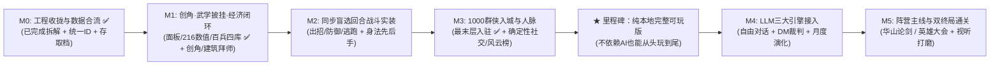

# 《北宋立志传》— 全局研发路线图与 Todo 进度总表

> **定位**：本文档汇总了跨会话分支的所有已完成工作，诊断当前距离“真正可玩（Playable）”的核心缺口，并作为后续唯一的主任务追踪看板（Single Source of Truth）。

---

## 一、 现状盘点与核心诊断：为什么感觉“东一榔头西一棒子”？

通过盘点现有分支（地图与空间主线 [分支 165aeb2d](conversation://v1/default/jetski_remote_agents_3p/165aeb2d-47c6-4ae8-9373-51acdcc9d87b) 与人物群像主线 [分支 222a70e6](conversation://v1/default/jetski_remote_agents_3p/222a70e6-fab2-424a-aeea-38a28a2e1fd7)），目前项目的真实画像非常清晰：

> [!IMPORTANT]
> **一句话诊断**：**世界观设定与视觉资产已完成约 75%，但驱动游戏的“可玩规则闭环”仅完成了约 12%（目前仍停留在地图漫游 + 点击加减几点数防的静态演示壳子）。**

### 当前暴露出的三大痛点
1. **横向铺量远超纵向闭环**：已经铺开了 **1,000 名独立人物**、**216 门武学名录**、**38 张地区手绘全景图**、**58 张特殊建筑半 3D 内景图** 和 **100+ 张人物画作**，但玩家还无法“创建角色 → 习得并装备一门武功 → 打一场真正的 8×8 战棋 → 获得战利品存盘”。
2. **多分支数据开始分叉**（注：已在 M0-2 完成合并）：
   * 地图分支的 [GAME_MECHANICS.md](./GAME_MECHANICS.md) 已将宋辽夏 19 城统一为三字府名（如 `开封府`、`洛阳府`、`泉州府`）；
   * 人物分支的 [CHARACTER_COMPENDIUM.md](./CHARACTER_COMPENDIUM.md) 中，1,000 名 NPC 的常驻地已完成归一并接入主地图。
3. **单文件 HTML + Base64 架构触顶**（注：已在 M0-1 拆解为模块化工程）：早期单文件原型体积曾膨胀至 **19.7 MB** + **4.1 MB**，现已拆分为 `Vite 8 + React 19 + TypeScript 7` 模块化架构与 `public/assets/` 静态懒加载。

### 八大核心模块当前进度总览

| 模块领域 | 当前进度 | 已完成资产 | 距离“能玩”的核心缺口 |
| :--- | :---: | :--- | :--- |
| **1. 世界观与规则总纲** | `98%` | 时空背景、十二时辰历法、30 门派（20 一流 + 10 二三流）、三维/四维/体能资粮、七槽披挂与四库行囊、双终局设定齐全 | 仅差战斗具体伤害/命中/护体公式定稿 |
| **2. 宏观舆图与移动系统** | `90%` | 华夏东亚全景 SVG、语义缩放、寻路、按日/时辰骑马行军（与第七槽坐骑及粮草体能联动）、43 地区全景（38 手绘 + 5 青绿营造 SVG）全齐 | 路途奇遇事件池待扩充 |
| **3. 地区建筑与室内交互** | `68%` | 43 地共 138 座特殊建筑 + 130 座基础建筑全量入库；58 座手绘内景 + 80 座宋式营造 SVG 矢量内景 100% 可步入 | 建筑功能仍是固定加点桩，缺商店/悬赏/拜师/奇遇实装 |
| **4. 工程架构与存取档** | `100%` | 已完成 M0 全阶段并升级至 `M1.1.0` 存档结构（兼容 `M0.4.0`/`M1.0.0`）：完整序列化时辰、体能、7 槽披挂、6 槽运使武学、所习武学重数与四库行囊 | **Phase M0 已圆满收官** |
| **5. 角色养成与武学系统** | `52%` | 已实装 1.5× 宽幅菜单、独立【壹·主角面板】、【贰·披挂与武学（7槽披挂 + 6槽武学运使 + 所习武学重数演练）】、【叁·行囊四库（含秘籍研读习武）】 | 缺开局创角流程与 216 武学战棋格子范围/威力细表 |
| **6. 8×8 武侠战棋系统** | `0%` | 仅有设计概念，`切磋` 按钮目前只弹一行字 `内力+18` | 战棋网格、身法行动条、招式范围、内力减伤、胜负结算全缺 |
| **7. 1000 群侠生态与社交** | `45%` | 1000 人全量入库并精确挂载至 43 地区最末层建筑；已修复群侠图鉴全身像统一 `3:4` 立轴画幅与高清点击放大灯箱（全身/头像双切） | 无好感度/送礼/结义/请教与排行榜动态演化逻辑 |
| **8. LLM 引擎与主线终局** | `5%` | 仅有随机游历滚动日志桩 | NPC 对话、DM 自由行动裁判、抗辽/反官事件链、论剑/盟主终局未做 |

---

## 二、 破局研发策略与两条铁律

> [!TIP]
> **防跑偏铁律 1（主支线彻底解耦）**：从现在起，**暂停一切散装生图任务**。5 座新辟州府全景（已实装青绿营造 SVG 矢量全景兜底）、剩余 80 座建筑内景图（已实装宋式营造 SVG 矢量室内图兜底）和剩余核心人物立绘（已实装门派母版与古籍名牌兜底）统一放入文末 **【异步美术积压池】**，绝不阻塞代码可玩闭环。
>
> **防跑偏铁律 2（先骨骼跑通，后上 LLM）**：在 M0~M3 阶段先把确定性数值玩法彻底做扎实——确保即便断网、不调大模型，这也是一款能创角、跑图、拜师、打回合心理博弈战、刷秘籍、冲排行榜的好玩《立志传》；M4 再接入 LLM 让对话和奇遇产生化学反应。

---

## 三、 分阶段研发 Todo List（主线进度追踪）

### 阶段 M0：工程底座收拢与跨分支数据合流（✅ 已全部完成）
> **阶段目标**：终结多分支各自为战与 20MB 单文件膨胀问题，在工作区建立标准模块化 Web 工程，跑通现有地图浏览并支持真实存取档。

- [x] 完成《北宋立志传》核心机制总纲、30 门派专卷、216 武学名录、43 地区建筑名录、1000 人物全录与百兵谱六大设定文档
- [x] 完成宏观《华夏山海全景舆图》与全部 43 处地区等轴全景（38 手绘 JPG + 5 青绿营造 SVG）
- [x] **[M0-1] 初始化标准前端工程**：已在 `/home/antigravity/northern-song-chronicles` 搭建 `Vite 8 + React 19 + TypeScript 7 + Tailwind CSS v4 + Zustand 5` 模块化工程；完整抽离独立 JPG 静态原画至 `public/assets/{regions,buildings,characters}/`，代码包内嵌 Base64 降至 `0 B`，实装 `useLazyImage` 按需懒加载与实时资源监控面板
- [x] **[M0-2] 统一跨分支标准 ID 字典**：已建立 `src/data/idRegistry.json`（43 地区 `REG-01..43`、30 武林门派 `SECT-01..30`［20 一流大派 + 10 二三流门派］ + 11 朝堂四夷组织 `ORG-01..11`、216 武学 `MA-001..216`、`WPN-001..100`），1,000 名 NPC 零悬空引用
- [x] **[M0-3] 编译结构化游戏数据库**：已编写可复现构建脚本 `scripts/compile_game_db.py`（`npm run build:db`），将六大 Markdown 文档编译为严格 TypeScript 类型的静态数据包（`regions.json`、`buildings.json`、`martial_arts.json`、`weapons.json`、`npcs.json`）及索引层 `src/data/gameDb.ts`
- [x] **[M0-4] 移植三层空间视图与真实存取档**：已打通 `天下舆图 → 43 地区全景 → 全部 138 座特殊建筑内景（58 手绘 JPG + 80 宋式营造 SVG 矢量内院）` 无缝切换，挂载千人名录与 216 武学总纲检视，并基于 `IndexedDB + localStorage` 实装 1 自动槽 + 6 手动槽存档、读档、抹除及 `.json` 存档文件导出/导入校验

---

### 阶段 M1：三大角色核心卷宗 UI、创角出身、216 武学数值化与养成经济闭环
> **阶段目标**：先把全局顶部状态 HUD、1.5× 宽幅行囊枢机菜单（【壹·主角面板】【贰·披挂与武学】【叁·行囊四库】独立三卷）与图鉴品鉴体验打磨到位，再推进创角、216 武学战棋数值表与城市门派养成闭环。

- [x] **[M1-0] 全局顶部状态栏（HUD）、1.5× 宽幅枢机菜单与三大核心面板拆分重构**：
  - **顶部常驻状态栏（Top Status HUD）**：常驻显示【年月日 + 十二时辰】、主角【气血】【体能】进度条与【资金（纹银）】【粮草（干粮）】
  - **枢机菜单长宽 1.5 倍扩容（`1536px × 975px` 响应式宽幅展卷）**，并将前三大核心功能重构为清晰独立的三卷：
    1. **【壹·主角面板】**：独立呈现少侠全身绘像（支持点击放大）、气血/真气/体能双精度条、实战交锋四维合计（装备+武学实时叠加）、先天三维禀赋、官道行军脚力与北宋十艺百工修为
    2. **【贰·披挂与武学】**：上半卷为 **7 槽位可视化纸娃娃装备栏**（武器、服饰、鞋履、弓箭、双配饰、坐骑）；下半卷为 **6 槽位主角武学运使台**（1 主运内功 + 1 轻功身法 + 4 出战招式）及 **少侠所习武学全表**（支持 1~10 重火候进度检视、消耗体能演武精修突破重数、切换运使实时重算实战属性与轻功行军提速）
    3. **【叁·行囊四库】**：【典籍书画】（已扩充实装皇祐百卷典录：10 天阶 + 20 地阶 + 30 良阶 + 40 凡阶共 100 卷；武学秘籍仅限初次展卷领悟第 1 重入门，熟练度与重数统一由演武精修提升；经史字画与雅器修习提升十艺根基）、【丹药毒物】、【雅器百工】、【行囊杂物】四大分栏，同步实装裸身根基 `baseStats` 纯函数派生与最新 `M1.3.0` 存档结构
  - **【肆·群侠图鉴】立绘尺寸统一与高清放大灯箱修复**：修复不同人物全身像因下方长文本挤压导致大小不一的 Bug（锁定 `3:4` 标准立轴画框 `shrink-0`），并为全部人物立绘与头像实装**点击全屏高清放大灯箱**（支持全身绘卷/半身头像一键切换品鉴）
- [ ] **[M1-1] 开局创角与出身系统（当前第一优先级）**：制作新游戏创角流程（姓名、男女/风格立绘挑选、初始出身预设如【寒门游侠 / 将门遗孤 / 书院学子 / 塞外孤儿】及对应初始武学与披挂、天赋三维 `根骨/悟性/颜值` 掷骰或分配、初始落脚州府选择）
- [x] **[M1-2] 216 门武学十一大类重构与 1~10 重数值表定稿 ✅**：统一收拢为 **内功、轻功、拳掌、指法、剑法、刀法、枪法、棍棒、毒功、暗器、音功** 十一大类（去除全部书名号，除内功轻功外每类至少一门天阶功法），对齐人物六境十六阶标尺完成 1~10 重数值、升重熟练度与 37 门天阶专属战斗特效（详见 [MARTIAL_ARTS_STATS.md](./MARTIAL_ARTS_STATS.md)），并同步接入前端面板
- [ ] **[M1-3] 披挂与四库总纲分卷定稿及城市商贸经济闭环**：
  - [x] **[M1-3a] 清空旧版占位披挂并定稿《皇祐披挂总纲 · 第一卷：百兵谱》100 种武器**：已彻底移除早期 14 件 `ITM-EQP-*` 占位装备，建立 [EQUIPMENT_COMPENDIUM.md](./EQUIPMENT_COMPENDIUM.md) 单一事实源并接入 `scripts/compile_game_db.py` 生成 `src/data/weapons.json`（`WPN-001 ~ WPN-100`：严格 **10 天阶 / 20 地阶 / 30 良阶 / 40 凡阶**，涵盖剑/刀/枪/棍棒/拳掌护手/暗器/奇门音兵七类，实装【兵武共鸣】、天阶佩戴门槛校验与【陆·披挂总纲】百兵图鉴面板）
  - [x] **[M1-3b] 清空旧版占位书卷并定稿《皇祐四库 · 典籍书画百卷录》100 种典籍书画**：已移除旧版 6 件示例典籍，于 `src/data/scrollsDb.ts` 完整设计 **100 卷典籍书画（严格 10 天阶 / 20 地阶 / 30 良阶 / 40 凡阶）**，并在行囊面板实装【随身藏卷 / 皇祐百卷总录】双视图检索
  - [ ] **[M1-3c] 后续五卷披挂（服饰/鞋履/弓箭/双配饰/坐骑）及丹药雅器定稿与城市商贸交易**：按卷补全其余六槽披挂与丹药雅器，实装马市、铁匠铺、药铺、书肆与市集/番坊买卖交易
- [ ] **[M1-4] 建筑功能实装与 30 门派三级拜师出师体系**：
  - 基础五建筑闭环：衙门（随机生成缉凶/护镖悬赏任务赚银两）、客栈（投宿恢复气血/内力/体能、推进时辰与存档）、拳馆/武堂（消耗体能银两锤炼四维与传授凡品把式）、书院（修习十艺）、酒楼（打听情报与饮酒结交）
  - 30 大武林门派三级阶梯晋升：实装【三流市井武馆零门槛入馆打工与圆满出师举荐帖】→【二流世家镖盟历练保举】→【20 大一流名门宗派严苛门规校验与凡品→良品→地阶→镇派天阶逐级传功机制】

---

### 阶段 M2：同步盲选指令 + 身法先后手回合制战斗系统（核心玩法验证器）
> **阶段目标**：把“切磋 / 缉凶 / 闯关”真正变成好玩、快节奏、心理博弈感拉满的三择一武侠回合对决。

- [ ] **[M2-1] 回合对决舞台与同步指令面板**：根据当前交战所在地点生成主题对决背景，实装每轮双方同时暗选 **【出招 / 防御 / 逃跑】** 三择一亮牌博弈 UI 与战斗播报卷轴
- [ ] **[M2-2] 实战四维与 37 门天阶特效结算引擎**：
  - **先后手与闪避脱身**：严格按双方实时 `身法` 决定先后手结算次序（兼容《独孤九剑》料敌机先等特例）、闪避率与逃跑检定
  - **四系伤害与护体抗性**：实装物理伤害（拳指剑刀枪棍）、毒性伤害、音律伤害、暗器伤害及内力护体减伤、抗性异常减免与 37 门天阶神功专属机制（确保 `根骨/悟性/颜值` 严格不介入战中公式）
- [ ] **[M2-3] AI 对手心理博弈策略**：为 NPC 编写回合制决策 AI（根据双方气血内力差、连招状态智能权衡【出招 / 防御 / 逃跑】及招式轮换）
- [ ] **[M2-4] 战斗模式与胜负结算**：区分【点到为止（切磋/论剑：血归零不死，涨武学熟练度与好感）】与【生死相搏（缉凶/截杀/闯堂：掉落银两秘籍、增加杀孽或侠名，战败触发重伤逃遁/医馆救治）】

---

### 阶段 M3：1000 群侠生态入驻、社交人脉与江湖奇遇（本地完整可玩版）
> **阶段目标**：把 1000 位鲜活人物放进 43 个地区里自由流动与交互，达成**第一个从开局到中后期的完整可玩里程碑**。

- [x] **[M3-1] 1000 人物入城与最末层建筑分流挂载**：已将 100 位历史名臣大儒与 900 位武林人士按常驻地及身份精确挂载至 43 地区最末层建筑与子建筑（如包拯展昭在开封府衙、乔峰汪剑通在洛阳杏子林、王元霸在洛阳金刀王家大宅、余靖在广州药洲幕府）；对暂无专属立绘的 NPC 提供精致宋式门派/官阶水墨名牌兜底
- [ ] **[M3-2] 确定性人脉社交系统**：实装 NPC 关系度（`-100 死仇` ~ `+100 生死之交`），支持【交谈】【雅集论道（按 NPC 偏好检定诗词/琴棋书画/经义/策论加好感）】【赠礼】【切磋讨教】【义结金兰】【请教独门武学】
- [ ] **[M3-3] 动态游历与《天下风云榜》面板**：升级月度结算逻辑，让名侠在相邻城池游历访友/办案；实装随时可查的【天下武道榜（前百强）】【三十门派威望榜】【个人人脉结交录】
- [ ] **[M3-4] 秘境机缘与行军路途事件池**：
  - 实装 30+ 个标志性特殊建筑机缘检定（如少林十八铜人阵闯关、华山思过崖悟剑、无量玉洞参悟北冥凌波、大内秘库夜探拓印《葵花残卷》、太原铁冶监铸神兵）
  - 实装大地图赶路随机事件（绿林剪径、胡商奇货、名侠同行指点、辽夏死士截杀、风雪受阻）

---

### 阶段 M4：LLM 三大动态模拟引擎接入（AI 灵魂注入）
> **阶段目标**：在 M3 稳固的数值地基上接入大模型，杜绝数值崩坏的同时实现高自由度涌现叙事。

- [ ] **[M4-1] LLM API 代理层与 JSON Schema 护栏**：搭建后端/代理接口，封装严格的结构化输出校验器（限制单次对话好感变动上下限、严禁凭空发放未定义武学或越阶秒杀宗师，API 异常时自动平滑降级回 M3 确定性模板）
- [ ] **[M4-2] 江湖群像心智引擎（自由交谈）**：接入酒楼/府邸 NPC 自由输入对话，自动组装人物小传、年龄、立场、与主角过往记忆 Prompt，结合主角【辩才/颜值/十艺】判定说服、套话、拜师或挑拨效果
- [ ] **[M4-3] 江湖司命裁判引擎（DM 自由行动）**：在任意建筑/秘境开放自由行动输入框，由 DM 模型结合主角轻功、身法、算术等属性暗骰裁定潜行、破阵、偷听、盗书结果并输出合法状态变更
- [ ] **[M4-4] 战中“英雄喝问”与动态《江湖风闻录》**：在关键武侠回合对决中开放每战 1 次的台词喝问（结合【辩才】触发震慑减防或化敌为友）；每月由模型汇总天下势力变动生成各地酒楼说书人播报的《皇祐江湖风闻录》

---

### 阶段 M5：胡汉恩仇主线抉择、双终局通关与视听打磨（正式发布版）
> **阶段目标**：收束宏大叙事与终极目标，让每一局都有荡气回肠的高潮与结局评价。

- [ ] **[M5-1] 双价值方向主线事件链**：
  - **护国侠义线（助宋抗辽/抗夏）**：识破真定榷场辽谍 → 驰援延安狄青/太原杨家将 → 揭开雁门关带头大哥旧案 → 雁门关绝壁阻击辽军南院高手
  - **反叛草莽线（替天行道/抗官）**：黄河渡口智劫生辰纲 → 太行山总寨聚义 → 救援受迫害义士并抗衡六扇门与大内禁军围剿
- [ ] **[M5-2] 双核心通关终局仪式**：
  - **【天下第一】终局（华山/嵩山绝顶论剑）**：战力达标后开启巅峰擂台，连续单挑战胜各派宗师与隐世大宗师，登顶天下榜首
  - **【武林盟主】终局（洛阳/雁门英雄大会）**：校验战力（前十）+ 江湖声望 + 至少 8 大门派崇敬关系 + 结义豪侠助阵，舌战并武服群雄执掌盟主令
  - **通关史册结算**：根据本局历法年限、武道境界、结交红颜知己/生死弟兄、护国或草莽事迹，生成宋代卷轴风格的《个人江湖列传》与多周目继承奖励
- [ ] **[M5-3] 视听氛围与新手引导打磨**：补充更多州府/战斗 BGM 与环境刀剑马蹄音效开关、首局 3 分钟轻量新手指引、全境界战斗数值平衡调优

---

## 四、 异步美术与内容补全池（非阻塞 Backlog · 有空再补）

> [!NOTE]
> 以下任务已有完善的程序化兜底方案（SVG 城郭/室内矢量图 / 宋风人物名牌），**切勿在 M0~M3 核心玩法跑通前投入主精力**，可利用空闲配额分批自动跑批补齐：

- [ ] **[ART-0] 新辟 5 座州府半 3D 等轴全景图补齐**：`广州府`、`潭州府`、`洪州府`、`秦州府`、`辽阳府`（当前已由 `SvgRegionPanoramaFallback.tsx` 青绿营造矢量全景兜底，后续可按 `/panorama-artist` 逐张补绘 JPG）
- [ ] **[ART-1] 特殊建筑半 3D 内景图补齐**：已完成 `58 / 138` 座，剩余 `80` 座城市与名山特殊建筑内景底图待分批生成与热点校准
- [ ] **[ART-2] 核心 249 人物独立头像与全身立绘补齐**：已完成 `177 / 249` 人双图齐全共 `354` 张独立原画（其中 **历史名人 `100 / 100` 人已 100% 全部绘完**，前 240 位核心历史与宗师/一流人物已绘 `177 / 240` 人共 `354 / 480` 张），剩余一流高手与新辟小门派掌门独立原画按配额窗口一对一补齐
- [ ] **[ART-3] 中低阶人物通用模板立绘映射**：将已生成的 12 套门派/身份模板立绘与剩余二流~不入流人物建立自动映射并补充缺失行当模板
