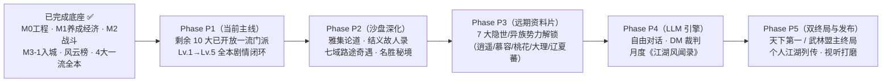

# 《北宋立志传》— 全局研发路线图与 Todo 总看板

> **定位**：本项目唯一的主任务追踪看板（Single Source of Truth）。
> **数据快照**（2026-11-21）：`43` 地区全景（100%） · `268` 座建筑实景内景（100%） · `1,059` 名 NPC（100% 挂载最末层建筑） · `251` 门武学 · `103` 件武器 · `184` 条声明式剧情任务链（零断链） · `《天下风云榜》` 百强武道榜已实装。

---

## 一、 全局演进总览

### 核心研发准则
1. **一流门派任务晋升铁律**：除开封府/六扇门（`SECT-17`）保留办案晋升外，**所有一流大派均已取消面板直晋，一律须推进本门专属任务册封**。因此补齐其余 10 个已开放一流门派的 Lv.1→Lv.5 全本主线，是当前最紧迫的核心闭环。
2. **每派全本质量标准**：每完成一个一流门派全本，需同步验收五项：① 覆盖 Lv.1→Lv.5 全职阶晋升与内功阶梯（Lv.6/8/9 覆核）；② 过早单挑宗师战点统一使用 `survive_rounds`（3~5 回合）；③ 尽量复用正式编目 `NPC-*`（不重复捏临时分身）；④ 剧情 CG/立绘台账登记与补绘；⑤ 通过 `npm run lint && npm test && npm run build`。

---

## 二、 当前主线（Phase P1）：已开放一流大派全本剧情矩阵

> 二流（6 派）与三流（6 派）共 12 派已 100% 跑通；已开放的 **15 个一流势力**（含开封府与大宋禁军联动）当前进度如下：

### 2.1 已全本完结（5 势力 / 4 套史诗线 ✅）

| 势力 | 入门线 | Lv.1→Lv.5 主线 | 支线 | 剧情 CG / 立绘 | 审查状态 |
| :--- | :---: | :---: | :---: | :---: | :---: |
| **`SECT-17` 开封府/六扇门 + `SECT-33` 大宋禁军** | ✅ | ✅ 20 卷（护驾/河北反谍/太行/破燕/同文馆/邕州/裂夏大结局） | ✅ 4 卷 | ✅ 已齐备 | ✅ 已审查 |
| **`SECT-05` 华山派** | ✅ 白纸 15 幕 | ✅ 22 卷（气剑双脉 + 三大终局 + 华山论剑） | ✅ 10 卷 | ✅ 已齐备 | ✅ 已审查修复 |
| **`SECT-01` 嵩山少林寺** | ✅ 杂役/剃度 | ✅ 42 卷（3年平滑节奏 + 全42卷高交互重构 + 双轨业报终评） | ✅ 18 卷（零天数门锁 + 全18卷高交互精修） | ✅ 已齐备 | ✅ 波次1-4全派60卷精修收官（高交互+双轨业报标杆） |
| **`SECT-11` 终南隐宗** | ✅ 古墓/观脉 | ✅ 41 卷（观脉/墓脉双线 + 四大终局） | ✅ 8 卷 | 🟡 补绘中 | ⬜ 待专项审查 |

### 2.2 待补全本主线的已开放一流大派（10 派 · 按批次推进）

#### 第一批：道剑名门四派（🔥 当前最高优先级）
- [ ] **`SECT-08` 武当山真武道宗**
  - 入门线 ✅（`QST-SECT-08-ENTRY`《汉水止戈 · 龟蛇问剑》）｜待补：Lv.1→Lv.5 全本主线 + 门派支线 + CG/立绘 + 审查
- [ ] **`SECT-07` 峨眉派**
  - 入门线 ✅（`QST-SECT-07-ENTRY`《锦水清音 · 金顶问心》）｜待补：Lv.1→Lv.5 全本主线 + 门派支线 + CG/立绘 + 审查
- [ ] **`SECT-06` 泰山派**
  - 入门线 ✅（`QST-SECT-06-ENTRY`《东岳砺剑 · 封禅问心》）｜待补：Lv.1→Lv.5 全本主线 + 门派支线 + CG/立绘 + 审查
- [ ] **`SECT-14` 青城派**
  - 入门线 ✅（`QST-SECT-14-ENTRY`《蜀道暗棋 · 松风试锋》）｜待补：Lv.1→Lv.5 全本主线 + 门派支线 + CG/立绘 + 审查

#### 第二批：抗辽豪侠与南北禅武
- [ ] **`SECT-02` 丐帮**（洛阳杏子林 · 乔峰/汪剑通抗辽主线）
  - 入门线 ✅（`QST-SECT-02-ENTRY`《青囊乞骨 · 杏林受袋》）｜待补：Lv.1→Lv.5 全本主线 + 门派支线 + CG/立绘 + 审查
- [ ] **`SECT-03` 五台山清凉寺**
  - 入门线 ✅（`QST-SECT-03-ENTRY`《清凉残雪 · 雁门梵钟》）｜待补：Lv.1→Lv.5 全本主线 + 门派支线 + CG/立绘 + 审查
- [ ] **`SECT-04` 莆田南少林**
  - 入门线 ✅（`QST-SECT-04-ENTRY`《刺桐风起 · 铁桥问禅》）｜待补：Lv.1→Lv.5 全本主线 + 门派支线 + CG/立绘 + 审查

#### 第三批：世家机巧、霸道绿林与西域邪宗
- [ ] **`SECT-13` 蜀中唐门**（暗器机关世家）
  - 入门线 ✅（`QST-SECT-13-ENTRY`《川药血引 · 万毒试药》）｜待补：Lv.1→Lv.5 全本主线 + 门派支线 + CG/立绘 + 审查
- [ ] **`SECT-15` 铁掌帮**（荆湘霸道帮派）
  - 入门线 ✅（`QST-SECT-15-ENTRY`《铁砂立威 · 五指拜山》）｜待补：Lv.1→Lv.5 全本主线 + 门派支线 + CG/立绘 + 审查
- [ ] **`SECT-19` 星宿派**（西域毒宗邪道线 · 曾入星宿永禁中原正派）
  - 入门线 ✅（`QST-SECT-19-ENTRY`《星宿紫烟 · 投名血契》）｜待补：Lv.1→Lv.5 弱肉强食全本主线 + 门派支线 + CG/立绘 + 审查

#### 存量门派收尾
- [ ] **`SECT-11` 终南隐宗**：完成全本 50 卷剧情逻辑审查与剩余 CG/立绘补齐（见 [MISSING_QUEST_ILLUSTRATIONS.md](./MISSING_QUEST_ILLUSTRATIONS.md) 与 [MISSING_NPC_PORTRAITS.md](./MISSING_NPC_PORTRAITS.md)）

---

## 三、 Phase P2：沙盘玩法与社交生态深化（原 M3 剩余）

> **已完成**：`[M3-1]` 1,059 人最末层建筑挂载 ✅、`[M3-3a]` 《天下风云榜》百强武道榜 ✅。以下为待补沙盘闭环：

- [ ] **[P2-1] 确定性人脉社交深化（原 M3-2）**
  - 实装【雅集论道】（按 NPC 最高十艺动态切出诗词唱和 / 手谈 / 经义问难 / 策论 / 算学 / 抚琴，激活前百名文臣百工交互）
  - 开放高阶非绑定典籍/名画/雅器赠礼；好感达生死之交后支持【义结金兰 / 红颜知己】与【请教散传绝学】
  - 新增【故人结交录】视图（筛选已结交/有任务关联 NPC，直显当前驻地并一键寻路）
- [ ] **[P2-2] 动态游历与扩展榜单（原 M3-3 剩余）**
  - 月度结算驱动部分名侠在相邻州府游历访友/办案
  - 补充【三十三门派威望榜】与【大宋十艺大宗师榜】
- [ ] **[P2-3] 大地图路途微奇遇池与名胜秘境交互（原 M3-4）**
  - 按中原/边塞/大漠/蜀道/江南/岭南/雪域七大生态区扩充官道行军轻抉择事件池（剪径、胡商奇货、古道名侠、边关斥候、风雪滑坡）
  - 实装 30+ 标志性建筑秘境机缘检定（十八铜人阵、思过崖观剑、无量玉洞、寒玉床闭关、太原名冶重铸等）
- [ ] **[P2-4] 经济循环与战斗/养成体验减负（QoL）**
  - 披挂与武学快捷预设（2~3 套命名方案一键切换）
  - 长篇多轮生死连战前的自动检查点存档
  - 跨城押镖、地域特产行商、高阶银两消耗漏斗（名冶开锋淬炼、酒楼设宴雅集）

---

## 四、 Phase P3：远期资料片 — 7 大隐世/异族势力（`DLC_LOCKED_SECTS`）

> 当前在 `src/engine/sect/rules.ts` 中处于锁定态，待常规 10 派与核心沙盘闭环后逐批解锁：

| 势力 | 定位与特色 | 入门奇遇 | 全本主线 | 支线 / CG |
| :--- | :--- | :---: | :---: | :---: |
| **`SECT-09` 逍遥派** | 隐世奇门（直入内门 · 珍珑棋局/琅嬛福地 · 北冥/小无相/凌波） | ⬜ | ⬜ | ⬜ |
| **`SECT-10` 姑苏慕容氏** | 复燕世家（直入内门 · 参合庄双视角 · 斗转星移/参合指） | ⬜ | ⬜ | ⬜ |
| **`SECT-12` 东海桃花岛** | 奇门音律（直入内门 · 承接海图奇遇 · 弹指神通/碧海潮生） | ⬜ | ⬜ | ⬜ |
| **`ORG-08` 大理皇室 / 天龙寺** | 皇室佛武（直入内门 · 镇南王府/天龙寺双轨 · 一阳指/六脉神剑） | ⬜ | ⬜ | ⬜ |
| **`SECT-20` 西夏一品堂** | 塞外强权（客卿重金礼聘 · 与大宋公门/禁军阵营互斥） | ⬜ | ⬜ | ⬜ |
| **`SECT-31` 辽国暗桩** | 塞外强权（幽燕潜伏 · 萧氏武学 · 胡汉立场抉择） | ⬜ | ⬜ | ⬜ |
| **`SECT-32` 吐蕃密宗** | 雪域佛宗（大轮寺/鸠摩智一脉 · 火焰刀/龙象般若） | ⬜ | ⬜ | ⬜ |

---

## 五、 Phase P4：LLM 三大动态模拟引擎接入（原 M4 · 远期独立里程碑）

> 严格遵守「先骨骼跑通，后上 LLM」铁律；断网或未配置 API 时 100% 无缝回退至本地确定性玩法。

- [ ] **[P4-1] LLM API 代理层与 JSON Schema 护栏**：封装结构化输出校验器，限制好感/状态变动上下限，严禁凭空发武学或数值崩坏
- [ ] **[P4-2] 江湖群像心智引擎（自由交谈）**：酒楼/府邸开放自由对话，结合人物小传、立场、过往记忆与主角【辩才/颜值/十艺】判定交互结果
- [ ] **[P4-3] 江湖司命裁判引擎（DM 自由行动）**：建筑/秘境开放自由行动输入，结合轻功/身法/算术暗骰裁定潜行、破阵、偷听、盗书
- [ ] **[P4-4] 战中“英雄喝问”与月度《皇祐江湖风闻录》**：关键战局每战 1 次台词喝问；每月汇总风云榜与势力变动生成各地酒楼评书

---

## 六、 Phase P5：通用双终局与正式发布打磨（原 M5）

- [ ] **[P5-1] 双核心通用通关终局仪式**
  - **【天下第一】终局（华山/嵩山绝顶论剑）**：武道榜前五触发，连战当世宗师与隐世大宗师登顶榜首
  - **【武林盟主】终局（洛阳/雁门英雄大会）**：校验战力前十 + 声望 + 门派崇敬 + 结义豪侠助阵，执掌盟主令
  - **《个人江湖列传》结算卷轴**：按本局年限、境界、门派、红颜/知己与功业生成宋代史传体列传与多周目继承
- [ ] **[P5-2] 视听与发布体验打磨**
  - 扩充州府/战斗 BGM 与刀剑马蹄环境音效
  - 首局 3 分钟轻量新手指引
  - 单文件离线包体积控制（`< 220 MB` 预算）与双模式无头冒烟回归

---

## 七、 已完成底座归档（✅ 历史里程碑收官）

- [x] **M0 工程底座与数据合流**：`Vite 8 + React 19 + TS 7 + Tailwind v4 + Zustand 5` 模块化工程、`public/assets/` 零 Base64 懒加载、`scripts/compile_game_db.py` 单一事实源编译管线、三层空间导航、`IndexedDB + localStorage` 跨版本兼容存取档（含 `.json` 导入导出）、单文件离线包防回归护栏。
- [x] **M1 创角、武学、披挂与基础经济闭环**：开局创角、1.5× 宽幅枢机菜单、251 门十一大类武学 1~10 重数值与按日闭关/战斗经验破境、全套九槽披挂（含 103 武器）与皇祐四库百卷、各地商铺分类买卖、衙门悬赏缉凶榜、每年六月开封大集、全部 12 个二三流门派跑通、全部 15 个已开放一流门派入门线完成、一流大派任务晋升制与星宿永禁中原正派规则落定。
- [x] **M2 同步盲选回合制战斗系统**：六择一同步盲选亮牌、身法先后手、双轨护体减伤、37 门天阶特效、守御回气与破绽反制、心理博弈 AI、切磋与生死决斗（`deadNpcIds` 持久化与 `GameOverModal`）。
- [x] **M3-1 & M3-3a 群侠生态与武道榜**：1,059 名 NPC 全量挂载至 43 地区最末层建筑；《天下风云榜》百强武道榜（按境界+综合战力排行）实装。
- [x] **ART 基础美术资产全覆盖**：43/43 地区半 3D 等轴全景、268/268 建筑实景内景、全库人物立绘/头像/透明抠图三件套及防回归护栏全部到位。
